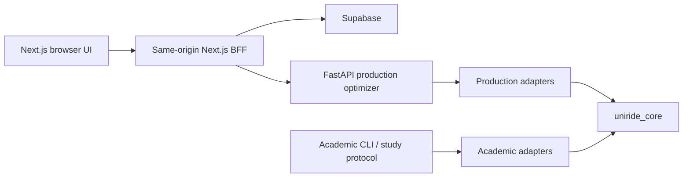

# UniRide Current Architecture

**Verified documentation snapshot:** 2026-09-02
**Historical verification evidence:** 2026-08-24 remediation derived from `fef5a2b537da7068b51b3b3a50c6d633a2853404`
**Latest scoped verification:** Dudullu Package 0 code gate on `codex/dudullu-package0-readiness-20260901` at `d983375d0307fa6b2ee7a995de9cbfa15fbf20e1`; live aggregate gate `BLOCKED-CONFIG`

The academic path (section 2, "Academic path after Gates C and D") and the algorithm ID migration table (section 8) were updated on 2026-10-26 for Gate D item D-11; every other section keeps the dates above.

This describes current, verified boundaries. It is not a production-readiness claim. When this document conflicts with live code or executable tests, those sources win.

## 1. Dual-engine boundary



- **Production** owns identities and authorization, operational DTOs, authoritative locations, travel-time/provider policy, geometry, persistence, and operational failures.
- **Academic** owns TSPLIB/CVRPLIB sources, BKS/gaps, experiment manifests, seed schedules, DOE, statistics, and research-result persistence.
- **`uniride_core`** owns neutral routing models, constraints, algorithm implementations, local search, matrix contracts, and solver-independent validation.

The intended dependency flow is inward: adapters may depend on the core; the core must not depend on FastAPI, Next.js, academic persistence, or study orchestration.

## 2. Current request and study paths

### Production request path

```text
Browser -> authenticated Next.js BFF -> FastAPI internal-key boundary
        -> canonical alias resolution -> fresh request-scoped strategy
        -> immutable compute policy (lowering-only) -> request-scoped solver work
        -> Package A feasibility certificate -> deterministic admission/ranking -> response/persistence
```

The admin route-test workflow calls the authenticated same-origin `/api/optimize-route` BFF and no longer calls the optimizer directly from the browser. General production compute is now protected end to end:

- The FastAPI `optimization` router requires `X-Internal-API-Key` (constant-time compared, router-level dependency) for `POST /api/v1/optimize`, `POST /api/v1/compare`, and `POST /api/v1/vehicle-calculator`. `/health`, `/api/v1/strategies`, `/api/v1/extract-time-windows`, and `/api/v1/schedule-to-students` remain public.
- Next.js server code calls those heavy endpoints only through `optimizerFetch` (`src/lib/optimizer-server.ts`), which imports `server-only`, reads `OPTIMIZER_INTERNAL_API_KEY`, and injects it as a header. Public raw `fetch` is reserved for `/health` and `/api/v1/strategies`. The key is never exposed through a `NEXT_PUBLIC_*` variable, responses, or logs.
- Every submitted strategy key resolves through `resolve_strategy`/`resolve_unique_strategies` (`optimizer_api/strategies/canonical.py`) to one canonical identity; each canonical run receives a fresh instance from `resolution.create()`, which fails closed if the factory returns a mismatched name.
- `apply_compute_policy` (`optimizer_api/compute_policy.py`) applies the frozen, immutable `production-conservative-v1` profile to a request-local copy, returns typed `applied_policy` metadata, and caps native solver budgets (`solver_seconds`, `ls_time_limit`) per request. Overrides may lower ceilings but never raise them.
- `/optimize` and `/compare` results pass through the Package A feasibility certificate; a result is successful only when it is solver-successful **and** `feasibility_certificate.is_feasible`. Failed/infeasible/uncertified/timed-out results are never ranked. Best/fastest ranking is deterministic (duration, vehicles, canonical name / execution seconds, canonical name).
- `/compare` deduplicates aliases, runs at most `max_workers` (2) canonical workers, and applies one 120-second **soft** response deadline via `concurrent.futures.wait`. Pending futures are not waited on and the executor shuts down with `wait=False`; running threads may continue, so Package B is **not** hard cancellation.
- Exact/permutation requests with more than ten waypoints fail fast before the solver method is invoked (`ExactTSPSizeError` in `uniride_core/algorithms/string_exact_tsp.py`; router preflight for `optimize`, `compare`, and `_run_single_algorithm`), with the same sanitized unsuccessful shape used when a solver produces no valid result.
- Dudullu Package 0 adds protected FastAPI `GET /api/v1/internal/readiness` for key handshake and `POST /api/v1/internal/readiness/time-matrix` for a redacted required-location matrix summary. The admin-only Next.js `GET /api/admin/dudullu-readiness` BFF reads narrow Supabase projections, calls the protected matrix endpoint through `optimizerFetch`, strictly reconstructs the allowlisted aggregate, and returns `Cache-Control: private, no-store`. It does not solve or mutate routes.
- `npm run dev:dudullu` is the local foreground launcher. It shares one in-memory internal key with both children, requires FastAPI health, the protected handshake, and the Next.js listener in the same poll before announcing readiness, and tears down both child trees when one exits. `--check-only` validates configuration without starting services.

### Academic path

```text
Dataset/study manifest -> academic registry/protocol -> canonical core solver
                      -> feasibility/result accounting -> analysis artifacts
```

Bildiri legacy solver material has a canonical-core boundary and archive/manifest protection. Academic execution remains separate from production request lifecycles.

#### Academic path after Gates C and D (updated 2026-10-26, WIP commit `04612880`)

- **Catalog.** `uniride_core/algorithms/capabilities.py` holds 15 capability IDs, all `VERIFIED` for TSP and ATSP, with fixed-budget and native-termination claims (14 normative rows of the unification design plus the design addition `Core-GA-TSP-Memetic-2opt`; DECISION_LOG A17, Gate C note and C-16c note). Every ID is listed in the migration table in section 8; old, aliased and refused names are listed there too.
- **Resolution.** `academic_benchmark/core/algorithm_resolution.py` resolves a request by exact identifier. Aliases resolve only from the CLI source; a manifest naming an alias is refused with the canonical ID, and a forbidden historical label is refused with its replacement.
- **Routing.** Every catalog ID, the `Numba-Swap`/`Numba-Hybrid`/`SOTA-*` IDs and the `FCM-*-TSP` IDs refuse CVRP/CVRPTW before any evaluation (A17: `58f77d66`, `e9f11e72`, `b55f90d3`). The string-waypoint matrix engines carry the names `Matrix-*-legacy` and are not canonical algorithms (A17, C-14 note).
- **Studies.** `academic_benchmark/studies/` holds two thin study profiles (`bildiri2026`: 10 algorithm IDs; `yaem2026`: 11) and one analysis plan each. Both profiles and both plans have status `draft`; the profiles still carry `run_count` 3 and base seeds 2026 (Bildiri) and 2027 (YAEM). The owner's confirmation of 30 runs per cell (A18, 2026-10-26) is not yet in the profile files; OQ-4 (native limits) was answered by the owner on 2026-10-26 (A18), and the profiles stay `draft` until the owner approves their values.
- **Run service.** `academic_benchmark/studies/run.py` runs a study in smoke or paper mode. Paper mode refuses a profile or analysis plan that is not `active`, a dirty or unknown git state and an output folder inside the repository, and checkpoints every row so an interrupted campaign can be resumed (A18, D-03 note).
- **Reproducibility.** Each run writes a `RunManifestV1` and a detached `.sha256`, and a campaign writes `run_index.json` (smoke with an unknown git state writes no manifests and says so); `python -m academic_benchmark.studies.verify_manifests` recomputes the checksums and binds every result row to one manifest (A18, D-02 note). With run-index completeness (`uniride-run-index/v2`) (A18 D-10 note) the index also holds the profile and analysis-plan hashes, the analysis-plan ID, the planned runs, the output location and the failed runs; the verifier refuses a v1 index.
- **Analysis.** `academic_benchmark/analysis/` provides the comparison-cell identity (`identity.py`, D-01), the analysis environment check (`environment.py`, D-04a), the statistics service (`statistics.py`, D-05), the gap columns against the exact reference (`gaps.py`, D-06) and the descriptive reports (`report.py`, `campaign_report.py`, D-07). `academic_benchmark/studies/estimate.py` estimates run cost from a calibration slice (D-04b1); its output is planning numbers, not evidence. The aggregation and report entry points refuse non-current and obsolete rows (D-08b), and the pilot aggregates report the sample SD under `sample_sd_cost` (D-08a).
- **Packaging.** A built wheel contains the study profiles, their analysis plans and the 7 referenced dataset manifests, and no `archive/` code (A18, D-14 note; `academic_benchmark/tests/test_gate_d_packaging.py`).
- **Not done.** Gate D status: Gate D is closed except D-12 (publication, owner permission); D-04b2 (final estimate on the stronger computer) is a precondition of the paper-scale run, not a Gate D acceptance item (A20 L1). The Gate D and MT6 close checks ran on WIP commit `04612880` (`docs/superpowers/plans/2026-10-26-gate-d-mt6-close-evidence.md`). MT6 (H10 with M25, H11, M14, N-1) is done; no `numba_accel` 3-opt symbol is reachable from a public entry point (spy test), and the production hybrid uses a core-owned path neighbourhood. Preconditions of any paper-scale run: MT6 (done), the native-limit question OQ-4 (answered by the owner on 2026-10-26, A18) and D-04b2 (still open), plus the owner's approval of the profile values. No paper-scale campaign has been run; smoke runs and cost estimates support no superiority, causality or proof claim. The dashboard statistics tab stays disabled (A09; A18, OQ-11).

## 3. Verified closures, with scope

| Area | Verified closure | Scope limit |
| --- | --- | --- |
| Customer identity | occurrence identity is preserved on the production paths covered by current tests | future/new strategy adapters still need the same contract review |
| Giant-tour splitting | split-decoder corrections cover infeasible-state initialization, prefixes, violation accounting, depot behavior, and missing directed arcs | does not certify every solver family universally |
| Academic solver ownership | active Bildiri GWO/HHO/Numba behavior is canonicalized behind the core boundary | not evidence that every research algorithm is publication-ready |
| Matrix integrity | injectable repository/lifecycle, timeout, last-known-good handling, strict invalid-arc rejection, and cache health are covered | matrix provenance and production/academic metric separation are still open |
| Matrix fail-closed (audit C2, repository part) | the stored Supabase `time_matrix` is the only source of operational travel times. With no authoritative matrix loaded, `TimeMatrixRepository.get_submatrix`/`get_duration` raise `MatrixUnavailableError` (never zeros, haversine or Euclidean values); a failed first load counts as stale and is retried with an exponential backoff (30 s, doubling per consecutive failure, capped at the cache TTL, reset on success; base `TIME_MATRIX_RETRY_BASE_SECONDS`; at most one fetch per window) without a restart; `get_submatrix` refreshes in every mode; unknown location codes raise `IncompleteTravelMatrixError`. Unbound `/optimize`, `/vehicle-calculator` and `/compare` map these to a redacted 503 (`travel-time matrix unavailable`) or 422 (`requested locations are missing from the travel-time matrix`); snapshot-bound requests keep their existing fail-closed response. `route_metrics.get_duration` is strict by default (no haversine, no generic 15-minute default). `APP_ENV=production` fails at startup without `SUPABASE_URL` and `SUPABASE_SERVICE_ROLE_KEY`, and also when `UNIRIDE_ALLOW_COORDINATE_FALLBACK` is set. That flag (truthy `1`/`true`/`yes`, default off) is the only way to get coordinate-derived stand-ins for DIRECT strategy and repository calls (tests, offline scripts); it does not affect the HTTP endpoints, which always require the stored matrix (the certificate cannot be judged on coordinates) and return 503 without it, flag or not. Its Euclidean path measures lat/lng degrees, not minutes (audit M3). The provider fetch runs under the repository lock, so a request can wait up to the provider timeout once per backoff window while the matrix is down | MT2 is partly done (see section 5: response provenance and the paginated fetch); the matrix domain enum (units/metric checked when an engine starts) and a maximum matrix age (fail closed when stale beyond a limit) are still open; PyVRP time scaling and the OR-Tools time-window bound rounding are documented follow-ups (the certifier re-costing and the OR-Tools arc/limit rounding are closed, see section 5); the geometric clustering strategies (kmeans, fuzzy c-means, sweep, hierarchical) use haversine on coordinates for grouping, not as travel times; the `uniride_core` split/scheduling helpers no longer carry a 15-minute default: `giant_tour_cost`, `educate_individual` (GA) and `calculate_scheduled_times` use `route_metrics.strict_arc` and raise `TravelTimeUnavailableError` (the router maps it to the redacted 503); the only remaining default is the explicit `strict=False` escape hatch of `route_metrics.get_duration` (default strict, no operational caller) |
| Determinism | seed `0` preservation and PSO deterministic seed handling are covered | each future stochastic algorithm must prove its own replay behavior |
| Python discovery | default pytest discovery is restricted to the three canonical suites | manual scripts remain historical/manual, not default test inputs |
| Optional solvers | health and default-compare enumeration tolerate unavailable optional solvers | explicit requested-algorithm policy remains a separate service concern |
| Supabase construction | proxy and driver routes defer client construction; credential-free build passes | credential-free build is not an authentication/security certification |
| Browser optimization test | admin route-test uses the authenticated BFF | other production/browser compute paths remain to be migrated |
| Dependencies | five unused **direct** root edges were removed | transitive Genkit packages and audit findings remain |
| Compute authentication | all three heavy endpoints deny missing/wrong keys (403) and accept a valid key; public endpoints remain public; `UNIRIDE_DISABLE_AUTH=1` is a startup error under `APP_ENV=production`; tenant keys resolve to distinct tenant identities; blank/untrimmed/reserved IDs, blank/duplicate secrets, and reuse of the ops key fail closed | per-tenant budgets/quotas beyond rate windows are not implemented |
| Compute profile | frozen `production-conservative-v1` ceilings; nine `UNIRIDE_COMPUTE_*` overrides validated at startup and may only lower ceilings; tuning allowlists are exhaustive and fail closed; authenticated rate windows are tenant-keyed with IP fallback | the limiter and profile are process-local to the optimizer service, not distributed admission control |
| Canonical resolution | every alias resolves to one canonical identity; explicit alias duplicates execute once; fresh request-scoped instances per canonical run | future registry additions need the same contract review |
| Bounded comparison | at most 2 workers, one 120-second soft deadline, six canonical defaults, deterministic best/fastest ranking, certificate-gated admission | soft deadline is not hard cancellation or process isolation |
| Exact TSP | >10-waypoint exact/permutation requests fail fast without truncation and never invoke the solver | applies to the canonical permutation_tsp/exact paths; other solver limits unchanged |
| Server-only transport | heavy Next.js calls route through server-only `optimizerFetch`; browser boundary test blocks the internal key from client code | browser-facing pages depend on BFF routes continuing to enforce the boundary |
| Dudullu daily demand domain | pure TypeScript schedule filtering, separate pickup/dropoff occurrences, hourly waves with exact anchors, inclusive previous-day 22:00 `Europe/Istanbul` admission, exception/lead handling, and shift-eligibility precheck are covered by `src/services/daily-planning.test.ts`; final hardening fails closed on out-of-day anchors, blank identities, invalid runtime directions, and malformed source demands, with boundary-first same-wave ordering | no database/API/UI integration, no live-data verification, no optimizer/matrix binding, no full depot-chain timing, no physical-fleet assignment, and no publication |
| Dudullu Package 0 runtime boundary | protected FastAPI readiness routes, pure redacted analyzer, admin-only BFF, strict aggregate schemas, no-store responses, one-command local launcher, and child-process lifecycle are test-gated | 2026-09-02 aggregate gate is `BLOCKED-CONFIG`; no administrator bearer token was available, so current Supabase/matrix/fleet readiness is unverified |

## 4. Open production boundaries

These are not closed by test count, a build pass, or documentation updates:

1. **Feasibility extension discipline.** The current `/optimize`, `/compare`, and tested requested-algorithm/vehicle-calculator paths are certificate-gated. Every future solver, router, persistence, or response surface must prove the same fail-closed contract; present coverage is not a blanket production certification.
2. **Compute protection and budgets.** Internal-key boundary authentication, tenant-key authorization, typed lowering-only limits, alias deduplication, worker ceilings, soft deadlines, tenant-keyed rate windows with IP fallback, and deterministic compare ranking are implemented. **Hard solver cancellation, process isolation, distributed quota state, and durable jobs remain open.**
3. **Durable execution.** Benchmark work is not yet a durable multi-worker job system with atomic admission, persisted heartbeat, idempotency, and cooperative cancellation.
4. **Matrix provenance.** Production travel time and academic problem metrics still require explicit, non-interchangeable provenance/domain/unit/directionality contracts.
5. **Frontend resilience.** State consolidation, cancellation/timeouts, polling, error handling, and the 158 lint warnings need focused work.
6. **GIS.** There is no current route-geometry contract or GIS renderer. Existing route lists and locations are not a map implementation.
7. **Dependency security.** The last recorded `npm audit --omit=dev --json` reported 84 unresolved findings (2 critical, 22 high, 59 moderate, 1 low); that count was not refreshed on 2026-08-24.
8. **Dudullu daily operations.** Package 1 is the pure, tested demand/slot boundary. Package 0 implementation is code-gated, but its live aggregate gate is `BLOCKED-CONFIG` until an administrator token is available; historical 28-student/29-node material is not current evidence. Package 2 remains blocked and must provide an authenticated preview API, authoritative matrix ID/version/hash, independent used-arc checks, full depot-to-depot timing including the closing arc, and two-stage day-level physical-fleet assignment with truthful shortage/non-publishable semantics. Package 3 requires transactional versioned multi-wave publication and RLS; Package 4 owns admin/student workflows; Package 5 needs certified cross-wave before/after re-solves and lexicographic fleet-first savings; Package 6 is pilot/operations. No automatic student shifting or unverified savings claim is allowed.

## 5. Solver and matrix contract

A production solver input must distinguish a customer occurrence from a physical stop. Multiple students can share coordinates without becoming one demand, time window, service requirement, or route stop.

A matrix must declare its source/domain, units, directionality, identity mapping, completeness, and validity. Invalid off-diagonal values fail closed on covered production paths. Operational travel times come only from the stored Supabase `time_matrix` (owner requirement, 2026-10-05; live traffic data will be a later source); an unavailable matrix is an error, not a zero or coordinate-derived value (see the "Matrix fail-closed" row in section 3). Academic TSPLIB/CVRPLIB distances and production travel-time estimates must never be silently substituted for one another.

Matrix provenance (MT2, partial; 2026-10-05): `/optimize`, `/vehicle-calculator` and `/compare` responses carry an optional `matrix_provenance` object (`source` = `supabase`, `sha256`, `location_count`, `loaded_at` ISO UTC, `age_seconds`; `/compare` also per result, with the response-level value set only when every run used the same digest). It is taken from the same captured arcs or bound snapshot the request was solved and certified with (`TimeMatrixRepository.capture_arcs_with_provenance` and `matrix_snapshot`, read through `verification.authoritative_arcs.matrix_provenance_of`), never carries keys, URLs or location codes, and the field is optional so existing clients keep parsing. `SupabaseTimeMatrixProvider` pages `time_matrix` with `.range()` (1000 rows per request, until a short page) so a hosted PostgREST max-rows limit cannot truncate a matrix above about 32 locations. Still open under MT2: the matrix domain enum and a maximum matrix age (fail closed beyond it).

Per-student ride time (owner decision 2026-10-04): the optional production request field `max_ride_time` (minutes, 1-600, default `None` = no limit; independent of the vehicle-tour limit `max_travel_time`) bounds every student's in-vehicle time on a route `depot -> s1..sk -> depot`. Pickup: a student's ride is the travel from that student's stop to the campus including the closing arc (longest = first student). Dropoff: the travel from the campus to that student's stop (longest = last student). Students sharing a stop share one ride time. `ga_split` constructs against it in the `SplitDecoder` trip builders (capacity-only and time-window, both directions; waiting aboard counts where the decoder simulates it). The singleton fallback in `SplitDecoder.decode` (taken when no feasible split exists) does not enforce it: it returns one route per student flagged `"error"`, and the certificate is the safety net for that path. `check_ride_time` in the production response certifier rejects (`ride_time_violation`) any strategy result that violates it, whether or not that strategy knows the field. The certifier checks pure travel time only; waiting aboard is not visible to it (audit H2). Other strategies do not construct with the limit and rely on that rejection. `None` leaves every existing behaviour, benchmark and academic result unchanged; the academic `ConstraintProfile` does not carry the field.

Route certificate and the travel-time matrix (owner requirement 2026-10-05, audit C2, both halves integrated): `certify_optimization_response(request, response, arc_lookup)` no longer synthesizes a matrix from the response. `arc_lookup` is an injected `Callable[[str, str], float]` over physical location codes (depot id, student `location_code`); occurrence keys map to the physical code of their student, so two students at one stop are joined by the matrix's own zero arc. `routers/optimization.py` builds it with `verification/authoritative_arcs.authoritative_arc_lookup`: for a snapshot-bound request (`expected_matrix_sha256`) from the `arcs` of the same `matrix_snapshot` the digest vouches for, otherwise from the DataLoader repository through its public strict accessors `TimeMatrixRepository.capture_arcs(codes)` / `arc(origin, destination)`, which read the stored matrix only and raise `MatrixUnavailableError` / `IncompleteTravelMatrixError` (never coordinate-derived values, neither under `UNIRIDE_ALLOW_COORDINATE_FALLBACK` nor inside `academic_coordinate_scope()`). Every step is re-costed on its matrix arc: a reported duration that deviates by more than `ARC_DURATION_TOLERANCE = 0.005` min (half a unit of the 2-decimal `round(x, 2)` the responses publish; it absorbs formatting only, not solver rounding) is an `arc_duration_mismatch` error, an arc the matrix cannot answer or an endpoint that cannot be resolved to a matrix code is a `missing_arc` error, and a missing `arc_lookup` yields `is_feasible=False` with a sanitized `certify_error`. Capacity, `max_travel_time`, `ride_time_violation` and time-window checks then run on the matrix durations, never on the reported ones. Scope limits: for an unbound request the router copies the request's arcs out of the repository (`capture_arcs`, one atomic read) BEFORE the solve and certifies against that copy, so a matrix refresh during the solve cannot change the certificate's matrix; if that capture raises, the request fails with the redacted 503 (422 for unknown codes) before any solve, while a snapshot-bound request keeps the 200 "matrix snapshot unavailable or changed" response; the legacy `/benchmark` runner (`benchmark_runner`, `academic_coordinate_scope()`) certifies with `certify_benchmark_response` over the problem's own matrix and never uses this lookup (see the next paragraph for what changed for it); the certificate is exactly as authoritative as the matrix behind the lookup (it cannot be satisfied by coordinate-derived values, so with the dev opt-in on `/optimize` still returns 503 rather than an uncertifiable result). The OR-Tools engine (`ortools_cvrp_engine.py`) has an `arc_rounding` option with two modes. `"conservative"` scales arcs and service times up with `ceil` and the route limit down with `floor` (float noise guarded by 1e-9), so a route that meets the scaled limit meets `max_route_duration` in true minutes, and reports the true unscaled arc durations (rounded to 2 decimals like every other strategy); the operational `ortools_cvrp` strategy uses it, except inside `academic_coordinate_scope()` (`in_academic_coordinate_scope()`). `"nearest"` is the engine default and preserves the historical scaled values and reporting byte for byte; the `academic_benchmark` OR-Tools callers and the strategy inside the academic scope use it. The cost is a slightly pessimistic internal objective (under 0.1 min per arc at the default scale of 10).

Legacy `/benchmark` runner and the academic package (C2 integration review): the runner executes the production strategies inside `academic_coordinate_scope()` on the problem's own coordinates. Parity is kept for `ortools_cvrp` (historical `"nearest"` rounding in scope); there are two intended behaviour changes, both kept. (1) The split strategies (`ga_split`, `pso_split`, `gwo_split`, `hho_split`) used to call `get_submatrix` without coordinates and therefore optimized on an all-zero matrix, which was the C2 defect itself; inside the scope they now optimize on the coordinate metric (measured on tiny12 EUC, seed 42: `ga_split` 556 -> 264; `pso_split`, `gwo_split` and `hho_split` 468 -> 264). Earlier legacy-runner numbers for these four algorithms are not comparable with new ones. (2) Every clustering strategy now receives the request's depot, so `sweep` pivots around the real depot instead of the hard-coded Dudullu point (41.001, 29.177): a no-op for the Dudullu depot (same coordinates), a correction for any other depot, e.g. the TSPLIB problems of the legacy runner. Legacy-runner results for the cluster-first strategies (`ga`, `pso`, `gwo`, `hho`, `two_opt`, `permutation_tsp`) are therefore not comparable with earlier ones either (measured on tiny12 EUC, seed 42: `two_opt` 276 -> 274). The `academic_benchmark` package itself is untouched: it does not use the repository or `route_metrics`, and its OR-Tools callers (`registry_setup.py`, `holistic_matrix_engine.py`) keep `"nearest"`.

Operational clustering (owner requirement 2026-10-05): the cluster-first strategies (`ga`, `pso`, `gwo`, `hho`, `two_opt`, `permutation_tsp`) pass the authoritative directed matrix, keyed by physical location code and including the depot, to `VehicleCalculator.calculate`, which hands it to the clustering strategy. `k_medoids` and `clarke_wright` read only matrix values and raise `MissingTravelTimeError` for a missing pair; their haversine fallback is removed (no caller relied on it: the only callers are `VehicleCalculator` and the FCM benchmark script `optimizer_api/tests/benchmark_hierarchical_threshold.py`, which does not use them). The geometric strategies (`kmeans`, `fuzzy_cmeans`, `fuzzy_cmeans_enhanced`, `hierarchical_fcm`, `sweep`) group by coordinates/centroids and do not compute travel times. A `MissingTravelTimeError` raised during clustering is mapped by the router like the other matrix errors (redacted 503). Clarke-Wright uses a direction-aware saving on the directed matrix: for closed tours `D -> ... -> D`, joining the tail `i` of one route to the head `j` of another saves `S(i -> j) = c(i, D) + c(D, j) - c(i, j)`; each ordered pair is a candidate, so the better orientation of a pair is tried first, and a merge requires `i` to be the last and `j` the first stop of their routes.

A target neutral contract is:

```text
Production DTO --production adapter--+
                                      +-> RoutingProblem / CostMatrix / ConstraintProfile
Academic record --academic adapter---+                 |
                                                        v
                                                   Solver / Result
                                                        |
                                                        v
                                           FeasibilityCertificate
```

Production-specific geometry, users, authorization, and errors remain outside this neutral model. BKS/gaps, DOE metadata, dataset persistence, and statistical reporting remain academic-only.

## 6. Execution and concurrency

Registry metadata should be immutable. Executable strategies must be request/job scoped. `/compare` now uses at most 2 canonical workers and a single 120-second soft response deadline; native solver budgets are capped per request. Because the deadline is soft (threads may continue, `wait=False` shutdown), hard cancellation that actually stops loops, process isolation, and durable persistence are still required before this can be treated as multi-worker production infrastructure.

## 7. Verification baseline

On 2026-08-24, branch `codex/audit-remediation-20260824` (base `fef5a2b`) passed full Python discovery with **3,355 passed, 1 skipped, 45 warnings in 429.17s**. Frontend Vitest passed **21 files / 58 tests in 78.99s** after restricting discovery to the current root `src` tree; TypeScript passed; ESLint reported **0 errors / 158 warnings** under the temporary waiver; and the Next.js 16.1.6 production build passed with **57 dynamic, server-rendered routes**. The previous environment-sensitive matrix test and ignored local Bildiri-boundary failures are closed. The npm security audit was not rerun, so the 84-finding figure above remains dated evidence rather than a current count.

On 2026-08-25, the Package 1 feature branch
`codex/dudullu-daily-planner-20260825` at `6ef36591215331bcd51b33a0f6f6508c62862702`
passed `daily-planning` (**1 file / 32 tests**) and the six named regression
files (**6 files / 19 tests**), `npm run typecheck` (**0 errors**), `npm run
lint` (**0 errors / 158 warnings**), and `git diff --check`. This is not a
current live-data or production-operation verification.

On 2026-09-02, Package 0 at `d983375` passed launcher **20/20**, focused
readiness Vitest **2 files / 43 tests**, focused FastAPI readiness **25 tests**,
TypeScript, and quiet lint. The local FastAPI health and Next.js listener both
returned HTTP 200. The authenticated BFF returned HTTP 401 because no
administrator bearer token was available, so the live aggregate state is
`BLOCKED-CONFIG`; no current student, matrix, driver, or vehicle count is
verified. See [docs/DUDULLU_RUNTIME_READINESS.md](docs/DUDULLU_RUNTIME_READINESS.md).

## 8. Academic algorithm ID migration table

This is the single migration table for academic algorithm names (owner decision OD-5, DECISION_LOG A18, 2026-10-23). The capability catalog (`uniride_core/algorithms/capabilities.py`) is the source of truth for canonical IDs; `academic_benchmark/tests/test_gate_d_docs_consistency.py` checks this table against the catalog, the resolver tables in `academic_benchmark/core/algorithm_resolution.py`, the matrix engine names in `uniride_core/algorithms/engine_factory.py` and the routing-refusal sets in `academic_benchmark/core/registry_setup.py`. A row that disagrees with the code is a documentation defect. Where a row cites a no-pooling note, rows under the old and the new name are not pooled.

<!-- migration-table:start -->

### 8.1 Old or refused names

| Old name | What it is now | Where enforced | DECISION_LOG |
| --- | --- | --- | --- |
| `GWO-LKH` | Forbidden label, refused with replacement `Core-GWO-TSP-Memetic-3opt` (pseudo-LKH labels without an actual LKH search (A01; unification design :27); the truthful hybrid is a GWO global stage followed by one 3-opt final polish). Also refused as a study `algorithm_parameters` key | `algorithm_resolution.py:65-72, 144-148`; `contracts/study.py:184-185` | A01; A17 (Q1; C-08 note 2026-10-21; C-13 note 2026-10-23) |
| `HHO-LKH` | Forbidden label, refused with replacement `Core-HHO-TSP-Memetic-3opt` (same reason) | `algorithm_resolution.py:65-72, 144-148`; `contracts/study.py:184-185` | A01; A17 (Q1; C-08 note 2026-10-21; C-13 note 2026-10-23) |
| `B-GA` | Forbidden label, refused with a pointer to `Core-GA-TSP`; no compatibility alias. The Bildiri 2026 paper's GA (2-opt on every initial chromosome and a final 2-opt) has the design counterpart `Core-GA-TSP-Memetic-2opt`; no parity claim with the archive (A17) | `algorithm_resolution.py:65-72` | A01 (migration guidance, not a false alias); A17 (Q2/P1; C-16c note) |
| `B-PSO` | Forbidden label, refused with a pointer to `Core-PSO-TSP`; no compatibility alias. The paper's PSO was a memetic PSO with uncounted 2-opt; no memetic PSO ID exists | `algorithm_resolution.py:65-72` | A01; A17 (Q2/P1) |
| `Numba-2-opt` | Deprecated CLI alias of `Core-TwoOpt-TSP`; a manifest naming it is refused; its own registry entry was removed | `algorithm_resolution.py:44-57, 151-162` | A17 (C-14 note 2026-10-21; `58f77d66` note 2026-10-22) |
| `Numba-3-opt-bounded` | Deprecated CLI alias of `Core-ThreeOpt-TSP`, same rules | `algorithm_resolution.py:44-57, 151-162` | A17 (C-14 note 2026-10-21; `58f77d66` note 2026-10-22) |
| `Numba-Or-opt` | Deprecated CLI alias of `Core-OrOpt-TSP`, same rules | `algorithm_resolution.py:44-57, 151-162` | A17 (C-14 note 2026-10-21; `58f77d66` note 2026-10-22) |
| `Numba-GA` | Deprecated CLI alias of `Core-GA-TSP` (the canonical pure GA); the raw registry entry was removed, so the alias reaches only the canonical GA. Rows named `Numba-GA` before the C-16a engine change are not pooled | `algorithm_resolution.py:44-57, 151-162` | A17 (C-16a note 2026-10-20; C-14 note 2026-10-21) |
| `Numba-PSO` | Deprecated CLI alias of `Core-PSO-TSP` (the canonical pure PSO), same rules | `algorithm_resolution.py:44-57, 151-162` | A17 (C-16b note 2026-10-20; C-14 note) |
| `GWO` | Active CLI alias of `Core-GWO-TSP-Pure` (the target is read from `academic_benchmark/core/algorithm_resolution.py:50-51`); a manifest naming an alias is still refused | `algorithm_resolution.py:50-51, 154-162` | A02 |
| `HHO` | Active CLI alias of `Core-HHO-TSP-Pure` (target read from `academic_benchmark/core/algorithm_resolution.py:50-51`); manifests refuse it | `algorithm_resolution.py:50-51, 154-162` | A02 |
| `Numba-GWO`, `Core-GWO-TSP` | Deprecated CLI aliases of `Core-GWO-TSP-Memetic-2opt`; registry entries removed. Fixed-budget rows before the 2026-10-22 budget-following schedule are not pooled with later rows | `algorithm_resolution.py:52-53` | A17 (C-14 note; `58f77d66` note; 2026-10-22 schedule note) |
| `Numba-HHO`, `Core-HHO-TSP` | Deprecated CLI aliases of `Core-HHO-TSP-Memetic-2opt`, same rules | `algorithm_resolution.py:54-55` | A17 (C-14 note; `58f77d66` note; 2026-10-22 schedule note) |
| `SOTA-ALNS-TSP` | Deprecated CLI alias of `ALNS-TSP`; registry entry removed | `algorithm_resolution.py:56` | A17 (C-14 note; `58f77d66` note); A03 |
| `Matrix-TwoOpt-TSP-legacy` | Truthful name of the string-waypoint 2-opt matrix engine that was served as `Core-TwoOpt-TSP` in matrix mode; not a canonical algorithm. Matrix-mode rows under `Core-*` names and rows under this name are never pooled | `engine_factory.py:31-37`; `engine_core.py:16-24` | A17 (Q10; C-14 note 2026-10-21) |
| `Matrix-GA-TSP-legacy` | Same, for the GA matrix engine (was `Core-GA-TSP`) | `engine_factory.py:31-37`; `engine_core.py:16-24` | A17 (Q10; C-14 note 2026-10-21) |
| `Matrix-PSO-TSP-legacy` | Same, for the PSO matrix engine (was `Core-PSO-TSP`) | `engine_factory.py:31-37`; `engine_core.py:16-24` | A17 (Q10; C-14 note 2026-10-21) |
| `Matrix-GWO-TSP-legacy` | Same, for the GWO matrix engine (was `Core-GWO-TSP`) | `engine_factory.py:31-37`; `engine_core.py:16-24` | A17 (Q10; C-14 note 2026-10-21) |
| `Matrix-HHO-TSP-legacy` | Same, for the HHO matrix engine (was `Core-HHO-TSP`) | `engine_factory.py:31-37`; `engine_core.py:16-24` | A17 (Q10; C-14 note 2026-10-21) |
| `Numba-Swap`, `Numba-Hybrid` | TSP/ATSP IDs outside the catalog that the governed resolver does not know. They refuse CVRP/CVRPTW in the registry wrapper and in the raw executor; no truthful `CVRP-`/`CVRPTW-` alternative exists | `registry_setup.py:46-53, 1671-1693` | A17 (owner decision 4 and `e9f11e72` note, 2026-10-23) |
| `SOTA-E2BSO-TSP`, `SOTA-R2DMA-TSP`, `SOTA-P-AOEA-TSP`, `SOTA-CGO-TSP`, `SOTA-RUN-TSP` | TSP/ATSP IDs outside the catalog; they refuse CVRP/CVRPTW like the two above; there is no `CVRP-SOTA-*` alias | `registry_setup.py:49-53` | A17 (owner decision 4 and `e9f11e72` note) |
| `FCM-GA-TSP`, `FCM-PSO-TSP`, `FCM-GWO-TSP`, `FCM-HHO-TSP` | TSP IDs that ran Split-based FCM engines on routing problems; they now refuse CVRP/CVRPTW in the registry wrapper, in the raw executor and inside `FCMSplitMatrixEngine`; no `CVRP-FCM-*` alias exists | `registry_setup.py:46-53` | A17 (2026-10-23 owner decisions and `b55f90d3` note) |
| `CVRP-Numba-Swap`, `CVRPTW-Numba-Swap` | Names kept because stored results use them; they run `Matrix-TwoOpt-TSP-legacy`, not a swap search | `registry_setup.py:1671-1693` | A17 (2026-10-23 owner decision 2; `b55f90d3` note) |
| `CVRP-Numba-Hybrid`, `CVRPTW-Numba-Hybrid` | Names kept for the same reason; they run `Matrix-TwoOpt-TSP-legacy`, not a hybrid search | `registry_setup.py:1671-1693` | A17 (2026-10-23 owner decision 2; `b55f90d3` note) |
| `CVRP-Core-Greedy-Routing`, `CVRPTW-Core-Greedy-Routing` | Routing alias; runs the engine `Core-Greedy-Routing`. Name unchanged | `registry_setup.py:1671-1693` | A17 (`58f77d66` note 2026-10-22) |
| `CVRP-Core-TwoOpt-TSP`, `CVRPTW-Core-TwoOpt-TSP` | Routing alias; runs `Matrix-TwoOpt-TSP-legacy`. Name unchanged | `registry_setup.py:1671-1693` | A17 (`58f77d66` note 2026-10-22) |
| `CVRP-Core-GA-TSP`, `CVRPTW-Core-GA-TSP` | Routing alias; runs `Matrix-GA-TSP-legacy`. Name unchanged | `registry_setup.py:1671-1693` | A17 (`58f77d66` note 2026-10-22) |
| `CVRP-Core-PSO-TSP`, `CVRPTW-Core-PSO-TSP` | Routing alias; runs `Matrix-PSO-TSP-legacy`. Name unchanged | `registry_setup.py:1671-1693` | A17 (`58f77d66` note 2026-10-22) |
| `CVRP-Core-GWO-TSP`, `CVRPTW-Core-GWO-TSP` | Routing alias; runs `Matrix-GWO-TSP-legacy`. Name unchanged | `registry_setup.py:1671-1693` | A17 (`58f77d66` note 2026-10-22) |
| `CVRP-Core-HHO-TSP`, `CVRPTW-Core-HHO-TSP` | Routing alias; runs `Matrix-HHO-TSP-legacy`. Name unchanged | `registry_setup.py:1671-1693` | A17 (`58f77d66` note 2026-10-22) |
| `CVRP-Numba-2-opt`, `CVRPTW-Numba-2-opt` | Routing alias; runs `Matrix-TwoOpt-TSP-legacy`. Name unchanged | `registry_setup.py:1671-1693` | A17 (`58f77d66` note 2026-10-22) |
| `CVRP-Numba-3-opt-bounded`, `CVRPTW-Numba-3-opt-bounded` | Routing alias; runs `Matrix-TwoOpt-TSP-legacy` (not a 3-opt search). Name unchanged | `registry_setup.py:1671-1693` | A17 (`58f77d66` note 2026-10-22) |
| `CVRP-Numba-Or-opt`, `CVRPTW-Numba-Or-opt` | Routing alias; runs `Matrix-TwoOpt-TSP-legacy` (not an Or-opt search). Name unchanged | `registry_setup.py:1671-1693` | A17 (`58f77d66` note 2026-10-22) |
| `CVRP-Numba-GA`, `CVRPTW-Numba-GA` | Routing alias; runs `Matrix-GA-TSP-legacy`. Name unchanged | `registry_setup.py:1671-1693` | A17 (`58f77d66` note 2026-10-22) |
| `CVRP-Numba-PSO`, `CVRPTW-Numba-PSO` | Routing alias; runs `Matrix-PSO-TSP-legacy`. Name unchanged | `registry_setup.py:1671-1693` | A17 (`58f77d66` note 2026-10-22) |
| `CVRP-Numba-GWO`, `CVRPTW-Numba-GWO` | Routing alias; runs `Matrix-GWO-TSP-legacy`. Name unchanged | `registry_setup.py:1671-1693` | A17 (`58f77d66` note 2026-10-22) |
| `CVRP-Numba-HHO`, `CVRPTW-Numba-HHO` | Routing alias; runs `Matrix-HHO-TSP-legacy`. Name unchanged | `registry_setup.py:1671-1693` | A17 (`58f77d66` note 2026-10-22) |
| `CVRP-GA-Split`, `CVRPTW-GA-Split` | Routing alias; runs `Matrix-GA-TSP-legacy`. Name unchanged | `registry_setup.py:1671-1693` | A17 (`58f77d66` note 2026-10-22) |
| `CVRP-PSO-Split`, `CVRPTW-PSO-Split` | Routing alias; runs `Matrix-PSO-TSP-legacy`. Name unchanged | `registry_setup.py:1671-1693` | A17 (`58f77d66` note 2026-10-22) |
| `CVRP-GWO-Split`, `CVRPTW-GWO-Split` | Routing alias; runs `Matrix-GWO-TSP-legacy`. Name unchanged | `registry_setup.py:1671-1693` | A17 (`58f77d66` note 2026-10-22) |
| `CVRP-HHO-Split`, `CVRPTW-HHO-Split` | Routing alias; runs `Matrix-HHO-TSP-legacy`. Name unchanged | `registry_setup.py:1671-1693` | A17 (`58f77d66` note 2026-10-22) |

### 8.2 Canonical catalog IDs

All 15 IDs are `VERIFIED` for TSP and ATSP. Every one of them refuses CVRP/CVRPTW on every path (`CoreRoutingRefusedError`, commit `58f77d66`, DECISION_LOG A17, 2026-10-22). The `CVRP-<base>` and `CVRPTW-<base>` names are unchanged and run the legacy matrix engines of `_ROUTING_ALIAS_ENGINES`; the column below names the variant that the refusal message offers.

| Canonical ID | Status | Routing variant offered on refusal | DECISION_LOG |
| --- | --- | --- | --- |
| `Core-TwoOpt-TSP` | Unchanged canonical | `CVRP-Core-TwoOpt-TSP` / `CVRPTW-Core-TwoOpt-TSP` (runs `Matrix-TwoOpt-TSP-legacy`) | A17 (Gate C note) |
| `Core-ThreeOpt-TSP` | Unchanged canonical | none | A17 (Gate C note); A04 |
| `Core-OrOpt-TSP` | Unchanged canonical (promoted by C2) | none | A17 (Gate C note); A03 |
| `Core-GA-TSP` | Same ID, new engine: the canonical pure GA since C-16a (2026-10-20). Rows before that date and the production `ga`/`ga_split` strategies are not pooled with it | `CVRP-Core-GA-TSP` / `CVRPTW-Core-GA-TSP` (runs `Matrix-GA-TSP-legacy`; its 2-opt is not counted) | A17 (C-16a note; GA/PSO promotions note) |
| `Core-GA-TSP-Memetic-2opt` | Design addition (C-16c, 2026-10-21): memetic GA with counted initial and final 2-opt; never pooled with pure `Core-GA-TSP` or archived Bildiri GA rows | `CVRP-Core-GA-TSP` / `CVRPTW-Core-GA-TSP` (runs `Matrix-GA-TSP-legacy`; its 2-opt is not counted) | A17 (C-16c note) |
| `Core-PSO-TSP` | Same ID, new engine: the canonical pure PSO since C-16b (2026-10-20); earlier rows not pooled | `CVRP-Core-PSO-TSP` / `CVRPTW-Core-PSO-TSP` (runs `Matrix-PSO-TSP-legacy`) | A17 (C-16b note) |
| `Core-GWO-TSP-Pure` | Unchanged canonical; fixed-budget rows before the 2026-10-22 budget-following schedule are not pooled | `CVRP-Core-GWO-TSP` / `CVRPTW-Core-GWO-TSP` (runs `Matrix-GWO-TSP-legacy`) | A17 (2026-10-22 schedule note) |
| `Core-HHO-TSP-Pure` | Same | `CVRP-Core-HHO-TSP` / `CVRPTW-Core-HHO-TSP` (runs `Matrix-HHO-TSP-legacy`) | A17 (2026-10-22 schedule note) |
| `Core-GWO-TSP-Memetic-2opt` | Unchanged canonical; native polish counted since C-10 (2026-10-21), so earlier native rows are not pooled; same schedule note as the pure ID | `CVRP-Core-GWO-TSP` / `CVRPTW-Core-GWO-TSP` (runs `Matrix-GWO-TSP-legacy`) | A17 (C-10 note; 2026-10-22 schedule note) |
| `Core-HHO-TSP-Memetic-2opt` | Same | `CVRP-Core-HHO-TSP` / `CVRPTW-Core-HHO-TSP` (runs `Matrix-HHO-TSP-legacy`) | A17 (C-10 note; 2026-10-22 schedule note) |
| `Core-GWO-TSP-Memetic-3opt` | Canonical hybrid (C-08, 2026-10-21): GWO global stage, then 3-opt final polish once; truthful successor of the forbidden LKH label | none | A17 (C-08 note); A01 |
| `Core-HHO-TSP-Memetic-3opt` | Same, for HHO | none | A17 (C-08 note); A01 |
| `Core-GWO-TSP-Memetic-ALNS` | Canonical hybrid (C-09, 2026-10-21): GWO global stage, then ALNS final polish once | none | A17 (C-09 note) |
| `Core-HHO-TSP-Memetic-ALNS` | Same, for HHO | none | A17 (C-09 note) |
| `ALNS-TSP` | Unchanged canonical | none | A03; A17 (Gate C note) |

<!-- migration-table:end -->

See [UniRide_Ultimate_Audit.md](UniRide_Ultimate_Audit.md) for qualifications, [ACTIVE_ROADMAP.md](ACTIVE_ROADMAP.md) for priority, and [NEXT_PHASE_EXECUTION_ROADMAP.md](NEXT_PHASE_EXECUTION_ROADMAP.md) for bounded future handoffs.
