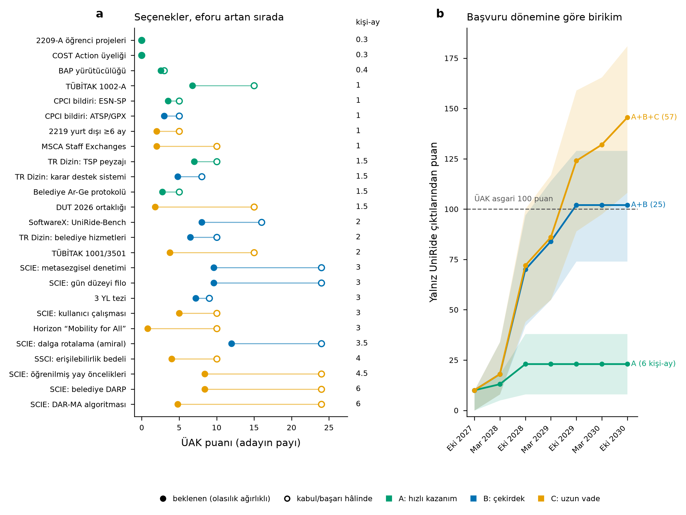

# UniRide Bütünsel Akademik Strateji Raporu

**Konu:** UniRide (planlama motoru, uygulama, TSPLIB optimizasyon kanadı) üzerinden SCI/ulusal yayın, proje ve destek portföyü; belediye işbirliği; Mühendislik Temel Alanı (Endüstri Mühendisliği) doçentlik puan stratejisi
**Tarih:** 16 Ekim 2026
**Hazırlayan:** Claude Science

---

## 0. Yönetici özeti

1. **Kural çerçevesi.** ÜAK Mühendislik Temel Alanı (Tablo 9) puanlamayı Mart 2024'ten bu yana JIF çeyreklerine göre yapıyor. Toplamda en az 100 puan gerekiyor ve bunun en az 90'ı doktora sonrasından gelmeli. Ayrıca şu alt şartlar var: Q1–Q3 dergilerde en az bir başlıca yazarlıkla en az 40 SCIE/SSCI puanı, en az 10 TR Dizin puanı, en az 5 bilimsel toplantı puanı ve en az 5 atıf puanı. Bunlara tezden üretilmiş en az bir yayın ve en az 2 eğitim-öğretim puanı eklenir; bu iki şart UniRide ile karşılanamaz.
2. **Puanı belirleyen en önemli kural yazar bölüşümü.** Başlıca yazarlık yalnızca iki durumda tanınıyor: tek yazarlı makaleler ve adayın kendi lisansüstü öğrencileriyle yazdığı makaleler. Örneğin bir Q1 makale tek yazarlıysa 30, kendi YL öğrencinizle iki yazarlıysa 24 puan getirir. Dış ortak yazarlı üç kişilik bir makalede ise puan eşit bölünür ve size 10 puan düşer. UniRide portföyü bu yüzden aday ile kendi öğrencileri ekseninde kurgulandı.
3. **UniRide'dan çıkabilecek eserler.** Birbirinden ayrık araştırma sorularına dayanan 9 SCIE/SSCI makale, 3 TR Dizin makalesi ve 2 CPCI bildirisi çıkarılabilir. Bunlara ek olarak 4–7 proje kalemi ve 3 YL tezi var. İçerik ayrıştırma matrisi (Bölüm 4) dilimlemeyi (salami) önleyecek, ama her şeyi tek makalede de tüketmeyecek biçimde tasarlandı.
4. **Fayda-maliyet sonucu.** Puan başına en az eforu isteyen kalemler sırasıyla TÜBİTAK 1002-A (12 ay, yürütücü 15 puan), BAP, tek yazarlı TR Dizin makalesi, CPCI bildirileri ve SoftwareX yazılım makalesi. En yüksek puanı ise amiral gemisi SCIE makalesi (dalga rotalama) taşıyor.
5. **Simülasyon (yalnız UniRide çıktıları, varsayımlar Bölüm 7'de).** Çekirdek portföy (paket A+B) yaklaşık 25 kişi-ay efor istiyor. Bu portföy Ekim 2029 başvuru döneminde medyan 102 puana ulaşıyor (P10–P90: 74–129). 100 puanı geçme olasılığı %55, SCIE ≥40 koşulunu sağlama olasılığı %87. Uzun vadeli kalemler eklendiğinde (A+B+C, yaklaşık 57 kişi-ay) aynı dönemde medyan 124 puan ve %82 olasılık elde ediliyor. Gerçekçi tavsiye şu: A+B'yi tamamen yapın, C'den seçici olun ve UniRide dışındaki mevcut eserlerinizle birleştirin.
6. **Belediye.** Dezavantajlı (engelli) öğrenci rota planlaması bir belediyeye sosyal sorumluluk projesi olarak sunulabilir. Ancak yalnızca "sosyal sorumluluk" etiketi ÜAK puanı getirmez. Belediyeyle imzalanan ve **başarıyla tamamlanan bir Ar-Ge protokolü** 7c maddesinden 5 puan getirir. Daha önemlisi, belediye ortaklığı AB çağrılarının kapısını açar: DUT 2026 konsorsiyumunda bir kentsel kamu otoritesinin yer alması zorunlu, Horizon "Mobility for All" konusu da yerel yönetimlerin katılımını bekliyor.
7. **Acil takvim.** TÜBİTAK 2209-A/B öğrenci projeleri için son başvuru 11 Kasım 2026. DUT 2026 ön önerisi için uluslararası son tarih 17 Kasım 2026, TÜBİTAK'a ulusal ön başvuru 20 Kasım (e-imza 24 Kasım). COST OC-2026-1 için son tarih 28 Ekim 2026 (yeni Action önermek yerine var olan bir Action'a katılım önerilir). MSCA Staff Exchanges 2027 için son tarih 15 Nisan 2027, Horizon CL5-2027-06-D6-08 için 7 Ekim 2027.
8. **Ön koşul.** Gerçek öğrenci verisi engellilik bilgisi içeriyor. Bu bilgi KVKK kapsamında özel nitelikli kişisel veri sayılır. **Etik kurul onayı hiçbir makale gönderilmeden önce** alınmalıdır; TR Dizin dergileri de insan katılımcı verisi için bu onayı ister.

---

## 1. Kapsam, kaynaklar ve varsayımlar

**İncelenen iç kaynaklar.** UniRide deposu (README, `docs/paper/DAILY_STUDENT_TRANSPORT_PLANNING_METHOD.md`, `docs/CODEX_TASK_ARCHITECTURE_RESEARCH.md`, `docs/UNIRIDE_WORKSTATE.md`). Bunlara ek olarak bu projede daha önce üretilmiş ölçüm raporları kullanıldı: ALGORITHM_DEVELOPMENT_RESULTS_2026-10-14, TSP_FAST_LS_REPORT, SOTA_FAMILY_EVALUATION_2026-10-13, SCIENCE_OGRENILMIS_ORUNTU_CALISMASI_2026-10-15 ve ML_ROTA_LITERATUR_2026-10-15. Bölüm 3'teki sayısal bulgular bu raporlardan aktarılmıştır, bugün yeniden koşturulmadı. IE492_v2 (Sultanbeyli afet konteyneri karar destek sistemi) yalnızca belediye ilişkisi ve sinerji açısından değerlendirildi.

**Dış kaynaklar.**
- ÜAK Mühendislik Temel Alanı Tablo 9 PDF'i, 16.10.2026'da ÜAK sitesinden indirilip tam metni okundu.
- TÜBİTAK, AB Funding & Tenders, DUT, COST, MSCA, EIT ve üniversite proje ofisi duyuruları 16.10.2026 tarihinde web üzerinden tarandı.
- Konumlandırma kaynaklarının DOI'leri CrossRef'te doğrulandı (Bölüm 10).

**Varsayımlar.**
- Aday Mühendislik Temel Alanında, Endüstri Mühendisliği bilim alanında başvuracak; doktora sonrası dönemde ve kadrolu öğretim üyesi.
- UniRide dışındaki mevcut eserleriniz bilinmiyor. Simülasyon yalnızca UniRide kaynaklı puanı gösteriyor.
- Tezden üretilmiş yayın (madde 3, en az 1 yayın zorunlu) ve eğitim-öğretim (madde 9) şartları UniRide ile karşılanamaz. Bunlar kendi doktora/YL tezinizden ve ders yükünüzden gelir.
- **Efor (kişi-ay) ve başarı olasılıkları öznel uzman tahminleridir**, resmî başarı oranı değildir. CSV dosyasında değiştirilebilir biçimde verildiler.
- ÜAK kriterleri her başvuru döneminden önce yeniden yayımlanabilir. Başvuru öncesinde güncel tablo yeniden kontrol edilmelidir.

---

## 2. ÜAK Mühendislik Tablo 9: UniRide stratejisini belirleyen kurallar

### 2.1 Puan tablosu (özet)

| Madde | Kalem ve puan | Zorunlu asgari | Tavan |
|---|---|---|---|
| 1. Uluslararası makale | SCIE/SSCI: Q1 30, Q2 20, Q3 15, Q4 10; AHCI 20; ESCI/Scopus 10; diğer 5 | Doktora sonrası Q1–Q3'te ≥1 başlıca yazarlıkla **40 puan** | Yok |
| 2. Ulusal makale | TR Dizin 10; diğer hakemli 4 | Doktora sonrası **TR Dizin'den ≥10 puan** | Yok |
| 3. Tezden üretilmiş yayın | SCIE/SSCI 20; ESCI/Scopus 10; TR Dizin 8; … | **≥1 yayın** (a–h bentleri) | 20 |
| 4. Kitap | BKCI kitap 20; BKCI bölüm 10; diğer 5/3 | — | 20 |
| 5. Atıf | SCIE/SSCI/AHCI/ESCI/Scopus 3; BKCI 2; TR Dizin 2; diğer 1 | Doktora sonrası **≥5** | 10 |
| 6. Tez danışmanlığı | Tamamlanmış DR 5, YL 3 (eş danışman yarısı) | — | 10 |
| 7. Proje (başarıyla tamamlanmış) | AB ÇP/TÜBİTAK: yürütücü 15, araştırmacı 10, danışman 5; uluslararası destekli 10; kamu/özel kurumla Ar-Ge 5; BAP yürütücü 3 | — | 30 |
| 8. Bilimsel toplantı | CPCI 5; diğer 3 | Doktora sonrası **≥5** | 10 |
| 9. Eğitim-öğretim | 4 yarıyıl ders 2 puan | ≥2 | 6 |
| 10. Patent | Uluslararası 20; ulusal 10; faydalı model 5; başvuru 2 | — | — |
| 11. Ödül | YÖK/TÜBİTAK/TÜBA GEBİP–TESEP 25 | — | 25 |
| 12. Editörlük | 2/1/1 | — | 4 |
| 13. Diğer | WoS h-indeksi ≥5: 5; ilk 300 üniversitede ≥6 ay yurt dışı araştırma: 5 | — | 10 |

Kaynak: ÜAK Tablo 9 (Mühendislik Temel Alanı). Çeyrek tanımı Web of Science JIF Quartile'dır.

### 2.2 UniRide için taktik sonuçlar

1. **Başlıca yazar tanımı dar.** Tanım iki durumu kapsıyor: tek yazarlı makaleler ve adayın danışmanlığını yaptığı **lisansüstü** öğrencilerle yazdığı makaleler (ikinci danışman yer alabilir, ancak başlıca sayılmaz). Lisans öğrencileri ve dış ortak yazarlar bu tanıma girmez. Başlıca yazarın belirtilmediği makalelerde puan eşit bölünür. Bir Q1 makalede adayın payı yazar düzenine göre şöyle değişir:
   - tek yazar: **30**
   - aday + kendi YL öğrencisi: **24**
   - aday + öğrenci + eş danışman: **15**
   - üç meslektaş: **10**
   Burada katı okuma esas alındı; dış ortak yazarın başlıca statüsünü bozup bozmadığını DBS yardım dokümanından teyit edin.
2. **TR Dizin şartı için iki yazarlı tek makale yetmez.** İki yazarlı başlıca makale 0,8 × 10 = 8 puan getirir. Şartı karşılamak için ya tek yazarlı bir TR Dizin makalesi ya da iki makale gerekir.
3. **Projeler yalnızca tamamlandığında sayılır.** 36 aylık bir 1001 projesi en erken 2030'da puana dönüşür. Doçentlik takviminde **12 aylık 1002-A en hızlı 15 puandır**.
4. **Bildiri puanı her zaman eşit bölünür.** Başlıca yazar kuralı bildirilere uygulanmaz. İki yazarlı bir CPCI bildirisi kişi başı 2,5 puan getirir. 8. madde için tek yazarlı iki CPCI bildirisi tavanı (10) doldurur. Aynı toplantıdan yalnızca bir bildiri puanlanır.
5. **Her eser tek bölümde puanlanır.** SCIE ve TR Dizin'de birlikte taranan bir dergi makalesini (örneğin Gazi Üniversitesi Mühendislik-Mimarlık Fakültesi Dergisi) ya 1a'da ya 2a'da sayarsınız.
6. **Kadroya atama ayrı bir süreçtir.** Üniversiteler doçent kadrosu için kendi ölçütlerini uygular. Örneğin MEF'in mühendislik ölçütü, ÜAK'taki 40 puan ve Q1–Q3 başlıca yazar şartını aynen tekrarlıyor. Kendi üniversitenizin ölçütlerini ayrıca kontrol edin.
7. **"Maksimum puan" hedefi.** Doçentlik için 100 puanın üstü ayrıca ödüllendirilmez. Jüri ise başlıca eserin niteliğine bakar. Bu yüzden hedef şöyle olmalı: tüm alt şartları güvenceye alan, 130–150 puan bandında ve en az iki güçlü Q1 başlıca eser içeren bir dosya. Bunun üstündeki emek, profesörlük ve fon başarısı açısından Q1 niteliğine ve projelere yatırılmalı.
8. **Başvuru takvimi.** Başvurular her yıl Mart ve Ekim dönemlerinde alınır; 2026 Ekim dönemi 20–30 Ekim 2026. UniRide eserleri bu döneme yetişmez. Hedef pencere Mart 2029 veya Ekim 2029.

---

## 3. UniRide'ın yayınlanabilir varlıkları (envanter)

| Varlık | Kayıtlı bulgu (önceki oturum raporları) | Yayın potansiyeli |
|---|---|---|
| Gerçek veri | Bir hafta (2026-10-05), 226 yolcu bacağı, 29 konum, günde 19–27 öğrenci, 3–6 araç. Yönlü, metrik olmayan süre matrisi; tekerlekli sandalye (Sw) ve oturan (So) için ayrı kapasite havuzları | Vaka; **tek kampüs ve tek hafta genelleme için zayıf**, örnek üretici şart |
| Kesin dalga çözücüsü | Alt küme DP + iki aşamalı (önce rota sayısı, sonra dakika) küme bölümleme. 228/228 arşiv dalgası kanıtlı optimum; GA-Split 19/228 dalgada optimum dışı (4'ünde fazladan rota) | Amiral SCIE (P1) |
| Gün düzeyi filo modeli | Haftalık homojen filo R=60 ve 70'te 6'dan 5'e iniyor. Tipli modelde sedan sayısı 4/3/3'ten 3/2/2'ye düşüyor. LB0 alt sınırıyla optimum kanıtı | SCIE (P2) |
| ESN-SP | 227/228 dalgada optimum. 19–54 yolculu sentetik dalgalarda eşit sürede GA-Split'ten iyi, 76–108 yolculu yoğun dalgalarda daha kötü | CPCI bildirisi (CNF-1) |
| Öğrenilmiş örüntüler | GBM ardıl-yay tahmininde AUC 0,909 (mesafe 0,764, durak-ID 0,714). Basit kural 0,855. Budama k=4'te kesin optimumu yalnızca 30/36 dalgada koruyor. Negatif sonuçlar da var | SCIE (P4), ek veri gerekli |
| TSP hızlı yerel arama | ILS-fast 50 koşunun 36'sında optimum, ortalama sapma %0,058 (depodaki ILS %2,02). LKH 50/50. ft53 ATSP 10/10 | Denetim makalesine (P5) kontrol kolu |
| Metasezgisel denetimi | E2BSO entropi normalizasyonu nedeniyle INJECT fazı hiç tetiklenmiyor. R2DMA kararların %99,7'sinden fazlasında "perturb" seçiyor. P-AOEA kredisi hiç sönümlenmiyor. Eşit süreli ILS kontrolü E2BSO'yu (p=0,006) ve P-AOEA'yı (p=0,0004) geçiyor | SCIE (P5) |
| GPX ablasyonu | Katkı yok (7/5/8, p=0,78) | Negatif sonuç bildirisi (CNF-2) |
| Peyzaj analizi | En iyi 100 yerel optimumun birleşimi optimal turun kenarlarının %100'ünü düğüm başına 1,8–2,6 kenarla içeriyor. Elitlerin ≥%90'ında bulunan kenarların %98–100'ü optimal | TR Dizin (TRD-1) |
| Uygulama / KDS | Next.js + FastAPI + Supabase. Fizibilite sertifikası, matris anlık görüntüsü ve kaynak izlenebilirliği var. Yerel testler: 3.399 Python ve 315 ön yüz testi geçiyor. Açık konular: RLS/KVKK | TR Dizin (TRD-3), kullanıcı çalışması (P10) |
| Belediye hedefi (G2) | Kapı-kapı paratransit, yüzlerce–binlerce talep, zaman pencereleri | 1001 projesi + SCIE (P11) |

**Konumlandırma.** Literatürde en yakın çalışma Ansari, Farrokhvar ve Kamali'nin (2021, TR-E 152) özel gereksinimli öğrenciler için atama ve okul servisi rotalamasını birleştiren makalesi. Genel çerçeve için şu kaynaklar referans alınmalı: okul servisi rotalaması üzerine derlemeler (Park ve Kim 2010, EJOR; Ellegood vd. 2020, Omega), heterojen kullanıcı ve araçlı DARP (Parragh 2011, TR-C; Braekers vd. 2014, TR-B) ve DARP derlemeleri (Cordeau ve Laporte 2007; Ho vd. 2018). UniRide'ın ayırt edici yönleri şunlar:
- iki ayrı kapasite havuzu (sandalye yeri oturan yerine kullanılamıyor);
- yönlü ve üçgen eşitsizliğini sağlamayan gerçek süre matrisi;
- dalga ve gün düzeyinde kanıtlı kesin çözüm;
- "önce rota, sonra dakika" sıralı (leksikografik) amaç;
- olay noktası eşzamanlılığıyla filo boyutlandırma.

---

## 4. Yayın portföyü ve dilimlemeyi önleme (katkı ayrıştırma matrisi)

İlke: **her eser ayrı bir araştırma sorusuna, ayrı bir ana iddiaya ve ayrı bir sonuç tablosuna** sahip olmalı. Ortak varlıklar (veri, kod, örnek üretici) önceki esere atıfla yeniden kullanılır. Bir eserin sonuç tablosu ya da şekli başka bir eserde tekrarlanmaz.

| Kod | Araştırma sorusu | Ana katkı (iddia) | Hedef dergi/toplantı | Bilinçli olarak dışarıda bırakılan |
|---|---|---|---|---|
| **SCI-P1** (amiral) | Çift kapasite havuzlu, yönlü ve metrik olmayan, binme ve tur süresi sınırlı dalga problemi gerçek ölçekte kesin çözülebilir mi? Sezgiseller optimumdan ne kadar uzak? | Model; sonek uygunluğu ile güvenli budama; alt küme baskınlığı; iki aşamalı (leksikografik) küme bölümleme; 228/228 kanıtlı optimum; **açık kıyas kütüphanesi** | Computers & OR / TR-E / EJOR | Gün düzeyi filo (P2), politika duyarlılığı (P3), öğrenme (P4) |
| **SCI-P2** | Dalgalar arası araç paylaşımı filoyu ne kadar küçültür? "Dalga başına en az rota" önceliğinin filo maliyeti nedir? | Olay noktası eşzamanlılık modeli (homojen ve tipli filo); LB0 alt sınırı ve kanıt; rota-araç ödünleşimi | Omega / TR-E / Computers & IE | R/T politika analizi (P3'e bırakılır) |
| **SCI-P5** | Hibrit veya metafor tabanlı metasezgisellerin imza mekanizmaları gerçekten çalışıyor mu? Bu nasıl test edilir? | Mekanizma telemetrisi + eşit süreli ILS kontrolü + kesin amaç muhasebesinden oluşan protokol. Vakalar: E2BSO, R2DMA, P-AOEA ve "esinlenilmiş" GWO/HHO uyarlamaları; TSP ve ATSP | Swarm & Evol. Comput. / ITOR / J. Heuristics | Yeni algoritma önerisi (P7) |
| **SCI-SW** | Yönlendirme sezgisellerinin adil kıyası için yeniden kullanılabilir yazılım | Adil karşılaştırma manifestosu, amaç değerlendirme muhasebesi, test paketi. **Bilimsel üstünlük iddiası yok** | SoftwareX | Algoritma performans iddiaları |
| **CNF-1** | Kesin yöntem ölçeklenmediğinde kesin komşuluk sayımı + küme bölümleme sezgiseli ne sağlar? | ESN-SP; orta ve yoğun dalgalarda güçlü ve zayıf olduğu bölgeler | Springer LNCS serisi kongre (CPCI teyidiyle) | P1'in kesin sonuçları |
| **CNF-2** | Yönlü (ATSP) yerel aramada ters çevirme gerektirmeyen operatörler ve GPX'in katkısı | Negatif sonuç: GPX'ten kazanç yok; kesişim yapısı tuzağı | LION / EvoCOP | P5'in denetim protokolü |
| **TRD-1** (tek yazar, Türkçe) | TSP yerel optimum peyzajı neye benziyor? | Uygunluk-mesafe korelasyonu, elit birleşim omurga kenarları, operatörün peyzajı nasıl değiştirdiği | TR Dizin mühendislik dergisi | Algoritma önerisi |
| **TRD-2** (tek yazar, Türkçe) | Türkiye'de belediyelerin engelli ulaşım hizmetleri nasıl planlanıyor? | Ulusal durum tespiti (açık kaynaklar ve bilgi edinme başvuruları); optimizasyon potansiyelinin çerçevesi | TR Dizin ulaştırma/kamu yönetimi/EM dergisi | Model sonuçları |
| **TRD-3** (öğrenciyle) | Doğrulanabilir (sertifikalı) planlama, karar destek sisteminde nasıl kurulur? | Mimari, fizibilite sertifikası, matris izlenebilirliği, insan-döngüde onay | TR Dizin mühendislik dergisi | P1 performans tabloları |
| **SCI-P10** | Kullanıcılar, sürücüler ve planlamacılar sistemi nasıl değerlendiriyor? | SUS kullanılabilirlik ölçümü + algılanan hizmet kalitesi (karma yöntem) | J. Transport & Health / Travel Behaviour and Society | Optimizasyon sonuçları |
| **SCI-P3** | Erişilebilirlik standartlarının (azami yolculuk süresi R, sandalye kapasitesi) bedeli nedir? | Belediye vakası; politika eğrileri; paydaş geri bildirimi | Transport Policy / Case Stud. Transp. Policy | Algoritmik yenilik |
| **SCI-P4** | Geçmiş rotalar yeni planlara ne zaman yardım eder? | Kesin çözümde güvenli kullanım (sıfır eleme), sezgiselde budama, plan kararlılığı; negatif sonuçlar | TR-C / EJOR / Computers & OR | P1'in kesin modeli |
| **SCI-P11** | Belediye ölçeğinde heterojen DARP (zaman pencereli, binme süresi adaletiyle) | Kesin yöntem + matsezgisel; gerçek belediye verisi | TR-B / Transportation Science / TR-C | Kampüs dalga modeli |
| **SCI-P7** | Ebeveyn mesafesine koşullu operatör seçimi (DAR-MA) katkı sağlıyor mu? | Yeni mekanizma; LKH/EAX karşısında dürüst konumlama | EJOR / Computers & OR | — (önce H1 hipotezinin doğrulanması gerekiyor) |

**Kırmızı çizgiler (mükerrer yayın riski).**
1. Aynı içeriğin Türkçe TR Dizin ve İngilizce SCI sürümü **çeviri yoluyla mükerrer yayındır**; yapmayın. TR Dizin makaleleri yukarıdaki matristeki gibi ayrı sorulara ayrılmıştır.
2. Bildiriyi dergi makalesine genişletirken önemli yeni katkı ekleyin, bildiriye atıf yapın ve dergi politikasını izleyin. Doçentlik dosyasında aynı çalışmanın iki sürümünü bağımsız eser gibi sunmayın.
3. Ortak veri kullanıldığında yönteme şu türden bir cümle ekleyin: "Bu çalışma [P1] örnek kütüphanesini kullanır; [P1]'in sonuçlarını yeniden raporlamaz."
4. Önceki raporlarda da belirtildiği gibi E2BSO, R2DMA ve P-AOEA için "SOTA" etiketi savunulamaz. P5 bu algoritmaları bir **denetim vakası** olarak sunmalı.

---

## 5. Belediye işbirliği: dezavantajlı öğrenci ulaşımını sosyal sorumluluk projesi olarak sunmak

**Kısa cevap.** Evet, sunulabilir ve sunulmalı. En güçlü çerçeve şöyle bir teklif: **"Engelli üniversite öğrencilerinin kampüse erişimi için belediye–üniversite ortak servis planlama pilotu."** Bu çerçeve üç kazanım sağlar:
- (i) belediye için ölçülebilir bir sosyal hizmet iyileştirmesi;
- (ii) sizin için Ar-Ge protokolü puanı (7c) ve gerçek veri;
- (iii) AB çağrılarında zorunlu olan kentsel kamu otoritesi ortağı.

**Aday belediyeler.**
- **Ümraniye:** Dudullu kampüsünün bulunduğu ilçe; doğal paydaş.
- **Sultanbeyli:** IE492_v2 çalışması bu ilçenin verisiyle yürütüldüğü için temas kurmak kolay olabilir. IE492 deposu kendisini doğrulanmış bir belediye aracı olarak tanımlamıyor; resmî bir ilişki varsayılmamalı.
- **İBB:** İkinci aşamada ölçekleme ortağı.

**Aşamalı teklif paketi.**

| Faz | Süre | İçerik | Çıktı |
|---|---|---|---|
| 0. Tanışma | 0–1. ay | Belediyenin mevcut engelli ulaşım hizmetinin (araç, talep, planlama yöntemi) tespiti | Niyet mektubu (DUT için de kullanılabilir) |
| 1. Hukuki ve etik çerçeve | 1–3. ay | TTO üzerinden işbirliği protokolü; veri işleme sözleşmesi (engellilik verisi KVKK'da özel nitelikli); üniversite etik kurulu; anonimleştirme planı | İmzalı protokol, etik kurul onayı |
| 2. Gölge planlama | 3–6. ay | Belediyenin 4–8 haftalık geçmiş talebiyle mevcut planlar ile UniRide planlarının karşılaştırılması (araç sayısı, araç-km, azami yolculuk süresi). **Operasyonel risk yok** | Ara rapor; TRD-2 ve P3 için veri |
| 3. Kontrollü pilot | 6–12. ay | Planlamacı onaylı (insan-döngüde) kullanım; öğrenci ve sürücü geri bildirimi (SUS) | Pilot raporu; P10 verisi |
| 4. Kapanış | 12. ay | Sonuç raporu, politika notu, anonim açık veri, ortak bildiri | "Başarıyla tamamlandı" yazısı (7c için gerekli) |

**Belediyenin kazanımı.** Daha az araç-km ve filo ihtiyacı, ölçülebilir hizmet kalitesi, Sürdürülebilir Kalkınma Amaçları (SKA 10/11) raporlaması için kanıt ve AB projelerinde ortaklık. Belediye maliyetinin sıfıra yakın tutulması önerilir (personel zamanı ve anonim veri).

**Dikkat noktaları.**
- Saf "sosyal sorumluluk" (ücretsiz danışmanlık) 7c puanı getirmez. Protokol açıkça "Ar-Ge'ye dayalı bilimsel araştırma projesi" olarak tanımlanmalı, sonunda tamamlanma belgesi alınmalı.
- Yerel yönetim takvimi bir risk: yönetim değişebilir. Pilotun 2028 sonuna kadar kapanması güvenli olur.
- Engellilik verisi için hukuk birimiyle KVKK'daki işleme şartı netleştirilmeli; araştırmada yalnızca anonim veya takma adlı veri kullanılmalı.
- Belediyeye ait araçların kullanımı ve sigorta sorumluluğu protokolde açık yazılmalı.

**Kurumsal sinerji.** YÖK Engelsiz Üniversite Ödülleri her yıl ocak–mart döneminde açılıyor. Ödüller Turuncu, Yeşil ve Mavi Bayrak ile Program Nişanı kategorilerinden oluşuyor. UniRide, üniversitenizin başvurusunda kampüse erişimi destekleyen bir kanıt olarak kullanılabilir. Kategori uyumunu Engelli Birimi temsilcisiyle teyit edin. Bu kazanım ÜAK puanı getirmez, ancak kurumsal destek sağlar.

---

## 6. Destekler ve çağrılar (16 Ekim 2026 itibarıyla)

### 6.1 Ulusal

| Program | Uyum | Tutar / süre | Takvim | ÜAK etkisi |
|---|---|---|---|---|
| **TÜBİTAK 2209-A / 2209-B** (lisans öğrencisi) | Yüksek (öğrenci boru hattı) | 2209-A: 12.000 TL, 12 ay | Son başvuru **11 Kas 2026**; kurum e-imzası 16–23 Kas | Öğrenci projesi olduğundan 7a dışı; bildiri ve öğrenci yetiştirme sağlar |
| **TÜBİTAK 1002-A** | Yüksek | 1 Şubat 2026'dan beri yıllık **150.000 TL**, 12 ay | Sürekli başvuru | Tamamlanınca 7a yürütücü **15** |
| **TÜBİTAK 1001** | Yüksek (belediye DARP) | 3.000.000 TL, 36 ay | 2026'da iki dönem (Mart; Eylül). 2027-1. dönem bekleniyor | 7a yürütücü 15 (geç sayılır); bursiyer → tez ve başlıca makale |
| **TÜBİTAK 3501** (doktoradan sonraki 7 yıl içindeyseniz) | Yüksek | 36 ay | Sürekli başvuru; 2025'te formlar yenilendi | 7a yürütücü 15 |
| **TÜBİTAK 1071** | DUT için ulusal fon kanalı | 36 ay | Çağrıya bağlı | Yürütücü/araştırmacı (TÜBİTAK projesi) |
| **TÜBİTAK 2219** | Orta–yüksek (DARP/VRP grubunda ≥6 ay) | Aylık burs, ≤12 ay | 2026 çağrısı 15 Eyl 2026'da kapandı; 2027 çağrısı yazın bekleniyor | 13b: **5** |
| **TÜBİTAK 1007** | Düşük | — | Çağrıya bağlı | Müşteri kurum Cumhurbaşkanlığı, TBMM, bakanlıklar ve bağlı kuruluşlarla sınırlı; belediye doğrudan müşteri kurum olamaz. 2026 "Kamu Yapay Zekâ Ekosistemi" çağrısının proje aşaması 6 Ağu 2026'da kapandı; benzer bir döngüde bir bakanlığın ihtiyaç bildirmesi gerekir |
| **BAP** | Yüksek | Kuruma göre | Kurum takvimi | 7d yürütücü 3 |
| **İSTKA 2026** (Yaratıcı Ekonomi / İnovasyon Ekonomisi) | Düşük | 5–20 M TL, en fazla %75 destek, 12–18 ay | 4 Ara 2026 | Kalkınma ajansı projesi; 7a dışı, olası 7b/7c tartışmalı |
| **Aile ve Sosyal Hizmetler Bakanlığı YADES** | Düşük–orta (65 yaş üstü ulaşımı) | 2026'da 50 M TL ödenek | 2026 son başvuru 26 Haz (belediyeler valiliğe) | Belediye yürütür; üniversite teknik ortak |
| **İŞKUR engelli projeleri** | Düşük (istihdam odaklı) | — | Dönemsel | Üniversite ve belediye başvurabilir |

### 6.2 Avrupa Birliği

| Çağrı | Uyum | Koşullar | Takvim | ÜAK etkisi |
|---|---|---|---|---|
| **DUT Call 2026, 15-minute City** (konu 2: sektörler arası mobilite dönüşümü) | **Çok yüksek** | En az 3 ülkeden en az 3 ortak; **en az bir kentsel kamu otoritesi** zorunlu; Türk ortaklar TÜBİTAK 1071 ile fonlanır | Ön öneri **17 Kas 2026**; TÜBİTAK ön başvurusu 20 Kas, e-imza 24 Kas; tam öneri 15 Nis 2027; karar Tem 2027 | Ulusal alt proje yürütücü 15 (2030–31'de) |
| **HORIZON-CL5-2027-06-D6-08** "Mobility for All" (IA, Societal Readiness pilotu) | **Çok yüksek** (konu dezavantajlı gruplar) | Proje başına yaklaşık 7 M€; SSH ortağı ve yerel yönetim katılımı bekleniyor | 3 Haz – **7 Eki 2027** | AB ÇP araştırmacı 10 (ortak PI için 15 tartışmalı) |
| **MSCA Staff Exchanges 2027** | Yüksek | En az 3 ülke; akademik + akademi dışı ortak (belediye uygun); fon personel hareketliliğini karşılar | Açılış 15 Ara 2026; son tarih **15 Nis 2027** | AB ÇP araştırmacı 10; ≥6 aylık ziyaret 13b'de 5 |
| **COST** | Yüksek (ağ kurma) | Yeni öneri için en az 7 ülke, %50 ITC, %40 genç araştırmacı | OC-2026-1 **28 Eki 2026** (yeni öneri için geç; var olan bir Action'a katılım önerilir) | Doğrudan puan yok; STSM ve konsorsiyum ağı |
| **EIT Urban Mobility (RIS)** | Orta | Türkiye RIS ülkesi | RIS Education 2027 çağrısı 8 Eyl 2026'da kapandı; yeni çağrılar izlenmeli | Uluslararası destekli proje 10 |
| **WIDERA Twinning** | Orta | Widening ülkesi koordinatör olur | 2026 çağrısı 9 Nis 2026'da kapandı (1.905 başvuru); sonraki çağrı belirsiz | AB ÇP |
| CIVITAS CSA 2026 | — | — | 8 Eki 2026'da kapandı | — |

---

## 7. Fayda-maliyet sıralaması (en az efordan en çoğa)

**Yöntem.**
- *Efor:* adayın kendi zamanı, kişi-ay cinsinden.
- *Başarı hâlinde puan:* ÜAK nominal puanı × yazar çarpanı.
- *p:* hedef dergi veya çağrıda başarı olasılığı (öznel tahmin).
- *Beklenen puan:* başarı hâlinde puan × p.
- *Sayılabilir (ay):* puanın ÜAK'ta sayılabilir hâle geleceği en erken ay (Ekim 2026 = 0).
- *Stratejik değer:* puan dışı kazanımlar (fon, ağ, toplumsal etki, atıf).

Sıralama efora göre artan; eşit eforda beklenen puan/kişi-ay yüksek olan önde.

*Şekil.* (a) 25 seçenek, eforu artan sırada. Dolu nokta olasılık ağırlıklı beklenen puanı, boş nokta kabul veya başarı hâlindeki puanı gösterir; sağdaki sütun efordur (kişi-ay). Panel (a) yalnızca ilk denemeyi yansıtır. (b) Yalnız UniRide çıktılarından toplanan puanın başvuru dönemlerine göre dağılımı. ÜAK bölüm tavanları (7: 30, 8: 10, 6: 10, 13: 10) uygulanmıştır. Simülasyon 20.000 Monte Carlo koşusundan oluşur; çizgi medyanı, bant P10–P90 aralığını gösterir. Reddedilen SCI makalesi 9 ay gecikmeyle bir alt çeyrekte %55 olasılıkla kabul ediliyor. DUT ve P3 belediye protokolüne bağlı, P11 ise 1001'e bağlı modellendi.

| # | Seçenek | Paket | Efor (kişi-ay) | Başarı hâlinde puan | p (tahmin) | Beklenen puan | Beklenen/kişi-ay | Sayılabilir (ay) | Stratejik değer |
|---|---|---|---|---|---|---|---|---|---|
| 1 | 2209-A öğrenci projeleri | A | 0.3 | 0 | 0.5 | 0 | 0 |  | Orta |
| 2 | COST Action üyeliği | A | 0.3 | 0 | 0.8 | 0 | 0 |  | Yüksek |
| 3 | BAP yürütücülüğü | A | 0.4 | 3 | 0.85 | 2.6 | 6.4 | 17 | Orta |
| 4 | TÜBİTAK 1002-A | A | 1 | 15 | 0.45 | 6.8 | 6.8 | 20 | Orta |
| 5 | CPCI bildiri: ESN-SP | A | 1 | 5 | 0.7 | 3.5 | 3.5 | 16 | Orta |
| 6 | CPCI bildiri: ATSP/GPX | B | 1 | 5 | 0.6 | 3 | 3 | 18 | Düşük |
| 7 | 2219 yurt dışı ≥6 ay | C | 1 | 5 | 0.4 | 2 | 2 | 24 | Yüksek |
| 8 | MSCA Staff Exchanges | C | 1 | 10 | 0.2 | 2 | 2 | 64 | Yüksek |
| 9 | TR Dizin: TSP peyzajı | A | 1.5 | 10 | 0.7 | 7 | 4.7 | 12 | Orta |
| 10 | TR Dizin: karar destek sistemi | B | 1.5 | 8 | 0.6 | 4.8 | 3.2 | 18 | Orta |
| 11 | Belediye Ar-Ge protokolü | A | 1.5 | 5 | 0.55 | 2.8 | 1.8 | 20 | Çok yüksek |
| 12 | DUT 2026 ortaklığı | C | 1.5 | 15 | 0.12 | 1.8 | 1.2 | 54 | Çok yüksek |
| 13 | SoftwareX: UniRide-Bench | B | 2 | 16 | 0.5 | 8 | 4 | 14 | Yüksek |
| 14 | TR Dizin: belediye hizmetleri | B | 2 | 10 | 0.65 | 6.5 | 3.2 | 20 | Yüksek |
| 15 | TÜBİTAK 1001/3501 | C | 2 | 15 | 0.25 | 3.8 | 1.9 | 52 | Çok yüksek |
| 16 | SCIE: metasezgisel denetimi | B | 3 | 24 | 0.4 | 9.6 | 3.2 | 21 | Orta |
| 17 | SCIE: gün düzeyi filo | B | 3 | 24 | 0.4 | 9.6 | 3.2 | 25 | Yüksek |
| 18 | 3 YL tezi | B | 3 | 9 | 0.8 | 7.2 | 2.4 | 30 | Çok yüksek |
| 19 | SCIE: kullanıcı çalışması | C | 3 | 10 | 0.5 | 5 | 1.7 | 30 | Yüksek |
| 20 | Horizon "Mobility for All" | C | 3 | 10 | 0.08 | 0.8 | 0.3 | 66 | Çok yüksek |
| 21 | SCIE: dalga rotalama (amiral) | B | 3.5 | 24 | 0.5 | 12 | 3.4 | 19 | Yüksek |
| 22 | SSCI: erişilebilirlik bedeli | C | 4 | 10 | 0.4 | 4 | 1 | 36 | Çok yüksek |
| 23 | SCIE: öğrenilmiş yay öncelikleri | C | 4.5 | 24 | 0.35 | 8.4 | 1.9 | 32 | Orta |
| 24 | SCIE: belediye DARP | C | 6 | 24 | 0.35 | 8.4 | 1.4 | 44 | Çok yüksek |
| 25 | SCIE: DAR-MA algoritması | C | 6 | 24 | 0.2 | 4.8 | 0.8 | 36 | Düşük |

Tam alanlar (hedef, son tarih, yazar düzeni, bağımlılık) için: [uniride_fayda_maliyet_secenekler.csv](uniride_fayda_maliyet_secenekler.csv).

**Simülasyon özeti** (yalnız UniRide; ayrıntılar [uniride_puan_simulasyonu.csv](uniride_puan_simulasyonu.csv)):

| Senaryo | Efor | Mart 2029 medyan (P10–P90) | Mart 2029 P(≥100) | Ekim 2029 medyan (P10–P90) | Ekim 2029 P(≥100) | Ekim 2029 P(SCIE ≥40) |
|---|---|---|---|---|---|---|
| A (hızlı kazanım) | 6 kişi-ay | 23 (8–38) | 0 | 23 (8–38) | 0 | 0 |
| A+B (çekirdek) | 25 kişi-ay | 84 (55–114) | 0,25 | 102 (74–129) | 0,55 | 0,87 |
| A+B+C (tamamı) | 57 kişi-ay | 86 (55–117) | 0,29 | 124 (89–159) | 0,82 | 0,95 |

**Yorum.**
1. **Paket A tek başına doçentlik getirmez** (en fazla 38 puan). Ancak efor başına en verimli paket bu. Proje puanı, TR Dizin şartı ve bildiri şartının yarısı 6 kişi-ayla kurulur.
2. **Darboğaz SCIE bölümü.** Çekirdek pakette ≥40 SCIE başlıca puanı Ekim 2029'da %87 olasılıkla sağlanıyor; bu, dört SCIE gönderimine ve reddedilen makalenin bir alt çeyrekte yeniden gönderilmesine dayanıyor. SCIE gönderimlerini tek bir makaleye bağlamayın.
3. **Paket C'nin katkısı geç ve belirsiz.** 1001, DUT, MSCA ve Horizon puanları ancak 2030 sonrasında tamamlanınca sayılır, üstelik bölüm 7'nin tavanı (30) çoğunlukla paket A ile dolar. C'nin asıl değeri fon, bursiyer, ağ ve profesörlük dosyasıdır. Puan açısından C'deki en iyi kalemler SCI-P10 (kullanıcı çalışması), 2219 (13b) ve SCI-P4 (veri biriktiğinde).
4. **Ertelenecekler.** DAR-MA (SCI-P7): beklenen puan/kişi-ay 0,8 ve H1 hipotezi henüz doğrulanmadı. Horizon IA ise koordinatör olarak değil, yalnızca güçlü bir konsorsiyumda ortak olarak düşünülmeli.

---

## 8. Önerilen yol haritası

### 8.1 Önümüzdeki 30 gün (Ekim–Kasım 2026)
1. **Etik kurul başvurusu.** Arşiv verisinin anonim ve geriye dönük kullanımı ile ileride yapılacak kullanıcı çalışması için.
2. **2209-A:** 2–3 öğrenci ekibi (arayüz kullanılabilirliği, sentetik örnek üretici, sürücü ekranı). Son tarih **11 Kasım**.
3. **DUT için karar.** TÜBİTAK Ufuk Avrupa irtibat noktası ve DUT ortak arama platformu üzerinden, 15mC teması için hazır bir konsorsiyum arayın. Ümraniye veya Sultanbeyli belediyesinden niyet mektubu isteyin. **1 Kasım'a kadar karar verin.** Konsorsiyum yoksa zorlamayın, MSCA SE 2027'ye yönelin.
4. **COST:** e-COST profili açın; ulaştırma, erişilebilirlik veya yöneylem araştırması temalı yürüyen bir Action'ın çalışma grubuna katılın.
5. **BAP ve 1002-A** başvurularını hazırlayın. 1002-A kapsamı açık kıyas kütüphanesi ve doğrulama olmalı, 1001 ile örtüşmemeli.
6. **Yazarlık sözleşmesi** (CRediT rolleri) ve **üretken yapay zekâ kullanım beyanı** şablonunu hazırlayın (Bölüm 9).

### 8.2 Kasım 2026 – Mart 2027
- TRD-1 (tek yazarlı TR Dizin) yazımı; Ocak'ta gönderim.
- SCI-P1 için örnek üretici, ek ölçekleme deneyleri ve anonimleştirme; Mart'ta gönderim.
- Akademik motoru açık kaynak olarak ayrıştırma: lisans kontrolü (LKH/elkai yalnızca akademik ve ticari olmayan kullanıma izin veriyor), testler, Zenodo DOI.
- TÜBİTAK 1001 2027-1. dönem (veya uygunsa 3501) başvurusu: belediye ölçeğinde heterojen DARP.
- Belediye protokolünün imzası; Bahar döneminde 2–3 YL öğrencisi alımı.

### 8.3 Nisan – Ekim 2027
- MSCA SE (15 Nisan; ortak olarak) ve DUT tam öneri (davet edilirse, 15 Nisan).
- SCI-P5 ve SoftwareX gönderimleri; CNF-1 kongre gönderimi.
- TRD-2 için veri toplama (belediye hizmetlerine yönelik bilgi edinme başvuruları).
- 2219 başvurusu (2027 çağrısı).
- Gölge planlama sonuçları; SCI-P2 gönderimi.
- Horizon D6-08 (7 Ekim 2027): yalnızca SSH ortağı ve toplu taşıma işletmecisi bulunan güçlü bir konsorsiyumda ortak olarak.

### 8.4 2028 – 2029
- Pilot ve SCI-P10 (kullanıcı çalışması); SCI-P3 (politika).
- 1002-A ve BAP kapanışları: puanlar sayılabilir hâle gelir.
- Mümkünse 2219 kapsamında ≥6 ay yurt dışı araştırma.
- **Mart 2029 veya Ekim 2029 başvuru penceresi**, UniRide dışındaki eserlerinizle birlikte. Başvuru öncesinde güncel ÜAK tablosunu ve kendi üniversitenizin atama ölçütlerini yeniden kontrol edin.

### 8.5 Sayısal hedef (soru: "kaç tane ve nasıl?")
- **SCIE/SSCI:** 4 çekirdek (P1, P2, P5, SoftwareX) + 4 koşullu (P10, P3, P4, P11) + 1 ertelenmiş (P7). Çekirdek makalelerin tamamı aday ve kendi lisansüstü öğrencisiyle (başlıca) yazılmalı.
- **TR Dizin:** 2 tek yazarlı (TRD-1, TRD-2) + 1 öğrenciyle (TRD-3).
- **CPCI bildirisi:** 2 tek yazarlı (8. madde tavanı 10).
- **Proje:** BAP + 1002-A + belediye Ar-Ge protokolü (2028'de 23 puan) → 1001/3501 + DUT/MSCA/Horizon ortaklıkları (uzun vade).
- **Tez:** 3 YL (9 puan) ve 1001 kapsamında olası 1 doktora.
- **Mobilite:** 2219 (13b, 5 puan).

---

## 9. Etik, uyum ve riskler

1. **Kişisel veri.** Engellilik bilgisi KVKK'da özel nitelikli kişisel veridir. Etik kurul onayı gönderimden önce alınmalı; geriye dönük onay çoğu dergide kabul edilmez. Yayımlanacak veri yalnızca sentetik veya pertürbe edilmiş matrislerden ve kodlanmış duraklardan oluşmalı. Kampüs adresi kamuya açık olduğundan yeniden tanımlama riski ayrıca değerlendirilmeli.
2. **Üretken yapay zekâ kullanımı.** UniRide'ın kodu ve analizleri önemli ölçüde yapay zekâ destekli üretildi (Codex, Claude). Yapay zekâ yazar olamaz. Dergilerin yapay zekâ kullanım beyanı politikalarına uyun ve **makalelerde raporlanan tüm sayıları kendiniz yeniden üretin**: jüri ve hakemler önünde sorumluluk yazardadır.
3. **Yazarlık.** Katkı veren herkes yazar olarak yer almalı. Puan optimizasyonu için katkı sahibini dışarıda bırakmak etik ihlaldir. Doğru yaklaşım, başlıca makalelerin araştırma işini gerçekten aday ve öğrencisi üzerinde tasarlamaktır.
4. **Lisanslar.** elkai/LKH yalnızca akademik ve ticari olmayan kullanıma izin veriyor. Yazılım makalesinde ve ileride olası bir ticarileşmede bu kısıt açıkça belirtilmeli.
5. **Dergi seçimi.** Çeyrek bilgisini başvuru yılının JCR'ından kontrol edin. Yüksek ücretli mega dergilerde (APC) puan sayılsa bile jüri nitelik değerlendirmesinde olumsuz bakabilir.
6. **Patent.** 6769 sayılı SMK'ya göre bilgisayar programları tek başına buluş sayılmaz; bu yol önerilmez.
7. **Kriter değişikliği.** ÜAK tabloyu her dönemden önce yeniden yayımlayabilir. Bu plan Mart 2024'ten beri geçerli olan sisteme dayanıyor.

---

## 10. Kaynaklar

**Resmî kurallar ve çağrılar** (erişim 16.10.2026)
- ÜAK, Tablo 9 Mühendislik Temel Alanı başvuru şartları: https://www.uak.gov.tr/documents/documents/68834053b3cbb.pdf
- TÜBİTAK 1001 2026/2. dönem duyurusu: https://tubitak.gov.tr/en/announcement/ardeb-1001-programme-2nd-call-2026-open-applications
- TÜBİTAK 1002-A: https://tubitak.gov.tr/en/funds/academic/national-support-programs/1002-short-term-support-module
- TÜBİTAK 2209-A: https://tubitak.gov.tr/en/scholarships/degree-associate-degree/destek-programlari/2209-research-project-support-programme-undergraduate-students
- TÜBİTAK 2219 2026 çağrısı: https://tubitak.gov.tr/tr/duyuru/2219-yurt-disi-doktora-sonrasi-arastirma-burs-programi-2026-yili-cagrisi-acildi
- TÜBİTAK 1007 Kamu Yapay Zekâ Ekosistemi–2026: https://tubitak.gov.tr/en/announcement/public-artificial-intelligence-ecosystem-2026-call-open-applications
- DUT Call 2026: https://dutpartnership.eu/calls/dut-call-2026
- Horizon CL5-2027-06-D6-08: https://cordis.europa.eu/programme/id/HORIZON_HORIZON-CL5-2027-06-D6-08
- MSCA Staff Exchanges: https://marie-sklodowska-curie-actions.ec.europa.eu/node/1505
- COST Open Call 2026: https://www.cost.eu/uploads/2026/03/2026-1-COST_Open_Call_Announcement.pdf
- YÖK Engelsiz Üniversite Ödülleri: https://proje.yok.gov.tr/tr/page/633

**Konumlandırma literatürü** (DOI'ler CrossRef'te doğrulandı)
- Ansari, S., Farrokhvar, L., Kamali, B. (2021). Integrated student to school assignment and school bus routing problem for special needs students. *TR-E* 152. doi:10.1016/j.tre.2021.102416
- Park, J., Kim, B.-I. (2010). The school bus routing problem: A review. *EJOR* 202(2):311–319. doi:10.1016/j.ejor.2009.05.017
- Ellegood, W. A. vd. (2020). School bus routing problem: Contemporary trends and research directions. *Omega* 95:102056. doi:10.1016/j.omega.2019.03.014
- Parragh, S. N. (2011). Introducing heterogeneous users and vehicles into models and algorithms for the dial-a-ride problem. *TR-C* 19(5):912–930. doi:10.1016/j.trc.2010.06.002
- Braekers, K. vd. (2014). Exact and meta-heuristic approach for a general heterogeneous dial-a-ride problem with multiple depots. *TR-B* 67:166–186. doi:10.1016/j.trb.2014.05.007
- Cordeau, J.-F., Laporte, G. (2007). The dial-a-ride problem: models and algorithms. *Annals of OR* 153(1):29–46. doi:10.1007/s10479-007-0170-8
- Ho, S. C. vd. (2018). A survey of dial-a-ride problems: Literature review and recent developments. *TR-B* 111:395–421. doi:10.1016/j.trb.2018.02.001
- Lucas, K. (2012). Transport and social exclusion: Where are we now? *Transport Policy* 20:105–113. doi:10.1016/j.tranpol.2012.01.013
- Sörensen, K. (2015). Metaheuristics—the metaphor exposed. *ITOR* 22(1):3–18. doi:10.1111/itor.12001
- Camacho-Villalón, C. L. vd. (2023). Exposing the grey wolf, moth-flame, whale, firefly, bat, and antlion algorithms: six misleading optimization techniques inspired by bestial metaphors. *ITOR* 30(6):2945–2971. doi:10.1111/itor.13176
- Aranha, C. vd. (2022). Metaphor-based metaheuristics, a call for action: the elephant in the room. *Swarm Intelligence* 16(1):1–6. doi:10.1007/s11721-021-00202-9

**Bu raporla gelen dosyalar**
- [uniride_fayda_maliyet.png](uniride_fayda_maliyet.png): fayda-maliyet ve puan birikimi figürü
- [uniride_fayda_maliyet_secenekler.csv](uniride_fayda_maliyet_secenekler.csv): 25 seçenek, tüm varsayımlar (düzenlenebilir)
- [uniride_puan_simulasyonu.csv](uniride_puan_simulasyonu.csv): dönem bazında Monte Carlo özeti (tek deneme ve yeniden gönderim modelleri)
