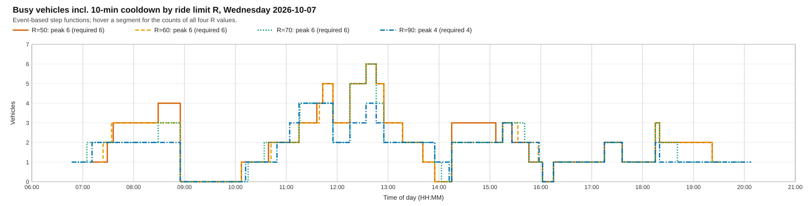
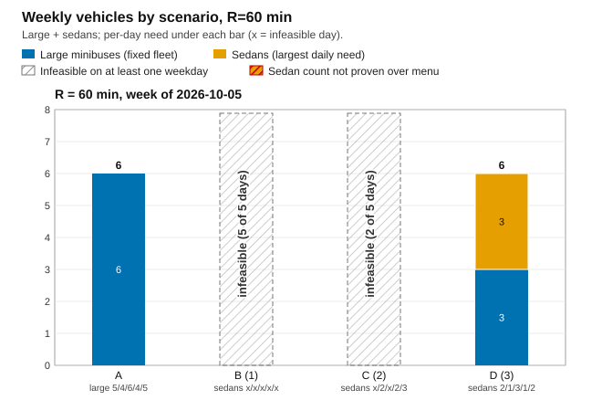
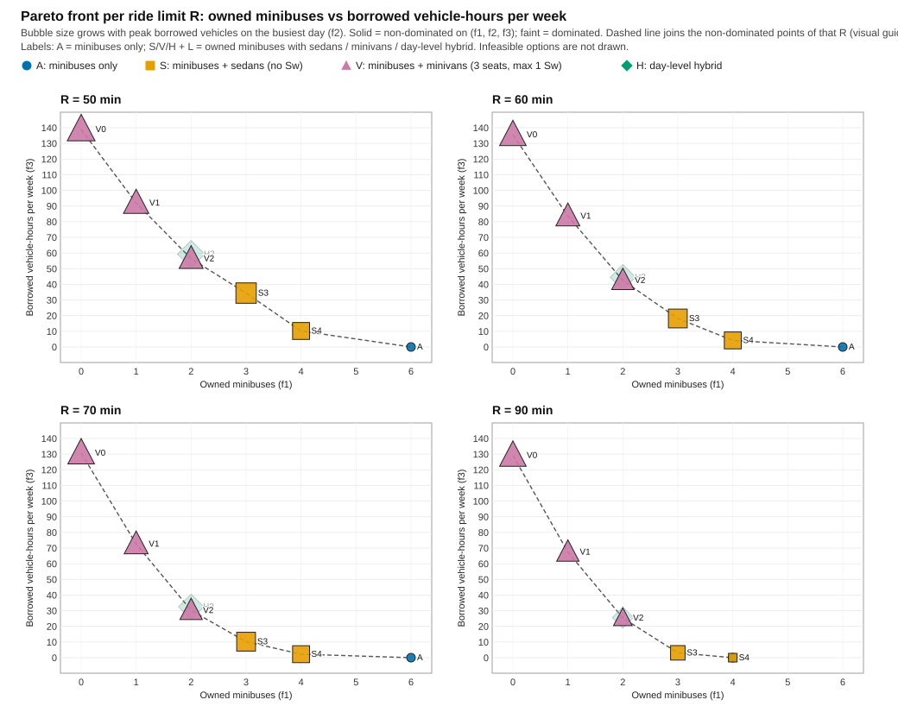

# Daily student transport planning with separate passenger capacities

[EKSİK: dated method-note review provenance file] Checked code baseline: `f7b8570`. [EKSİK: committed method-note review provenance for this baseline] The sensitivity campaign and the heterogeneous fleet and Pareto analyses were executed and archived. [S: docs/paper/results/week-2026-10-05-4sw5so/README.md:3-21] [S: docs/paper/results/week-2026-10-05-fleet/README.md:13] [S: docs/paper/results/week-2026-10-05-fleet/pareto_analysis.md:26-36] The exact-reference solves and the fleet re-run for the typed exact comparison remain planned; the checked implementation contains only the WP-E0 contracts and offline archive loader. [S: uniride_core/exact/__init__.py:1-14] [S: scripts/exact_archive_loader.py:1-5] [S: docs/designs/EXACT_SOLVER_AMPL_DESIGN.md:237-242]

## 1. Problem setting

A single campus provides transport for students with weekly class timetables. For a selected service date, the corresponding weekday determines each student's first class start and last class end. An eligible student generates a pickup leg before the first class and a drop-off leg after the last class. These are separate demand occurrences: one student can contribute two daily passenger trips. Students without an applicable class are excluded from that day's timetable demand.

Passengers use two separate capacity pools: wheelchair positions (Sw) and seated positions (So). An empty seated position cannot replace a wheelchair position. Each vehicle has capacities for both types. Each route starts and ends at the campus depot, serves its assigned demand occurrences once, and respects both capacities. Occurrence identifiers distinguish passengers even when they share a physical stop.

Admission is an input to planning. A hypothetical scenario can treat pending legs as admitted while retaining cancellations. This preview is explicitly non-publishable and does not create confirmations. Operational demand and a hypothetical timetable scenario must be reported separately: their passenger sets and inferred fleet requirements can differ.

## 2. Travel-time data

Let c(i,j) denote travel time in minutes from physical location i to location j. Planning uses a stored, directed matrix derived from road-network routing. [S: docs/DECISION_LOG.md:95-98] c(i,j) may differ from c(j,i). [S: docs/designs/EXACT_SOLVER_AMPL_DESIGN.md:20] Straight-line distances and coordinate-based travel-time approximations are not used in this operational method. [S: docs/DECISION_LOG.md:97-98] Missing or invalid required arcs prevent certification rather than being silently assigned zero travel time. [S: optimizer_api/verification/response_certifier.py:348-355]

The matrix is not assumed to satisfy the triangle inequality. [S: docs/DECISION_LOG.md:167-168] A direct campus-to-stop time is therefore not a certified lower bound on a route reaching that stop through other stops. [S: docs/DECISION_LOG.md:167-168] A wave cannot be rejected solely because a direct arc exceeds its ride limit. [S: docs/DECISION_LOG.md:167-169] Different passenger occurrences at one physical location may have a zero connecting hop; this does not justify zero travel between different locations. [S: optimizer_api/verification/response_certifier.py:125-127] [S: optimizer_api/verification/response_certifier.py:348-355]

A matrix snapshot is captured before solving. [S: src/services/daily-plan-run.ts:522-539] Wave requests are bound to its identity, and route verification uses the captured authoritative arc values. [S: src/services/daily-plan-run.ts:522-539] [S: optimizer_api/verification/response_certifier.py:348-358] Experiments must record the snapshot identity and provenance. The archived analysis uses a fixed travel-time matrix, with no traffic, boarding times or driver assignment. [S: docs/paper/results/week-2026-10-05-fleet/pareto_analysis.md:185]

Current fleet selection sends centi-minute endpoints and cooldowns with `time_scale = 100`, rejecting off-grid values. [S: src/services/fleet-scenario-run.ts:544-578] [S: docs/DECISION_LOG.md:382-386] T08 defers a two-decimal constraint on `time_matrix.duration_minutes` and plans integer-second Google storage, minutes derived as seconds / 60, and fleet selection with `time_scale = 60` when that integration starts. [S: docs/DECISION_LOG.md:21] [S: docs/DECISION_LOG.md:138-142] Google duration units and fractional-second handling have not been verified for the planned integration. [S: docs/DECISION_LOG.md:139] [EKSİK: live Google response confirming the duration units and fractional-second handling] [EKSİK: pending fractional-second research report is outside the checked repository snapshot]

## 3. Demand waves and constraints

Demands are grouped by direction and exact anchor time. A pickup anchor is the first class start minus a 15-minute arrival buffer: a 09:00 class produces an 08:45 campus arrival anchor. Drop-off departure is anchored at the last class end plus a 15-minute departure buffer. Groups within the same clock hour but at different anchors remain separate waves. The current method does not solve individual passenger time windows within a wave.

For a closed route D, v1, …, vk, D, tour duration is the sum of all directed arcs, including the empty outbound or return journey. This sum must not exceed the tour cap T. Passenger ride time has a separate definition:

- Pickup: a passenger boarding at vi experiences the arc sum from vi through the remaining stops to D. The empty initial journey from D is excluded.
- Drop-off: a passenger alighting at vi experiences the arc sum from D through preceding stops to vi. The final return to D is excluded.

Every passenger ride must be at most R. These definitions include travel only; boarding time and waiting are not added in the current anchored-wave calculation. Capacity is checked separately for Sw and So. Defaults are R = 90 minutes and T = 150 minutes, with selectable ranges of 15–240 and 30–300 minutes respectively. These are different service constraints.

For identical vehicles with capacities qSw and qSo, a wave containing nSw and nSo passengers has the necessary seat-capacity floor

**Lseat = max(⌈nSw / qSw⌉, ⌈nSo / qSo⌉).**

This floor ignores ride limits, tour limits, and inter-wave reuse. It is a minimum imposed by seats, not the number of feasible routes or a proof of the minimum daily fleet. Its maximum across the day's waves is also a necessary daily lower bound.

## 4. Solution method

### 4.1 Route-first, cluster-second search

Each wave uses a genetic algorithm (GA) over a permutation of passenger occurrences, called a giant tour. [S: src/services/daily-plan-run.ts:526-554] [S: uniride_core/algorithms/ga_split_engine.py:97-120] A split decoder partitions consecutive subsequences into depot-closed vehicle routes. [S: uniride_core/algorithms/string_split_decoder.py:324-367] [S: uniride_core/algorithms/string_split_decoder.py:249-269] This follows the route-first, cluster-second representation associated with [Prins (2004)](https://doi.org/10.1016/S0305-0548(03)00158-8). [S: optimizer_api/strategies/ga_split_strategy.py:44-55] The present implementation has its own constraints and acceptance checks; no comparative performance claim is inferred from the reference. [S: uniride_core/algorithms/string_split_decoder.py:337-367] [S: optimizer_api/verification/response_certifier.py:333-358]

Initialization combines randomized permutations and a nearest-neighbour tour. [S: uniride_core/algorithms/ga_split_engine.py:71-94] Tournament selection, order crossover, mutation, and elitism generate new candidates. [S: uniride_core/algorithms/ga_split_engine.py:251-293] Periodic local search modifies a selected giant tour, which is then decoded and evaluated again. [S: uniride_core/algorithms/ga_split_engine.py:352-370] The outer ranking prioritizes feasibility, then route count, then total travel time. [S: docs/DECISION_LOG.md:173]

The decoder enumerates feasible contiguous segments under both passenger capacities and the tour and ride limits. [S: uniride_core/algorithms/string_split_decoder.py:324-367] Dynamic programming chooses a minimum-travel-time partition for a fixed permutation, preferring partitions without violations. [S: uniride_core/algorithms/string_split_decoder.py:202-228] This restricted calculation does not optimize all permutations, and its cost objective differs from the outer GA's route-count priority. [S: uniride_core/algorithms/string_split_decoder.py:190-228] [S: docs/DECISION_LOG.md:173] Neither a decoded partition nor the final wave result proves globally minimum route count. [S: uniride_core/algorithms/string_split_decoder.py:202-228] [S: uniride_core/algorithms/ga_split_engine.py:318-379] With nonmetric travel, a duration violation also does not imply that every longer segment violates the limit; alternatives must still be examined. [S: uniride_core/algorithms/string_split_decoder.py:350-358] [S: docs/DECISION_LOG.md:167-168]

The single-type daily planner selects `ga_split` and supplies no per-request algorithm configuration; the heterogeneous campaign additionally calls `ga_split_hf` to build quota options. [S: src/services/daily-plan-run.ts:534-554] [S: src/services/fleet-scenario-run.ts:493-508] The following are the strategy's declared defaults. [S: optimizer_api/strategies/ga_split_strategy.py:58-70]

| Parameter | Declared default | Interpretation | Source |
|---|---:|---|---|
| Population size | 50 | Candidate giant tours | [S: optimizer_api/strategies/ga_split_strategy.py:58-70] |
| Maximum generations | 100 | Upper limit; early stopping can intervene | [S: optimizer_api/strategies/ga_split_strategy.py:58-70] |
| Crossover probability | 0.85 | Applied when generating offspring | [S: optimizer_api/strategies/ga_split_strategy.py:58-70] |
| Mutation probability | 0.20 | Applied to each offspring | [S: optimizer_api/strategies/ga_split_strategy.py:58-70] |
| Elite count | 3 | Retained candidates | [S: optimizer_api/strategies/ga_split_strategy.py:58-70] |
| Tournament size | 4 | Selection sample | [S: optimizer_api/strategies/ga_split_strategy.py:58-70] |
| Local search | Hybrid | Education of a selected giant tour | [S: optimizer_api/strategies/ga_split_strategy.py:58-70] [S: uniride_core/algorithms/ga_split_engine.py:351-370] |
| Local-search interval | 10 generations | Checked at zero-based indices 0, 10, … | [S: optimizer_api/strategies/ga_split_strategy.py:58-70] [S: uniride_core/algorithms/ga_split_engine.py:352-370] |
| No-improvement stop | 25 generations | Consecutive lack of improvement | [S: optimizer_api/strategies/ga_split_strategy.py:58-70] |
| Diversification threshold | 30 stagnant generations | Configured, but unreachable under the preceding default stop | [S: optimizer_api/strategies/ga_split_strategy.py:58-70] [S: uniride_core/algorithms/ga_split_engine.py:378-382] |
| Seed setting | None | Seed helper resolves this to effective seed 42 | [S: optimizer_api/strategies/ga_split_strategy.py:58-70] [S: optimizer_api/strategies/seed_utils.py:7-17] |

The constructor can overlay promoted parameters on the defaults. [S: optimizer_api/strategies/ga_split_strategy.py:72-79] [EKSİK: method-note deployment-inspection record] The sensitivity manifest records a locally resolved effective configuration equal to the defaults above and an effective seed of 42, with the qualification that the optimizer must use the same checkout and environment. [S: docs/paper/results/week-2026-10-05-4sw5so/run_manifest.json:39-53] An absent or None seed resolves to 42. [S: optimizer_api/strategies/seed_utils.py:7-21] A fixed seed alone does not establish reproducibility when demand ordering, matrix data or configuration changes; those inputs must also be archived. [S: docs/designs/EXACT_SOLVER_AMPL_DESIGN.md:251-258] [S: uniride_core/algorithms/ga_split_engine.py:79-92]

The defaults were not demonstrated to be tuned for this campus problem. [S: docs/DECISION_LOG.md:407] Correctness and feasibility tests do not establish solution quality or comparative superiority. [S: docs/DECISION_LOG.md:90] Current termination uses iterations and stagnation; it is not a fixed objective-evaluation-budget experiment. [S: uniride_core/algorithms/ga_split_engine.py:336-379]

### 4.2 Independent certification

An independent certificate reconstructs every route using the captured matrix. [S: optimizer_api/verification/response_certifier.py:348-358] It checks required occurrence coverage, continuity, depot closure, passenger counts and capacities, tour duration, and direction-specific ride limits. [S: optimizer_api/verification/response_certifier.py:333-355] [S: optimizer_api/verification/response_certifier.py:660-684] A 0.005-minute tolerance per reported arc accommodates two-decimal formatting, with corresponding aggregate formatting checks; it is not extra operational ride allowance. [S: optimizer_api/verification/response_certifier.py:129-140] [S: optimizer_api/verification/response_certifier.py:348-355] [S: optimizer_api/verification/response_certifier.py:339-341] Solver-reported durations alone do not establish feasibility. [S: optimizer_api/verification/response_certifier.py:348-355] The preview also checks whether accepted output can form consistent daily route jobs. [S: src/services/dudullu-preview.ts:887-925]

Only accepted routes proceed to vehicle assignment. [S: src/services/dudullu-preview.ts:911-932] A failed certificate establishes that the returned candidate is unacceptable. [S: src/services/dudullu-preview.ts:918-925] Failure to generate a candidate or exhaustion of a search budget does not prove that no feasible routing exists. [S: uniride_core/algorithms/string_split_decoder.py:236-247] [S: uniride_core/algorithms/ga_split_engine.py:318-379] A feasibility certificate is not an optimality certificate. [S: optimizer_api/verification/response_certifier.py:357-358]

### 4.3 Vehicle reuse across waves

A pickup route with duration t and arrival anchor a becomes the interval [a−t, a]; a drop-off route becomes [a, a+t]. [S: src/services/dudullu-preview.ts:489-494] Intervals outside the service day are rejected. [S: src/services/dudullu-preview.ts:495-502] A vehicle can serve multiple routes if both capacity pools suffice and each next route starts no earlier than the preceding route's end plus its cooldown. [S: src/services/dudullu-preview.ts:623-634]

Daily assignment searches for the fewest distinct vehicles for these fixed route jobs. [S: src/services/dudullu-preview.ts:829-877] It explores assignments in time order, uses concurrency lower bounds, and avoids equivalent branches for vehicles with matching capacities, cooldowns, and availability. [S: src/services/dudullu-preview.ts:724-742] [S: src/services/dudullu-preview.ts:784-826] The default budget is 50,000 visited nodes. [S: src/services/dudullu-preview.ts:6] [S: src/services/dudullu-preview.ts:745-748] [S: src/services/dudullu-preview.ts:829-835] A completed search, or a feasible witness meeting a valid lower bound, can prove the minimum for the given routes. [S: src/services/dudullu-preview.ts:829-877] [S: docs/DECISION_LOG.md:197-198] If the budget is exhausted before proof, the result is indeterminate; an available witness gives only an upper bound. [S: src/services/dudullu-preview.ts:829-877] [S: docs/DECISION_LOG.md:197-198] Completed failure establishes a shortage for the fixed routes and candidate fleet, not for every alternative routing. [S: src/services/dudullu-preview.ts:866-877] [S: docs/DECISION_LOG.md:203-204]

For identical virtual vehicles this provides a conditional fleet minimum after heuristic routing. [S: docs/DECISION_LOG.md:197-198] [S: docs/paper/results/week-2026-10-05-4sw5so/README.md:26] [S: src/services/dudullu-preview.ts:246-256] It is not a joint minimum over all possible routes. [S: docs/paper/results/week-2026-10-05-4sw5so/README.md:26] Comparing its count with a heterogeneous real fleet's vehicle count is insufficient: physical capacities, cooldowns, and assignment feasibility require separate evidence. [S: docs/DECISION_LOG.md:203-204]

## 5. Planning workflow

The planner selects the service date, admission scenario, ride cap, tour cap, and fleet mode, then inspects the routes and fleet requirement. [S: src/app/(app)/admin/daily-plan/page.tsx:439-475] [S: src/app/(app)/admin/daily-plan/page.tsx:132-169] [S: src/app/(app)/admin/daily-plan/page.tsx:253-275] [S: src/app/(app)/admin/daily-plan/page.tsx:400-435] [S: src/app/(app)/admin/daily-plan/page.tsx:602] The fleet template is supplied as a parameter; this study uses the physical minibus layout, 4 Sw + 5 So, with a 10-minute cooldown. [S: src/services/daily-plan-run.ts:542-553] [S: docs/paper/results/week-2026-10-05-4sw5so/README.md:20] [S: docs/DECISION_LOG.md:354] Template capacities are effective scenario inputs, although the current planning screen does not expose them as freely editable parameters. [S: src/app/(app)/admin/daily-plan/page.tsx:439-472] [S: src/app/(app)/admin/daily-plan/page.tsx:491-570]

Results include waves, routes, longest passenger ride, capacity floors, and assignment status. [S: src/services/daily-plan-view.ts:81-114] [S: src/services/daily-plan-view.ts:172-205] A proven minimum, an unproven witness, and a shortage have different meanings. [S: src/services/dudullu-preview.ts:866-877] [S: docs/DECISION_LOG.md:197-204] Re-running with different limits supports exploring service-level trade-offs. [S: src/app/(app)/admin/daily-plan/page.tsx:457-475] Vehicles above the seat floor can be associated with routing constraints, overlap, or cooldown, but the observed gap does not measure each cause. [S: uniride_core/algorithms/string_split_decoder.py:337-358] [S: src/services/dudullu-preview.ts:623-634] [S: src/app/(app)/admin/daily-plan/page.tsx:93-127]

Mean passenger ride is recorded in the archived study CSVs, although it is absent from the planning view's route fields. [S: docs/paper/results/week-2026-10-05-4sw5so/summary.csv:1-5] [S: src/services/daily-plan-view.ts:81-108] It is computed from each admitted occurrence's cumulative travel time and weighted by passenger trips, rather than by route maxima. [S: src/services/plan-experiments.ts:106-132] Students, daily legs, routes and vehicles remain distinct quantities. [S: docs/paper/results/week-2026-10-05-4sw5so/summary.csv:1-2]

## 6. Sensitivity experiment

The executed sensitivity campaign crossed five weekdays with R ∈ {50, 60, 70, 90} minutes, giving 20 scenario cells, with T = 150 minutes and the 4 Sw / 5 So template with a 10-minute cooldown. [S: docs/paper/results/week-2026-10-05-4sw5so/README.md:7-21] Every archived response uses that template and the same declared matrix snapshot. [S: docs/paper/results/week-2026-10-05-4sw5so/README.md:20-21] For a future paired comparison, timetable data, admission rules, passenger ordering and the matrix must also be held fixed. [S: docs/designs/EXACT_SOLVER_AMPL_DESIGN.md:251-255] [S: uniride_core/algorithms/ga_split_engine.py:79-92]

This campaign used one run per cell with effective GA seed 42 under native termination. [S: docs/paper/results/week-2026-10-05-4sw5so/README.md:19] The manifest records effective parameters, per-run files and matrix provenance; it does not turn a single-seed result into evidence about variation across seeds. [S: docs/paper/results/week-2026-10-05-4sw5so/run_manifest.json:24-67] Multi-seed robustness remains further study. [S: docs/designs/EXACT_SOLVER_AMPL_DESIGN.md:278]

The archived summaries record daily vehicles V, routes K, waves W, the seat floor Lseat, gap V−Lseat, maximum and passenger-weighted mean ride, and total vehicle travel-minutes. [S: docs/paper/results/week-2026-10-05-4sw5so/summary.csv:1-2] Vehicle-minutes sum closed-route travel times and exclude cooldown; resource busy time includes cooldown. [S: docs/paper/results/week-2026-10-05-4sw5so/schedule_verification.md:5] [S: docs/paper/results/week-2026-10-05-4sw5so/schedule_verification.md:259] Indeterminate assignments must remain visible; witness counts must not be reported as optima, and route generation remains heuristic. [S: docs/DECISION_LOG.md:197-198]

### Results: week of 2026-10-05 (4 Sw / 5 So template)

These are archived results for one snapshot week, one run per cell (GA seed 42, native termination), under assumed confirmations and the 4 Sw / 5 So template. [S: docs/paper/results/week-2026-10-05-4sw5so/README.md:19-27] Raw files and provenance are in [results/week-2026-10-05-4sw5so/](results/week-2026-10-05-4sw5so/). [S: docs/paper/results/week-2026-10-05-4sw5so/README.md:5-12] An earlier campaign used an incorrect 4 Sw / 10 So capacity record and is labelled INVALID and superseded; its result values are not used here. [S: docs/paper/results/week-2026-10-05-4sw5so/README.md:3] [S: docs/paper/results/week-2026-10-05/README.md:1] Every row is `preview_ready`, and V is proven only for the generated fixed routes; gap = V−Lseat. [S: docs/paper/results/week-2026-10-05-4sw5so/summary.csv:1-21] [S: docs/paper/results/week-2026-10-05-4sw5so/README.md:26]

| Weekday | R (min) | V / proof status | K (routes) | Lseat / gap | Max / mean ride (min) | Vehicle-minutes | Routes/waves (exact count ratio) | Source |
|---|---:|---|---|---|---|---|---|---|
| Monday | 50 | 6 (proven for fixed routes) | 26 | 3 / 3 | 50 / 28.314815 | 1600 | 26/12 | [S: docs/paper/results/week-2026-10-05-4sw5so/summary.csv:2] |
| Monday | 60 | 5 (proven for fixed routes) | 21 | 3 / 2 | 60 / 31.796296 | 1475 | 21/12 | [S: docs/paper/results/week-2026-10-05-4sw5so/summary.csv:3] |
| Monday | 70 | 4 (proven for fixed routes) | 17 | 3 / 1 | 70 / 36.166667 | 1355 | 17/12 | [S: docs/paper/results/week-2026-10-05-4sw5so/summary.csv:4] |
| Monday | 90 | 4 (proven for fixed routes) | 17 | 3 / 1 | 90 / 40.925926 | 1338 | 17/12 | [S: docs/paper/results/week-2026-10-05-4sw5so/summary.csv:5] |
| Tuesday | 50 | 5 (proven for fixed routes) | 22 | 2 / 3 | 50 / 26.595238 | 1334 | 22/13 | [S: docs/paper/results/week-2026-10-05-4sw5so/summary.csv:6] |
| Tuesday | 60 | 4 (proven for fixed routes) | 20 | 2 / 2 | 58 / 29.238095 | 1307 | 20/13 | [S: docs/paper/results/week-2026-10-05-4sw5so/summary.csv:7] |
| Tuesday | 70 | 4 (proven for fixed routes) | 18 | 2 / 2 | 67 / 31.761905 | 1237 | 18/13 | [S: docs/paper/results/week-2026-10-05-4sw5so/summary.csv:8] |
| Tuesday | 90 | 3 (proven for fixed routes) | 14 | 2 / 1 | 88 / 42.904762 | 1164 | 14/13 | [S: docs/paper/results/week-2026-10-05-4sw5so/summary.csv:9] |
| Wednesday | 50 | 6 (proven for fixed routes) | 20 | 2 / 4 | 50 / 28.891304 | 1302 | 20/11 | [S: docs/paper/results/week-2026-10-05-4sw5so/summary.csv:10] |
| Wednesday | 60 | 6 (proven for fixed routes) | 18 | 2 / 4 | 57 / 31.565217 | 1252 | 18/11 | [S: docs/paper/results/week-2026-10-05-4sw5so/summary.csv:11] |
| Wednesday | 70 | 6 (proven for fixed routes) | 18 | 2 / 4 | 69 / 34.652174 | 1209 | 18/11 | [S: docs/paper/results/week-2026-10-05-4sw5so/summary.csv:12] |
| Wednesday | 90 | 4 (proven for fixed routes) | 14 | 2 / 2 | 88 / 42.608696 | 1141 | 14/11 | [S: docs/paper/results/week-2026-10-05-4sw5so/summary.csv:13] |
| Thursday | 50 | 5 (proven for fixed routes) | 24 | 2 / 3 | 50 / 28.043478 | 1494 | 24/13 | [S: docs/paper/results/week-2026-10-05-4sw5so/summary.csv:14] |
| Thursday | 60 | 4 (proven for fixed routes) | 20 | 2 / 2 | 60 / 31.978261 | 1387 | 20/13 | [S: docs/paper/results/week-2026-10-05-4sw5so/summary.csv:15] |
| Thursday | 70 | 4 (proven for fixed routes) | 16 | 2 / 2 | 69 / 38.217391 | 1294 | 16/13 | [S: docs/paper/results/week-2026-10-05-4sw5so/summary.csv:16] |
| Thursday | 90 | 4 (proven for fixed routes) | 16 | 2 / 2 | 81 / 39.304348 | 1286 | 16/13 | [S: docs/paper/results/week-2026-10-05-4sw5so/summary.csv:17] |
| Friday | 50 | 6 (proven for fixed routes) | 17 | 2 / 4 | 50 / 29.078947 | 1092 | 17/8 | [S: docs/paper/results/week-2026-10-05-4sw5so/summary.csv:18] |
| Friday | 60 | 5 (proven for fixed routes) | 15 | 2 / 3 | 60 / 31.263158 | 1029 | 15/8 | [S: docs/paper/results/week-2026-10-05-4sw5so/summary.csv:19] |
| Friday | 70 | 5 (proven for fixed routes) | 13 | 2 / 3 | 65 / 31.210526 | 958 | 13/8 | [S: docs/paper/results/week-2026-10-05-4sw5so/summary.csv:20] |
| Friday | 90 | 4 (proven for fixed routes) | 12 | 2 / 2 | 89 / 40.710526 | 933 | 12/8 | [S: docs/paper/results/week-2026-10-05-4sw5so/summary.csv:21] |

Weekly fleet need is the maximum daily V over the five weekdays, for this single snapshot and native-termination run at GA seed 42. [S: docs/paper/results/week-2026-10-05-4sw5so/run_manifest.json:22-25] [S: docs/paper/results/week-2026-10-05-4sw5so/run_manifest.json:52] [S: docs/paper/results/week-2026-10-05-4sw5so/schedule_verification.md:55]

| R (min) | Weekly fleet need | Mon | Tue | Wed | Thu | Fri | Total vehicle-minutes | Source |
|---:|---:|---:|---:|---:|---:|---:|---:|---|
| 50 | 6 | 6 | 5 | 6 | 5 | 6 | 6822 | [S: docs/paper/results/week-2026-10-05-4sw5so/weekly.csv:2] |
| 60 | 6 | 5 | 4 | 6 | 4 | 5 | 6450 | [S: docs/paper/results/week-2026-10-05-4sw5so/weekly.csv:3] |
| 70 | 6 | 4 | 4 | 6 | 4 | 5 | 6053 | [S: docs/paper/results/week-2026-10-05-4sw5so/weekly.csv:4] |
| 90 | 4 | 4 | 3 | 4 | 4 | 4 | 5862 | [S: docs/paper/results/week-2026-10-05-4sw5so/weekly.csv:5] |

In this single snapshot week (one run per cell, GA seed 42, native termination), weekly fleet need was 6 vehicles at R = 50, 60 and 70 minutes and 4 at R = 90 minutes. [S: docs/paper/results/week-2026-10-05-4sw5so/README.md:19-27] [S: docs/paper/results/week-2026-10-05-4sw5so/weekly.csv:2-5] Wednesday required 6 vehicles through R = 70 and 4 at R = 90. [S: docs/paper/results/week-2026-10-05-4sw5so/summary.csv:10-13] Weekly vehicle-minutes were 6822, 6450, 6053 and 5862 at R = 50, 60, 70 and 90, respectively. [S: docs/paper/results/week-2026-10-05-4sw5so/weekly.csv:2-5] The daily mean rides, reproduced at the CSV's precision in the table, range from 26.595238 to 29.078947 minutes at R = 50, 29.238095 to 31.978261 at R = 60, 31.210526 to 38.217391 at R = 70, and 39.304348 to 42.904762 at R = 90. [S: docs/paper/results/week-2026-10-05-4sw5so/summary.csv:2-21] Daily seat floors are 2 or 3, vehicle counts are 3 to 6, and every floor gap is positive (1 to 4). [S: docs/paper/results/week-2026-10-05-4sw5so/summary.csv:2-21] The maximum ride equals R on every day at R = 50, on Monday, Thursday and Friday at R = 60, and on Monday alone at R = 70 and 90. [S: docs/paper/results/week-2026-10-05-4sw5so/summary.csv:2-21] These values describe heuristic routes under assumed admissions, and the vehicle proof is conditional on those routes. [S: docs/paper/results/week-2026-10-05-4sw5so/README.md:25-27]

#### Resource requirement profile

For this snapshot week (one run per cell, GA seed 42, native termination), the [resource step charts](results/week-2026-10-05-4sw5so/figures/) count vehicles on routes and vehicles busy through the 10-minute cooldown. [S: docs/paper/results/week-2026-10-05-4sw5so/README.md:19-20] [S: docs/paper/results/week-2026-10-05-4sw5so/schedule_verification.md:257-261] The figure below compares the four ride limits on Wednesday. [S: docs/paper/results/week-2026-10-05-4sw5so/schedule_verification.md:267-284]

On Wednesday, R = 50, 60 and 70 each require 6 vehicles; the busy peak occurs at 12:34–12:46 and the on-route peak at 12:34–12:36. [S: docs/paper/results/week-2026-10-05-4sw5so/schedule_verification.md:267] [S: docs/paper/results/week-2026-10-05-4sw5so/schedule_verification.md:272] [S: docs/paper/results/week-2026-10-05-4sw5so/schedule_verification.md:277] Tuesday at R = 50 has an on-route peak of 4 and a busy peak of 5, with busy-peak windows 08:48–08:55 and 12:15–12:16; the other 19 rows have equal peak counts, although their peak windows can differ. [S: docs/paper/results/week-2026-10-05-4sw5so/schedule_verification.md:265-284] For the fixed routes, adding cooldown changes the resource intervals, but these observations do not isolate causes of the observed fleet differences. [S: docs/paper/results/week-2026-10-05-4sw5so/schedule_verification.md:259] [S: docs/paper/results/week-2026-10-05-4sw5so/README.md:27] On Monday, the busy peak starts at 08:11, 07:43, 07:31 and 07:33 for R = 50, 60, 70 and 90, respectively. [S: docs/paper/results/week-2026-10-05-4sw5so/schedule_verification.md:265] [S: docs/paper/results/week-2026-10-05-4sw5so/schedule_verification.md:270] [S: docs/paper/results/week-2026-10-05-4sw5so/schedule_verification.md:275] [S: docs/paper/results/week-2026-10-05-4sw5so/schedule_verification.md:280] Wednesday to Friday generally peak around midday; Thursday at R = 60 also has a busy-peak window at 16:15–16:42 and another at 13:35–13:44. [S: docs/paper/results/week-2026-10-05-4sw5so/schedule_verification.md:267-284] The [weekly chart at R = 50](results/week-2026-10-05-4sw5so/figures/resource_week_R50.svg) stacks the weekdays. [S: docs/paper/results/week-2026-10-05-4sw5so/figures/resource_week_R50.svg:2-433] For Wednesday at R = 50, 60 and 70, outside the reported busy-peak window at most 5 vehicles are busy; outside the on-route peak window at most 5 are on routes. [S: docs/paper/results/week-2026-10-05-4sw5so/schedule_verification.md:267] [S: docs/paper/results/week-2026-10-05-4sw5so/schedule_verification.md:272] [S: docs/paper/results/week-2026-10-05-4sw5so/schedule_verification.md:277] Thursday's busy-peak windows at R = 50, 70 and 90 are 12:39–12:55, 13:35–13:53 and 13:35–13:52, respectively; Friday's at R = 50, 60, 70 and 90 are 13:15–13:35, 13:15–13:33, 13:16–13:33 and 13:15–13:33. [S: docs/paper/results/week-2026-10-05-4sw5so/schedule_verification.md:268-284]

#### Heterogeneous fleet scenarios

The heterogeneous campaign uses a large minibus (4 Sw / 5 So) and sedans (0 Sw / 4 So), each with a 10-minute cooldown, the same R and tour limit 150, and the captured travel-time matrix. [S: docs/paper/results/week-2026-10-05-fleet/README.md:24-36] Sedan Sw = 0 is a scenario assumption, so any route with an Sw passenger must use a minibus. [S: docs/paper/results/week-2026-10-05-fleet/README.md:29] Fleet types are explicit CLI inputs; the vehicle table is not consulted. [S: docs/paper/results/week-2026-10-05-fleet/README.md:29] Scenario A computes the all-large minimum for the heuristic fixed routes; L1–L3 (B–D in the tables) fix 1, 2 or 3 minibuses and minimise the sedan count over the generated menus. [S: docs/paper/results/week-2026-10-05-fleet/README.md:17-22] [S: docs/paper/results/week-2026-10-05-fleet/README.md:41-43] These are single-snapshot results with one run per cell, GA seed 42 and native termination. [S: docs/paper/results/week-2026-10-05-fleet/README.md:13] [S: docs/paper/results/week-2026-10-05-fleet/README.md:33] The [archive](results/week-2026-10-05-fleet/) contains responses, statuses and manifests, and [weekly_summary.md](results/week-2026-10-05-fleet/weekly_summary.md) gives the recomputed weekly tables. [S: docs/paper/results/week-2026-10-05-fleet/README.md:58-68]

For each wave, a typed split decoder checks contiguous segments against each type's Sw and So pools, any shared total-capacity limit, and that type's ride and tour caps. [S: uniride_core/algorithms/typed_split_decoder.py:119-148] Its dynamic programme minimises borrowed-type route count and then travel time, subject to the large-route quota, for a fixed giant tour. [S: uniride_core/algorithms/typed_split_decoder.py:150-172] The campaign producer adds the `ga_split` all-large baseline and `ga_split_hf` quota options; the large+sedan campaign uses q = 0..3, the corrected minivan campaign q = 0..2, and L4 q = 0..4, bounded by the wave size. [S: src/services/fleet-scenario-run.ts:478-525] [S: docs/designs/EXACT_SOLVER_AMPL_DESIGN.md:18] [S: docs/paper/results/week-2026-10-05-fleet/extra/L4/README.md:13] Duplicate GA options are removed by route partition, ignoring stop order. [S: src/services/fleet-scenario-run.ts:233-235] [S: src/services/fleet-scenario-run.ts:519-524] A CP-SAT model chooses one option per wave and labels its routes by feasible vehicle type, constraining the large-vehicle busy peak by L. [S: uniride_core/planning/typed_day_selection.py:6-15] Its lexicographic objective is sedan count, sedan route minutes, total route minutes and option-index sum. [S: uniride_core/planning/typed_day_selection.py:17-25] The current implementation shares one call's time allowance across the stages; it does not grant a fresh allowance to every stage. [S: uniride_core/planning/typed_day_selection.py:211-220] The archive records CP-SAT 9.15.6755, solver seed 20261008, one worker and a 30-second selection limit, separately from GA seed 42. [S: docs/paper/results/week-2026-10-05-fleet/run_manifest.json:80-100] The chosen fixed routes are independently assigned and checked in TypeScript for capacities, per-type ride/tour limits, overlap and cooldown before `proven_over_menu` is emitted. [S: src/services/fleet-scenario-run.ts:609-636] The archived verification reports 51 feasible runs passing its checks and 29 menu-infeasible rows with no routes. [S: docs/paper/results/week-2026-10-05-fleet/fleet_verification.md:3-16]

Weekly results for one snapshot week, one run per cell (GA seed 42, native termination), under assumed confirmations: the archive records 226 passenger legs per R; daily student counts sum to 113 student-days. [S: docs/paper/results/week-2026-10-05-fleet/README.md:13] [S: docs/paper/results/week-2026-10-05-fleet/README.md:33] [S: docs/paper/results/week-2026-10-05-fleet/README.md:47] [S: docs/paper/results/week-2026-10-05-fleet/scenario_weekly.csv:2-14] [S: docs/paper/results/week-2026-10-05-fleet/weekly_summary.md:30-34] Weekly need is the largest daily need, representing the same fleet across weekdays; A proofs are conditional on fixed routes, while feasible L1–L3 rows are proven over menus and independently assigned. [S: docs/paper/results/week-2026-10-05-fleet/README.md:41-56] [S: docs/paper/results/week-2026-10-05-fleet/weekly_summary.md:3] [S: docs/paper/results/week-2026-10-05-fleet/weekly_summary.md:24] [S: docs/paper/results/week-2026-10-05-4sw5so/README.md:26]

| R (min) | Scenario | Weekdays feasible | Minibuses | Sedans (max per day) | Weekly vehicles | Sedans per day (Mon to Fri) | Source |
|---|---|---|---|---|---|---|---|
| 50 | A: none | 5/5 | 6 | 0 | 6 | - | [S: docs/paper/results/week-2026-10-05-fleet/weekly_summary.md:7] |
| 50 | B: 1 | 0/5 | 1 | - | - | - | [S: docs/paper/results/week-2026-10-05-fleet/weekly_summary.md:8] |
| 50 | C: 2 | 2/5 | 2 | - | - | x / 3 / x / x / 4 | [S: docs/paper/results/week-2026-10-05-fleet/weekly_summary.md:9] |
| 50 | D: 3 | 5/5 | 3 | 4 | 7 | 4 / 2 / 4 / 2 / 3 | [S: docs/paper/results/week-2026-10-05-fleet/weekly_summary.md:10] |
| 60 | A: none | 5/5 | 6 | 0 | 6 | - | [S: docs/paper/results/week-2026-10-05-fleet/weekly_summary.md:11] |
| 60 | B: 1 | 0/5 | 1 | - | - | - | [S: docs/paper/results/week-2026-10-05-fleet/weekly_summary.md:12] |
| 60 | C: 2 | 3/5 | 2 | - | - | x / 2 / x / 2 / 3 | [S: docs/paper/results/week-2026-10-05-fleet/weekly_summary.md:13] |
| 60 | D: 3 | 5/5 | 3 | 3 | 6 | 2 / 1 / 3 / 1 / 2 | [S: docs/paper/results/week-2026-10-05-fleet/weekly_summary.md:14] |
| 70 | A: none | 5/5 | 6 | 0 | 6 | - | [S: docs/paper/results/week-2026-10-05-fleet/weekly_summary.md:15] |
| 70 | B: 1 | 0/5 | 1 | - | - | - | [S: docs/paper/results/week-2026-10-05-fleet/weekly_summary.md:16] |
| 70 | C: 2 | 3/5 | 2 | - | - | 3 / x / x / 2 / 3 | [S: docs/paper/results/week-2026-10-05-fleet/weekly_summary.md:17] |
| 70 | D: 3 | 5/5 | 3 | 3 | 6 | 1 / 1 / 3 / 1 / 2 | [S: docs/paper/results/week-2026-10-05-fleet/weekly_summary.md:18] |
| 90 | A: none | 5/5 | 4 | 0 | 4 | - | [S: docs/paper/results/week-2026-10-05-fleet/weekly_summary.md:19] |
| 90 | B: 1 | 0/5 | 1 | - | - | - | [S: docs/paper/results/week-2026-10-05-fleet/weekly_summary.md:20] |
| 90 | C: 2 | 3/5 | 2 | - | - | 2 / x / x / 2 / 2 | [S: docs/paper/results/week-2026-10-05-fleet/weekly_summary.md:21] |
| 90 | D: 3 | 5/5 | 3 | 1 | 4 | 1 / 0 / 1 / 1 / 0 | [S: docs/paper/results/week-2026-10-05-fleet/weekly_summary.md:22] |

An x denotes a menu-infeasible weekday; a dash denotes an unavailable weekly count because at least one weekday is infeasible. [S: docs/paper/results/week-2026-10-05-fleet/weekly_summary.md:3-22] [S: docs/paper/results/week-2026-10-05-fleet/README.md:51-56] For A, daily minibus minima are 6 / 5 / 6 / 5 / 6 at R = 50, 5 / 4 / 6 / 4 / 5 at R = 60, 4 / 4 / 6 / 4 / 5 at R = 70, and 4 / 3 / 4 / 4 / 4 at R = 90. [S: docs/paper/results/week-2026-10-05-fleet/weekly_summary.md:24]

The following observations describe that single snapshot, one run per cell (GA seed 42, native termination), and the generated menus. [S: docs/paper/results/week-2026-10-05-fleet/README.md:13] [S: docs/paper/results/week-2026-10-05-fleet/README.md:33-43]

- **L1 has no feasible menu selection.** All 20 cells are `infeasible_for_L`: 15 are labelled `SW_DEMAND_EXCEEDS_LARGE_CAPACITY` and 5 `CROSS_WAVE_CONFLICT`. [S: docs/paper/results/week-2026-10-05-fleet/YONETIM_OZETI.md:32] At R = 60, the largest Sw wave contains 5 passengers on Monday and Thursday, 4 on Friday, and 3 on Tuesday and Wednesday. [S: docs/paper/results/week-2026-10-05-fleet/weekly_summary.md:30-34]
- **L2 is feasible on some weekdays.** It is feasible on 2 of 5 days at R = 50 and 3 of 5 at R = 60, 70 and 90, so none of these generated-menu scenarios provides a complete week with two minibuses. [S: docs/paper/results/week-2026-10-05-fleet/weekly_summary.md:9-21] Of its 9 infeasible cells, 2 are labelled `SW_DEMAND_EXCEEDS_LARGE_CAPACITY` (Monday at R = 50 and 60) and 7 `CROSS_WAVE_CONFLICT`. [S: docs/paper/results/week-2026-10-05-fleet/YONETIM_OZETI.md:33]
- **L3 has a feasible selection on every weekday at every R.** Peak daily sedan need is 4, 3, 3 and 1 at R = 50, 60, 70 and 90, respectively; Tuesday and Friday need no sedan at R = 90. [S: docs/paper/results/week-2026-10-05-fleet/weekly_summary.md:10-22] At R = 60, Wednesday's three sedan windows are 11:15–12:36, 11:51–12:45 and 12:15–13:07. [S: docs/paper/results/week-2026-10-05-fleet/car_usage_windows.csv:28-30] At R = 60, the other L3 sedan windows are 07:12–16:50 and 07:43–08:45 on Monday, 07:23–13:36 on Tuesday, 13:15–16:49 on Thursday, and 07:37–17:28 and 13:02–13:45 on Friday. [S: docs/paper/results/week-2026-10-05-fleet/car_usage_windows.csv:6-7] [S: docs/paper/results/week-2026-10-05-fleet/car_usage_windows.csv:22] [S: docs/paper/results/week-2026-10-05-fleet/car_usage_windows.csv:39] [S: docs/paper/results/week-2026-10-05-fleet/car_usage_windows.csv:56-57]
- **Vehicle count and route minutes describe different resources.** L3 and A have weekly counts of 7 versus 6 at R = 50, and equal counts of 6, 6 and 4 at R = 60, 70 and 90. [S: docs/paper/results/week-2026-10-05-fleet/weekly_summary.md:7-22] Their respective weekly route-minute totals are 6967 versus 6822, 6472 versus 6450, 6048 versus 6053, and 5838 versus 5862. [S: docs/paper/results/week-2026-10-05-fleet/scenario_weekly.csv:2-17] At R = 60 the passenger-weighted mean rides are 31.221239 minutes for A and 31.172566 for L3. [S: docs/paper/results/week-2026-10-05-fleet/scenario_weekly.csv:6] [S: docs/paper/results/week-2026-10-05-fleet/scenario_weekly.csv:9] These are descriptive comparisons of heuristic route sets. [S: docs/paper/results/week-2026-10-05-fleet/README.md:3-43] Summing the L3 daily rows gives 29 of 111 sedan routes at R = 50, 16 of 94 at R = 60, 10 of 81 at R = 70 and 3 of 73 at R = 90. [S: docs/paper/results/week-2026-10-05-fleet/scenario_daily.csv:2-81] The sedan shares of route minutes are the exact ratios 1775/6967, 931/6472, 513/6048 and 156/5838, respectively. [S: docs/paper/results/week-2026-10-05-fleet/scenario_weekly.csv:5] [S: docs/paper/results/week-2026-10-05-fleet/scenario_weekly.csv:9] [S: docs/paper/results/week-2026-10-05-fleet/scenario_weekly.csv:13] [S: docs/paper/results/week-2026-10-05-fleet/scenario_weekly.csv:17]
- **Sedan borrowing days depend on R.** L3 uses sedans on every weekday at R = 50, 60 and 70 and on Monday, Wednesday and Thursday at R = 90. [S: docs/paper/results/week-2026-10-05-fleet/weekly_summary.md:10-22]

The proof label `proven_over_menu` applies to borrowed-vehicle count over the generated menus; a different routing could change the count, and `infeasible_for_L` means no feasible selection within those menus. [S: docs/paper/results/week-2026-10-05-fleet/README.md:43-54] All timetable legs are assumed confirmed, all So students are assumed able to use the declared borrowed type, and sedan Sw = 0 remains an unverified scenario assumption. [S: docs/paper/results/week-2026-10-05-fleet/README.md:29] [S: docs/paper/results/week-2026-10-05-fleet/README.md:47] [S: docs/paper/results/week-2026-10-05-fleet/YONETIM_OZETI.md:63-64] The recorded failure codes distinguish a wave requiring more large routes than L from cross-wave overlap; they are not causal estimates. [S: docs/paper/results/week-2026-10-05-fleet/README.md:51-54] The same fixed arc times apply to both types; cost, lender availability, drivers and boarding times are not modelled. [S: docs/paper/results/week-2026-10-05-fleet/YONETIM_OZETI.md:65-67] The [earlier fixed-route fleet what-if](results/week-2026-10-05-4sw5so/fleet_mix_analysis.md) only reassigns routes built for the large vehicle and provides an upper bound; it is not the typed-menu evidence used above. [S: docs/paper/results/week-2026-10-05-4sw5so/fleet_mix_analysis.md:7-14]

#### Multi-objective trade-off (Pareto) analysis

An option combines a fleet family with owned minibus count L and ride limit R: all-large A, large+sedan L1–L4, or large+Doblò L0–L2. [S: docs/paper/results/week-2026-10-05-fleet/pareto_analysis.md:24-32] Each campaign uses at most two types; the extra scenarios are L4 with sedans and the corrected minivan campaign, rather than a simultaneous three-type solve. [S: docs/paper/results/week-2026-10-05-fleet/extra/L4/README.md:8-13] [S: docs/paper/results/week-2026-10-05-fleet/extra/minivan-cap3/README.md:12-17] Doblò is modelled as `minivan:1sw3so:cap3:cd10`: at most 1 Sw, at most 3 So, and at most 3 passengers in total, with a 10-minute cooldown; an Sw passenger occupies a seat while the wheelchair is stowed. [S: docs/DECISION_LOG.md:370] [S: docs/paper/results/week-2026-10-05-fleet/extra/minivan-cap3/README.md:7] This is an assumed scenario model, not verified service accessibility; no `1sw2so` variant was run. [S: docs/paper/results/week-2026-10-05-fleet/pareto_analysis.md:24] The earlier `extra/minivan/` campaign allowed four passengers and is SUPERSEDED by [extra/minivan-cap3/](results/week-2026-10-05-fleet/extra/minivan-cap3/). [S: docs/paper/results/week-2026-10-05-fleet/extra/minivan/README.md:1] [S: docs/paper/results/week-2026-10-05-fleet/extra/minivan-cap3/README.md:3-7] The approved brief records a one-vehicle increase in the pure-minivan peak at every R after that correction, unchanged L1/L2 minivan peaks, and borrowed-hour changes of at most 2.7 hours for L1/L2. [S: docs/paper/results/week-2026-10-05-fleet/YONETIM_OZETI.md:62] The valid extra archives use the same snapshot week, matrix, R grid and tour limit, GA seed 42, native termination and assumed confirmations, with one archived run per cell. [S: docs/paper/results/week-2026-10-05-fleet/extra/L4/README.md:13-20] [S: docs/paper/results/week-2026-10-05-fleet/extra/minivan-cap3/README.md:17-23]

The ε-constraint analysis fixes L and R and minimises each day's borrowed-vehicle count over its generated route menus; a weekly option requires a feasible selection on all five weekdays. [S: docs/paper/results/week-2026-10-05-fleet/pareto_analysis.md:7] The reported objectives are f1, owned minibuses; f2, maximum daily distinct borrowed vehicles; f3, weekly borrowed busy hours (route minutes plus the 10-minute cooldown after each borrowed route, divided by 60); f4, weekdays with any borrowing; and f5, R and realised passenger-weighted mean ride. [S: docs/paper/results/week-2026-10-05-fleet/pareto_analysis.md:15-19] Here f4 counts borrowing days, while the separate CSV field `borrowed_vehicle_days` sums vehicles over days. [S: docs/paper/results/week-2026-10-05-fleet/pareto_analysis.md:18] Dominance is evaluated on (f1, f2, f3) within R and on (f1, f2, f3, R) across R; equal objective vectors do not dominate one another. [S: docs/paper/results/week-2026-10-05-fleet/pareto_analysis.md:7] [S: docs/paper/results/week-2026-10-05-fleet/pareto_analysis.md:40] The archive contains 36 options, comprising 32 non-derived options and 4 day-level hybrids, of which 28 are feasible. [S: docs/paper/results/week-2026-10-05-fleet/pareto_options.csv:2-37] The recorded route/CSV checks cover 131 feasible-day runs with zero violations and 29 infeasible-day runs with no routes. [S: docs/paper/results/week-2026-10-05-fleet/pareto_analysis.md:36] Owned utilisation uses busy minutes over the common service span times owned capacity; borrowed utilisation uses busy minutes over first-start to last-end-plus-cooldown loan windows, and the before-10:00 share uses borrowed busy time. [S: docs/paper/results/week-2026-10-05-fleet/pareto_analysis.md:20-22]

For this snapshot week (one run per cell, GA seed 42, native termination), the six non-dominated options at R = 60 are shown below at the precision printed in the archive. [S: docs/paper/results/week-2026-10-05-fleet/README.md:33] [S: docs/paper/results/week-2026-10-05-fleet/extra/L4/README.md:18] [S: docs/paper/results/week-2026-10-05-fleet/extra/minivan-cap3/README.md:22] [S: docs/paper/results/week-2026-10-05-fleet/pareto_analysis.md:108-113]

| Option | f1 owned minibuses | f2 peak borrowed | f3 borrowed h/week | f4 borrowing days | Source |
|---|---:|---:|---:|---:|---|
| L0 + Doblò | 0 | 7 | 135.5 | 5 | [S: docs/paper/results/week-2026-10-05-fleet/pareto_analysis.md:108] |
| L1 + Doblò | 1 | 5 | 83.6 | 5 | [S: docs/paper/results/week-2026-10-05-fleet/pareto_analysis.md:109] |
| L2 + Doblò | 2 | 4 | 42.5 | 5 | [S: docs/paper/results/week-2026-10-05-fleet/pareto_analysis.md:110] |
| L3 + sedan | 3 | 3 | 18.2 | 5 | [S: docs/paper/results/week-2026-10-05-fleet/pareto_analysis.md:111] |
| L4 + sedan | 4 | 2 | 4.2 | 3 | [S: docs/paper/results/week-2026-10-05-fleet/pareto_analysis.md:112] |
| A | 6 | 0 | 0.0 | 0 | [S: docs/paper/results/week-2026-10-05-fleet/pareto_analysis.md:113] |

The same six option families form the per-R non-dominated sets at R = 50, 70 and 90; at R = 90, A and L4 have identical (f1, f2, f3) = (4, 0, 0), although their realised mean rides differ. [S: docs/paper/results/week-2026-10-05-fleet/pareto_analysis.md:102-131] [S: docs/paper/results/week-2026-10-05-fleet/pareto_analysis.md:93-94] Borrowed peaks and hours fall as L increases within each family in these runs; sedan options with L ≥ 3 use fewer borrowed hours than the tested Doblò options with L ≤ 2 but require more owned minibuses. [S: docs/paper/results/week-2026-10-05-fleet/pareto_analysis.md:170-171] The derived L2 day-level hybrid uses sedans on feasible sedan weekdays and minivans otherwise; it is dominated by pure L2+Doblò on (f1, f2, f3) at all four R. [S: docs/paper/results/week-2026-10-05-fleet/pareto_analysis.md:127] [S: docs/paper/results/week-2026-10-05-fleet/pareto_analysis.md:135-144] At R = 60, it uses minivans on 2 days rather than 5 and records 44.5 borrowed hours against 42.5 for pure L2+Doblò; that reduced minivan-day count is outside the stated dominance objectives. [S: docs/paper/results/week-2026-10-05-fleet/pareto_analysis.md:140-144] A wave-level hybrid with three types remains future work. [S: docs/paper/results/week-2026-10-05-fleet/pareto_analysis.md:135] At R = 60, owned utilisation is 34% in A and 49%–72% in the borrowing options; the options borrowing on five weekdays have borrowed utilisation 50%–54%, and the before-10:00 shares of borrowing options are 26%–32%, at the archive's printed precision. [S: docs/paper/results/week-2026-10-05-fleet/pareto_analysis.md:60-66]

Figures (in `results/week-2026-10-05-fleet/figures/`, indexed in `index.html`): [pareto_front_by_R.svg](results/week-2026-10-05-fleet/figures/pareto_front_by_R.svg) and [pareto_front_combined.svg](results/week-2026-10-05-fleet/figures/pareto_front_combined.svg) (owned minibuses against borrowed hours, bubble size = peak borrowed); [pareto_service_vs_minibuses.svg](results/week-2026-10-05-fleet/figures/pareto_service_vs_minibuses.svg) (mean ride against owned minibuses); [pareto_borrowed_heatmap_R60.svg](results/week-2026-10-05-fleet/figures/pareto_borrowed_heatmap_R60.svg) (borrowed vehicles by hour and weekday); [pareto_parallel_coordinates.svg](results/week-2026-10-05-fleet/figures/pareto_parallel_coordinates.svg); [pareto_utilisation.svg](results/week-2026-10-05-fleet/figures/pareto_utilisation.svg). [S: docs/paper/results/week-2026-10-05-fleet/pareto_analysis.md:174-181]

The front is an approximation over the tested L and R values and heuristic menus. [S: docs/paper/results/week-2026-10-05-fleet/pareto_analysis.md:9-34] Borrowed count is proven only over those menus; f3 and f4 are reported outcomes rather than separately minimised objectives, so another count-minimal plan could change f3. [S: docs/paper/results/week-2026-10-05-fleet/pareto_analysis.md:9] The analysis concerns one week, one captured matrix, assumed confirmations and a single GA seed 42 under native termination. [S: docs/paper/results/week-2026-10-05-fleet/pareto_analysis.md:9] [S: docs/paper/results/week-2026-10-05-fleet/README.md:33] Capacities and accessibility of the borrowed types are scenario assumptions, and cost and lender availability are absent, so the analysis does not rank affordability or practical acceptability. [S: docs/paper/results/week-2026-10-05-fleet/pareto_analysis.md:185-189]

Achieved service level and fleet size can be studied descriptively, but these single-snapshot, single-seed native results do not support superiority, causal attribution or a global fleet optimum. [S: AGENTS.md:38-54] [S: docs/paper/results/week-2026-10-05-fleet/README.md:3] [S: docs/paper/results/week-2026-10-05-fleet/README.md:33-43] Later algorithm comparisons require primary fixed objective-evaluation budgets; native-termination evidence must remain separately labelled. [S: AGENTS.md:38-39]

**Corrections and their effect on reported results.** CX-01 replaced outward whole-minute interval rounding with centi-minute endpoints and cooldowns (`time_scale = 100`); off-grid values fail closed rather than being rounded. [S: docs/DECISION_LOG.md:382-386] [S: src/services/fleet-scenario-run.ts:544-578] The recorded archive effect is none because the archived arcs and interval endpoints are whole minutes. [S: docs/ULTIMATE_AUDIT_2026-10-01_CLAUDE_OPUS_5_5.md:2399] [S: docs/designs/EXACT_SOLVER_AMPL_DESIGN.md:27] [EKSİK: replay evidence file] CX-03 makes the typed GA decode cost-only for one type without an active quota, restoring the documented parity with the untyped GA; two-type quota decoding is unchanged. [S: docs/DECISION_LOG.md:374-378] [S: uniride_core/algorithms/ga_split_typed_engine.py:76-89] [S: docs/ULTIMATE_AUDIT_2026-10-01_CLAUDE_OPUS_5_5.md:2398] The typed campaigns used two types, and the single-type campaign used `ga_split`, so CX-03 does not change their reported routes. [S: docs/designs/EXACT_SOLVER_AMPL_DESIGN.md:26] The core archives were produced at `6be127d`, `8ab88ca` and `4200acb`, before CX-01/CX-03, and each manifest records a dirty tree; L4 records `afc7208` and a dirty tree as well. [S: docs/designs/EXACT_SOLVER_AMPL_DESIGN.md:26] [S: docs/paper/results/week-2026-10-05-fleet/extra/L4/README.md:17] These remain historical native, single-seed archives; the planned typed exact comparison requires a new campaign at one pinned commit. [S: docs/designs/EXACT_SOLVER_AMPL_DESIGN.md:280]

## 7. Further study

Further studies can add individual passenger windows, boarding times, driver assignment, traffic-aware matrices and publication of approved daily plans, subject to separate contracts and evidence. [S: docs/DECISION_LOG.md:344-348] [S: docs/paper/results/week-2026-10-05-fleet/pareto_analysis.md:185] [S: docs/designs/HETEROGENEOUS_FLEET_DESIGN.md:34-37] Further work could examine anchor shifts, cooldown variation and class staggering as possible changes to the peak resource requirement. Heterogeneous routing with Sw/So pools is now represented by the archived scenarios, while a joint optimum over all route sets and vehicle types remains outside their evidence. [S: docs/paper/results/week-2026-10-05-fleet/README.md:13-43] Matrix-based clustering remains a separate research question; geometric grouping does not replace road-network evaluation. [S: docs/DECISION_LOG.md:119-123]

The approved exact-reference plan uses complete feasible-route enumeration followed by two-stage set partitioning in AMPL: first route count for the single type, or borrowed-type route count under a large-route quota for a typed wave, then travel duration with the first-stage count fixed. [S: docs/designs/EXACT_SOLVER_AMPL_DESIGN.md:36-66] Gurobi is the main solver and HiGHS the cross-check. [S: docs/designs/EXACT_SOLVER_AMPL_DESIGN.md:201-202] Each solver call (stage 1, stage 2 and the free-duration-bound solve) has a 60-second wall limit, or 600 seconds on peak waves; a peak is the largest-leg wave per date, including ties. [S: docs/designs/EXACT_SOLVER_AMPL_DESIGN.md:86] The archive census contains 57 waves and 226 legs per R, with 50 waves of 1–6 legs and a largest wave of 20; the five peak pickup waves are anchored at 08:45 and contain 20, 11, 11, 10 and 13 legs. [S: docs/designs/EXACT_SOLVER_AMPL_DESIGN.md:23] [S: docs/designs/EXACT_SOLVER_AMPL_DESIGN.md:30]

Before the typed comparison, WP-E10 will re-run both large+sedan and large+Doblò(cap3) campaigns at a clean pinned commit, using GA seed 42 and native termination, and archive every menu option's routes, minutes, intervals and certificate. [S: docs/designs/EXACT_SOLVER_AMPL_DESIGN.md:241] [S: docs/designs/EXACT_SOLVER_AMPL_DESIGN.md:253-258] A read-only preflight must match live inputs to the archive; mismatch stops the re-run for an owner decision, and archived input replay through the current production path is not the approved fallback. [S: docs/designs/EXACT_SOLVER_AMPL_DESIGN.md:251] Historical typed rows will not be pooled with the re-run. [S: docs/designs/EXACT_SOLVER_AMPL_DESIGN.md:258] The day comparison will solve GA menus and the union of GA and per-wave exact menus at one commit with `time_scale = 100`, without deduplicating exact options against GA options by partition alone. [S: docs/designs/EXACT_SOLVER_AMPL_DESIGN.md:121-124] Only optimal results in both CP-SAT runs, with independent TypeScript assignment confirmation, can receive `proven_over_union_menu`; otherwise the prescribed labels include `union_not_proven` or `not_independently_confirmed`. [S: docs/designs/EXACT_SOLVER_AMPL_DESIGN.md:125-127] A union solve lacking proof will be retried once at 60 seconds; none of these labels denotes a global day optimum. [S: docs/designs/EXACT_SOLVER_AMPL_DESIGN.md:125-127]

Only WP-E0, the contracts and offline archive loader, is implemented at the checked baseline; no exact route enumeration, AMPL solve, WP-E10 re-run or exact-gap result is reported here. [S: uniride_core/exact/__init__.py:1-14] [S: scripts/exact_archive_loader.py:1-5] [S: docs/designs/EXACT_SOLVER_AMPL_DESIGN.md:237-244] The existing exact single-route TSP helper is not a capacitated multi-route or day-level reference. [S: docs/DECISION_LOG.md:407] Planned gap reporting distinguishes route-count bounds, duration bounds conditional on a proven first-stage count, and a separate free-count duration bound, with time-limited and unresolved cases labelled explicitly. [S: docs/designs/EXACT_SOLVER_AMPL_DESIGN.md:64-88]

## 8. Validity and scope

The archived daily student counts are 27, 21, 23, 23 and 19 from Monday to Friday, and full-snapshot matrix provenance records 29 locations. [S: docs/paper/results/week-2026-10-05-fleet/weekly_summary.md:30-34] [S: docs/paper/results/week-2026-10-05-4sw5so/run_manifest.json:63-67] Earlier planning notes reported 28 students in a D0 read-only inventory dated 2026-10-04. [S: docs/DEMO_ROADMAP_2026-10-04.md:276] The archived matrices are per-date slices: their declared snapshot hash and location count describe the full snapshot and cannot be recomputed from the slice alone. [S: docs/designs/EXACT_SOLVER_AMPL_DESIGN.md:22] Larger networks, multiple campuses, wheelchair handling delays and variable traffic require new evidence. [S: docs/paper/results/week-2026-10-05-fleet/pareto_analysis.md:185-188]

The sensitivity, heterogeneous fleet and Pareto analyses were executed for one snapshot week with one run per cell, GA seed 42 and native termination; the exact-reference solves and WP-E10 re-run remain planned. [S: docs/paper/results/week-2026-10-05-4sw5so/README.md:19-27] [S: docs/paper/results/week-2026-10-05-fleet/README.md:13] [S: docs/paper/results/week-2026-10-05-fleet/README.md:33-43] [S: docs/designs/EXACT_SOLVER_AMPL_DESIGN.md:241-244] Validity limits include assumed confirmations, a captured matrix, heuristic route generation, assignment proofs conditional on fixed routes, and fleet minima conditional on generated menus. [S: docs/paper/results/week-2026-10-05-4sw5so/README.md:25-27] [S: docs/paper/results/week-2026-10-05-fleet/README.md:43-47] The approximate Pareto front excludes cost and lender availability and does not validate service accessibility, traffic realism or boarding-time assumptions. [S: docs/paper/results/week-2026-10-05-fleet/pareto_analysis.md:185-189] No superiority, causality, global optimality or validated service quality is claimed. [S: AGENTS.md:38-54]

## References and implementation provenance

Prins, C. (2004). A simple and effective evolutionary algorithm for the vehicle routing problem. *Computers & Operations Research*, 31(12), 1985–2002. [doi:10.1016/S0305-0548(03)00158-8](https://doi.org/10.1016/S0305-0548(03)00158-8).

Review metadata: [EKSİK: method-note review date, checked baseline and access-history record]. [EKSİK: committed provenance confirming the source blobs at the checked baseline] [EKSİK: pending research-note provenance is outside the checked repository snapshot] These repository links support maintenance and can be omitted from a publication.

- [Timetable demand](../../src/services/daily-planning.ts), [daily orchestration](../../src/services/daily-plan-run.ts), and [preview endpoint](../../src/app/api/admin/dudullu-preview/route.ts).
- [Route jobs and bounded assignment](../../src/services/dudullu-preview.ts) and [displayed metrics](../../src/services/daily-plan-view.ts).
- [GA defaults and overlays](../../optimizer_api/strategies/ga_split_strategy.py), [seed resolution](../../optimizer_api/strategies/seed_utils.py), [GA engine](../../uniride_core/algorithms/ga_split_engine.py), and [split decoder](../../uniride_core/algorithms/string_split_decoder.py).
- [Core feasibility](../../uniride_core/algorithms/feasibility_certificate.py), [independent certificate](../../optimizer_api/verification/response_certifier.py), and [matrix binding](../../optimizer_api/routers/optimization.py).
- [Typed decoder](../../uniride_core/algorithms/typed_split_decoder.py), [typed GA](../../uniride_core/algorithms/ga_split_typed_engine.py), [day selection](../../uniride_core/planning/typed_day_selection.py), and [fleet-selection router](../../optimizer_api/routers/fleet_selection.py).
- [Fleet-scenario producer](../../src/services/fleet-scenario-run.ts), [typed vehicle assignment](../../src/services/typed-fleet-assignment.ts), and [archived ride-metric computation](../../src/services/plan-experiments.ts).
- [WP-E0 contracts](../../uniride_core/exact/wave_instance.py), [archive loader](../../scripts/exact_archive_loader.py), [exact-reference plan](../designs/EXACT_SOLVER_AMPL_DESIGN.md), and [heterogeneous fleet design](../designs/HETEROGENEOUS_FLEET_DESIGN.md).
- [Exact single-route helper](../../uniride_core/algorithms/string_exact_tsp.py), [architecture](../../CURRENT_ARCHITECTURE.md), and [fair comparison protocol](../../ACADEMIC_FAIRNESS_PROTOCOL_DESIGN.md).
- [Prior planning notes](../DEMO_ROADMAP_2026-10-04.md) and [decision library](../DECISION_LOG.md).
