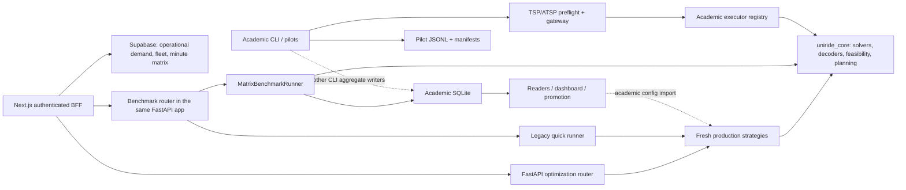

# One core for operational planning and academic benchmarking

Research snapshot: **2026-10-10**. Repository: UniRide. Goals: **G1** production/research coexistence; **G2** a possible municipal disability-paratransit service; **G3** publishable algorithm benchmarking. This is a research proposal, not implementation or approval of a new work package. UI and visual design are outside scope.

## Summary

- Keep canonical algorithms, objectives and feasibility in `uniride_core`; separate deployment, credentials, experiment configuration and result admission around it (A26; R40).
- Current campus routing is closest to heterogeneous school transport with fixed waves and multi-trip scheduling. A municipal service needs a full static/dynamic heterogeneous DARP contract; that contract is not present today (A7–A11; R1–R7).
- Typed capacity and CP-SAT day selection are implemented. Their optimality concerns the supplied route menu. Exact wave contracts exist, but the AMPL backend and `exact_reference_v1` execution remain planned (A7–A9, A24–A25).
- H8 still applies: the FastAPI app mounts academic benchmark workers and the matrix path writes academic SQLite. Authentication and row source labels have improved; neither provides process isolation (A3, A15–A18).
- Removing the router alone is insufficient: production still imports academic promoted-configuration code (A21).
- Current fair/native pilots provide useful provenance. Other writers allow missing protocol fields and can store an average as a raw run; dashboard inference is now disabled (A12–A20).
- Preserve fixed objective evaluations as the primary protocol, separately report native termination, and extend accounting explicitly for multi-route problems. Uninstrumented library search is ineligible for the primary comparison (A13, A26; R29–R39).
- ALNS with DARP schedule checks and route-pool recombination is a strong candidate to test. HGS/ILS are useful baselines, but CVRP success does not establish wheelchair-DARP correctness or municipal throughput (R14–R28).
- PyVRP has changed from HGS to ILS. Its development features and open ride-time/reload issues require a pinned-version capability trial; no inspected library is a verified turnkey fit for the complete UniRide contract (R21–R26).
- Google durations are seconds; Routes can include fractional seconds. Today's producer uses centi-minutes; approved T08 plans integer seconds and `time_scale=60` within the existing API range. Fractional Routes durations still need explicit normalization. Matrix rights and health-data duties affect publication (A10, A29; R45–R48, R54–R56).
- Implement Option 0's already planned isolation/provenance fixes first; recommend Option 1's separately deployed adapters around a versioned core. Reserve Option 2's dynamic job/event architecture for an approved municipal service model.
- Dataset rights and current classic-instance formats remain partly unresolved. Code/source inspection here certifies neither a live deployment nor published algorithm superiority.

## Findings table

All web sources were inspected on 2026-10-10. **VERIFIED** means the precise claim was seen in an opened source during this research, including delegated source inspection. It does not mean performance was replicated. Abstract-only verification is identified in the citation and supports only that narrow claim. Confidence concerns source support, not suitability for UniRide. **UNVERIFIED** and “unknown” retain unresolved fields. Mutable documentation must be pinned again before implementation.

| no | claim | source (full citation + DOI or URL) | source type (peer-reviewed / preprint / docs / blog) | confidence | VERIFIED? |
|---|---|---|---|---|---|
| R1 | DARP couples passenger pickup/delivery routing with schedules, capacities, windows and ride-time limits. | Jean-François Cordeau and Gilbert Laporte (2007). The Dial-a-Ride Problem: Models and Algorithms. Annals of Operations Research 153:29–46. [DOI 10.1007/s10479-007-0170-8](https://doi.org/10.1007/s10479-007-0170-8). Abstract. | peer-reviewed | high | VERIFIED |
| R2 | DARP taxonomy separates static/dynamic and deterministic/stochastic information; Tables 3 and 10–13 document historical instance sets and solution references. | Sin C. Ho, W. Y. Szeto, Yong-Hong Kuo, Janny M. Y. Leung, Matthew Petering and Terence W. H. Tou (2018). A Survey of Dial-a-ride Problems: Literature Review and Recent Developments. Transportation Research Part B 111:395–421. [DOI 10.1016/j.trb.2018.02.001](https://doi.org/10.1016/j.trb.2018.02.001); [author manuscript](https://hub.hku.hk/bitstream/10722/258567/1/Content.pdf), §§3–5, Tables 3, 10–13. | peer-reviewed | high | VERIFIED |
| R3 | SBRP includes stop selection, route generation, trip scheduling, bell times and fleet mix; routing and scheduling are distinct subproblems. | William A. Ellegood, Stanislaus Solomon, Jeremy North and James F. Campbell (2020). School Bus Routing Problem: Contemporary Trends and Research Directions. Omega 95:102056. [DOI 10.1016/j.omega.2019.03.014](https://doi.org/10.1016/j.omega.2019.03.014); [author PDF](https://profiles.umsl.edu/ws/portalfiles/portal/40305502/School%20Bus%20Routing%20Problem-Contemporary%20Trends.pdf), §§2.1.2–2.1.3. | peer-reviewed | high | VERIFIED |
| R4 | Demand-responsive bus systems differ by offline/online decisions, many-to-one/many-to-many service and door/stop service. | Pieter Vansteenwegen, Lissa Melis, Dilay Aktaş, Bryan David Galarza Montenegro, Fábio Sartori Vieira and Kenneth Sörensen (2022). A Survey on Demand-responsive Public Bus Systems. Transportation Research Part C 137:103573. [DOI 10.1016/j.trc.2022.103573](https://doi.org/10.1016/j.trc.2022.103573); [author manuscript](https://repository.uantwerpen.be/docman/irua/143c4f/a_survey_on_demand_responsive_public_bus_systems.pdf), classification framework. | peer-reviewed | high | VERIFIED |
| R5 | Multi-trip VRP permits several trips per physical vehicle; its formulations include trip scheduling rather than treating each trip as a new vehicle. | Diego Cattaruzza, Nabil Absi and Dominique Feillet (2016). Vehicle Routing Problems with Multiple Trips. 4OR 14:223–259. [DOI 10.1007/s10288-016-0306-2](https://link.springer.com/article/10.1007/s10288-016-0306-2). Abstract. | peer-reviewed | high | VERIFIED |
| R6 | Choosing when routes start is a separate decision in routing over time, including multi-trip routing. | A. Mor and M. G. Speranza (2020). Vehicle Routing Problems over Time: A Survey. 4OR 18:129–149. [DOI 10.1007/s10288-020-00433-2](https://doi.org/10.1007/s10288-020-00433-2); [author institution record](https://re.public.polimi.it/handle/11311/1191138). Abstract. | peer-reviewed | high | VERIFIED |
| R7 | A heterogeneous DARP can model multiple passenger types and reconfigurable capacities; this study combines LNS and set covering. | Oscar Augusto Tellez Sanchez, Samuel Vercraene, Fabien Lehuédé, Olivier Péton and Thibaud Monteiro (2018). The Fleet Size and Mix Dial-a-ride Problem with Reconfigurable Vehicle Capacity. Transportation Research Part C 91:99–123. [DOI 10.1016/j.trc.2018.03.020](https://doi.org/10.1016/j.trc.2018.03.020); [institutional abstract](https://orbi.uliege.be/handle/2268/256902). | peer-reviewed | high | VERIFIED |
| R8 | POSTECH publishes synthetic and real SBRP instances, solutions and comparisons under school windows and passenger ride limits. | POSTECH Logistics Lab; Junhyuk Park, Hyunchul Tae and Byung-In Kim. Mixed-load School Bus Routing Benchmark, [original benchmark page](https://logistics.postech.ac.kr/Mixed_SBRP_Benchmark.html), instance tables; [current SBRP host](https://logistics.postech.ac.kr/sbrp/). Inspected 2026-10-10; later fetches intermittent. | docs | medium | VERIFIED |
| R9 | The X set contains 100 CVRP instances with 100–1,000 customers, generated with varied spatial/demand features; it is a CVRP benchmark. | Eduardo Uchoa, Diego Pecin, Artur Pessoa, Marcus Poggi, Anand Subramanian and Thibaut Vidal (2017). New Benchmark Instances for the Capacitated Vehicle Routing Problem. European Journal of Operational Research 257(3):845–858. [DOI 10.1016/j.ejor.2016.08.012](https://doi.org/10.1016/j.ejor.2016.08.012); [author manuscript](https://optimization-online.org/wp-content/uploads/2014/10/4597.pdf), generation and results sections. | peer-reviewed | high | VERIFIED |
| R10 | Malheiros' MDHDARP repository defines 24 instances, 72–192 requests, 9–16 vehicles, four capacity resources, service/ride limits and pickup–delivery pairing. | Igor Malheiros, Instances-MDHDARP, [official README](https://github.com/igormalheiros/Instances-MDHDARP), Instance format. Related paper: Igor Malheiros, Rodrigo Ramalho, Bruno Passeti, Teobaldo Bulhões and Anand Subramanian (2021). A Hybrid Algorithm for the Multi-depot Heterogeneous Dial-a-Ride Problem. Computers & Operations Research 129:105196. [DOI 10.1016/j.cor.2020.105196](https://doi.org/10.1016/j.cor.2020.105196). | docs | high | VERIFIED |
| R11 | Real-demand ridesharing instances cover Chicago, New York and Washington; their long-horizon demand is much larger than classic DARP sets. | David Fiedler and Jan Mrkos (2023). Large-scale Ridesharing DARP Instances Based on Real Travel Demand. IEEE ITSC 2023; [author preprint, arXiv:2305.18859](https://arxiv.org/abs/2305.18859), [DOI 10.48550/arXiv.2305.18859](https://doi.org/10.48550/arXiv.2305.18859), instance-size discussion. | preprint | high | VERIFIED |
| R12 | The official ridesharing repository documents CSV/YAML/HDF5 inputs and solutions; dataset rights are CC BY 4.0, separate from GPL-3.0 repository code. | David Fiedler and Jan Mrkos, [Ridesharing_DARP_instances README](https://github.com/aicenter/Ridesharing_DARP_instances), Contents, Results and License, inspected 2026-10-10; [repository-linked dataset DOI 10.5281/zenodo.7986103](https://doi.org/10.5281/zenodo.7986103). README rights/format verified; version-specific Zenodo metadata not independently verified. | docs | high | VERIFIED |
| R13 | Current original-download schemas and dataset reuse licenses for classic Cordeau/Parragh/Braekers sets remain unresolved in this search. | R2 Table 3 supplies historical HEC, Vienna and Hasselt links; current fetches of the original hosts failed. No primary license or byte-level format specification was successfully verified. This row records a verification gap, not a claim that reuse is prohibited. | docs | low | UNVERIFIED |
| R14 | ALNS adapts destroy/repair operator selection for pickup-and-delivery routing with time windows. | Stefan Ropke and David Pisinger (2006). An Adaptive Large Neighborhood Search Heuristic for the Pickup and Delivery Problem with Time Windows. Transportation Science 40(4):455–472. [DOI 10.1287/trsc.1050.0135](https://doi.org/10.1287/trsc.1050.0135). Abstract. | peer-reviewed | high | VERIFIED |
| R15 | DARP-specific ALNS addresses schedule feasibility, including windows and ride times, with a constant-time feasibility-test construction. | Timo Gschwind and Michael Drexl (2019). Adaptive Large Neighborhood Search with a Constant-Time Feasibility Test for the Dial-a-Ride Problem. Transportation Science 53(2):480–491. [DOI 10.1287/trsc.2018.0837](https://doi.org/10.1287/trsc.2018.0837). Abstract; no implementation-speed replication here. | peer-reviewed | high | VERIFIED |
| R16 | DARP LNS can exchange routes with a column-generation/set-partitioning component. | Sophie N. Parragh and Verena Schmid (2013). Hybrid Column Generation and Large Neighborhood Search for the Dial-a-Ride Problem. Computers & Operations Research 40(1):490–497. [DOI 10.1016/j.cor.2012.08.004](https://doi.org/10.1016/j.cor.2012.08.004); [author manuscript](https://prolog.univie.ac.at/research/publications/downloads/Par_2013_510.pdf), abstract. | peer-reviewed | high | VERIFIED |
| R17 | Branch-cut-and-price uses a route-based master and resource-constrained pricing for PDPTW; passenger DARP requires additional schedule constraints. | Stefan Ropke and Jean-François Cordeau (2009). Branch and Cut and Price for the Pickup and Delivery Problem with Time Windows. Transportation Science 43(3):267–286. [DOI 10.1287/trsc.1090.0272](https://doi.org/10.1287/trsc.1090.0272). Formulation/abstract; DARP distinction also R1. | peer-reviewed | high | VERIFIED |
| R18 | Patient-transport DARP has a trip-based branch-price-and-cut formulation, showing exact-method relevance without a general municipal runtime guarantee. | Zhixing Luo, Mengyang Liu and Andrew Lim (2019 issue; online 2018). A Two-Phase Branch-and-Price-and-Cut for a Dial-a-Ride Problem in Patient Transportation. Transportation Science 53(1):113–130. [DOI 10.1287/trsc.2017.0772](https://pubsonline.informs.org/doi/abs/10.1287/trsc.2017.0772). Abstract. | peer-reviewed | high | VERIFIED |
| R19 | A unified HGS framework addresses multiple VRP attributes using a common search framework; this is not proof of native disability-DARP support. | Thibaut Vidal, Teodor Gabriel Crainic, Michel Gendreau and Christian Prins (2014). A Unified Solution Framework for Multi-Attribute Vehicle Routing Problems. European Journal of Operational Research 234(3):658–673. [DOI 10.1016/j.ejor.2013.09.045](https://doi.org/10.1016/j.ejor.2013.09.045); [CIRRELT-2013-22 manuscript](https://www.cirrelt.ca/documentstravail/cirrelt-2013-22.pdf), abstract/framework. | peer-reviewed | high | VERIFIED |
| R20 | HGS-CVRP is an open MIT-licensed CVRP implementation with SWAP*; the cited study/version must be distinguished from later code. | Thibaut Vidal (2022). Hybrid Genetic Search for the CVRP: Open-source Implementation and SWAP* Neighborhood. Computers & Operations Research 140:105643. [DOI 10.1016/j.cor.2021.105643](https://doi.org/10.1016/j.cor.2021.105643); [author preprint](https://arxiv.org/abs/2012.10384); [HGS-CVRP repository](https://github.com/vidalt/HGS-CVRP), References and License. | peer-reviewed | high | VERIFIED |
| R21 | OR-Tools exposes routing dimensions, paired jobs with explicit same-vehicle/precedence constraints, and initial-route solving; its license is Apache-2.0. | Google OR-Tools, [Pickups and Deliveries](https://developers.google.com/optimization/routing/pickup_delivery), [Dimensions](https://developers.google.com/optimization/routing/dimensions), [Common Routing Tasks](https://developers.google.com/optimization/routing/routing_tasks), and [repository/license](https://github.com/google/or-tools). Official docs/repository, inspected 2026-10-10. [Releases](https://github.com/google/or-tools/releases). | docs | high | VERIFIED |
| R22 | PyVRP documents vector loads, heterogeneous types, shipments and depot reloads; inspected feature docs are 1.0.0a0 development docs. License: MIT. | PyVRP contributors, [API](https://pyvrp.org/api/pyvrp.html), [Load and vehicle capacities](https://pyvrp.org/notebooks/load.html), [Shipments](https://pyvrp.org/notebooks/shipments.html), [Reloading](https://pyvrp.org/notebooks/reloading.html), [MIT license](https://github.com/PyVRP/PyVRP/blob/main/LICENSE.md), inspected 2026-10-10. | docs | high | VERIFIED |
| R23 | PyVRP changed from HGS to ILS in 0.13.0. Maximum ride duration and shipments across reload depots remain open requests at inspection. | PyVRP, [Benchmark history](https://pyvrp.org/setup/benchmarks.html), version table/footnote 1; [issue #1097](https://github.com/PyVRP/PyVRP/issues/1097), Max ride duration; [issue #1149](https://github.com/PyVRP/PyVRP/issues/1149), Allow shipments across reload depots, inspected 2026-10-10. | docs | high | VERIFIED |
| R24 | VROOM supports shipments, capacity vectors, skills, windows and custom matrices; vehicle max travel time is not passenger max ride time. Plan mode softens constraints. | VROOM Project, [API.md](https://github.com/VROOM-Project/vroom/blob/master/docs/API.md), shipments, vehicles, matrices and Plan mode; [repository](https://github.com/VROOM-Project/vroom), [BSD-2-Clause license](https://raw.githubusercontent.com/VROOM-Project/vroom/master/LICENSE), inspected 2026-10-10. [Releases](https://github.com/VROOM-Project/vroom/releases). | docs | high | VERIFIED |
| R25 | jsprit documents rich VRP, heterogeneous fleets, pickup/delivery and time-dependent costs, capacity dimensions/skills and extensible constraints. License: Apache-2.0. | GraphHopper, [jsprit README](https://github.com/graphhopper/jsprit), [Features](https://github.com/graphhopper/jsprit/blob/master/docs/Features.textile), and [package versions](https://github.com/graphhopper/jsprit/packages/2409416/versions), inspected 2026-10-10. DARP advertisement does not verify every required passenger constraint. | docs | high | VERIFIED |
| R26 | Timefold's open solver is a constraint-modelling framework with VRP quickstarts; implementing a complete DARP model remains application work. License: Apache-2.0. | Timefold, [solver repository](https://github.com/TimefoldAI/timefold-solver), [quickstarts](https://github.com/TimefoldAI/timefold-quickstarts), [releases](https://github.com/timefoldai/timefold-solver/releases), [license](https://raw.githubusercontent.com/TimefoldAI/timefold-solver/main/LICENSE.txt), inspected 2026-10-10. | docs | high | VERIFIED |
| R27 | Learned repair can be embedded in LNS; the inspected NLNS paper evaluates CVRP/SDVRP rather than wheelchair DARP. | André Hottung and Kevin Tierney (2020). Neural Large Neighborhood Search for the Capacitated Vehicle Routing Problem. ECAI 2020. [Conference paper](https://ecai2020.eu/papers/786_paper.pdf); [author preprint](https://arxiv.org/abs/1911.09539), abstract. Preprint first posted 2019. | peer-reviewed | high | VERIFIED |
| R28 | A recent neural deconstruction policy works with greedy insertion; its claimed results concern the tested routing variants, not municipal paratransit. | André Hottung, Paula Wong-Chung and Kevin Tierney (2025). Neural Deconstruction Search for Vehicle Routing Problems. [arXiv:2501.03715v2](https://arxiv.org/html/2501.03715v2), [DOI 10.48550/arXiv.2501.03715](https://doi.org/10.48550/arXiv.2501.03715). Author version, abstract/problem definitions; arXiv notes TMLR publication. | preprint | high | VERIFIED |
| R29 | Optimization experiments need clear instances, algorithm/configuration, computing environment, randomness and termination reporting. | Graham Kendall, Ruibin Bai, Jacek Błazewicz, Patrick De Causmaecker, Michel Gendreau, Robert John, Jiawei Li, Barry McCollum, Erwin Pesch, Rong Qu, Nasser Sabar, Greet Vanden Berghe and Angelina Yee (2016). Good Laboratory Practice for Optimization Research. Journal of the Operational Research Society 67(4):676–689. [DOI 10.1057/jors.2015.77](https://doi.org/10.1057/jors.2015.77); [full author PDF](https://www.graham-kendall.com/papers/ketal2016.pdf), experimental-design guidance. | peer-reviewed | high | VERIFIED |
| R30 | VRP testing must align problem definitions/objectives, representative instances, strong baselines, repeated-run averages and computational limits. | Luca Accorsi, Andrea Lodi and Daniele Vigo (2022). Guidelines for the Computational Testing of Machine Learning Approaches to Vehicle Routing Problems. Operations Research Letters 50(2):229–234. [DOI 10.1016/j.orl.2022.01.018](https://doi.org/10.1016/j.orl.2022.01.018); [author preprint](https://arxiv.org/pdf/2109.13983), §2. | peer-reviewed | high | VERIFIED |
| R31 | Matched dataset comparisons can use Wilcoxon for two algorithms or Friedman with post-hoc comparisons for several; experimental-unit assumptions matter. | Janez Demšar (2006). Statistical Comparisons of Classifiers over Multiple Data Sets. Journal of Machine Learning Research 7:1–30. [Official paper](https://www.jmlr.org/papers/volume7/demsar06a/demsar06a.pdf). Methodological transfer to routing requires a justified matched design. | peer-reviewed | high | VERIFIED |
| R32 | All-pairwise post-hoc comparisons need a declared family and multiplicity control; Holm is among the evaluated procedures. | Salvador García and Francisco Herrera (2008). An Extension on “Statistical Comparisons of Classifiers over Multiple Data Sets” for All Pairwise Comparisons. Journal of Machine Learning Research 9:2677–2694. [Official paper](https://www.jmlr.org/papers/volume9/garcia08a/garcia08a.pdf). | peer-reviewed | high | VERIFIED |
| R33 | Bayesian comparison can report posterior probabilities and a region of practical equivalence; significance and practical importance differ. | Alessio Benavoli, Giorgio Corani, Janez Demšar and Marco Zaffalon (2017). Time for a Change: A Tutorial for Comparing Multiple Classifiers Through Bayesian Analysis. Journal of Machine Learning Research 18(77):1–36. [Official paper](https://www.jmlr.org/papers/volume18/16-305/16-305.pdf). | peer-reviewed | high | VERIFIED |
| R34 | Common random numbers are a deliberately constructed variance-reduction/comparison design. | Wei-Ning Yang and Barry L. Nelson (1991). Using Common Random Numbers and Control Variates in Multiple-Comparison Procedures. Operations Research 39(4):583–591. [DOI 10.1287/opre.39.4.583](https://pubsonline.informs.org/doi/10.1287/opre.39.4.583). Abstract. | peer-reviewed | high | VERIFIED |
| R35 | Performance profiles summarize relative performance distributions over a problem set for a chosen metric. | Elizabeth D. Dolan and Jorge J. Moré (2002). Benchmarking Optimization Software with Performance Profiles. Mathematical Programming 91:201–213. [DOI 10.1007/s101070100263](https://link.springer.com/article/10.1007/s101070100263); [open preprint](https://arxiv.org/abs/cs/0102001). | peer-reviewed | high | VERIFIED |
| R36 | IOHprofiler separates fixed-budget quality from fixed-target runtime and logs objective-evaluation traces. | IOHprofiler, [Background: Performance Measures](https://iohprofiler.github.io/Background), inspected 2026-10-10. Carola Doerr, Furong Ye, Naama Horesh, Hao Wang, Ofer M. Shir and Thomas Bäck (2020). Benchmarking Discrete Optimization Heuristics with IOHprofiler. Applied Soft Computing 88:106027. [DOI 10.1016/j.asoc.2019.106027](https://doi.org/10.1016/j.asoc.2019.106027). | docs | high | VERIFIED |
| R37 | COCO supplies testbeds, experiment templates and result processing for continuous black-box optimization. | Nikolaus Hansen, Anne Auger, Raymond Ros, Olaf Mersmann, Tea Tušar and Dimo Brockhoff (2021). COCO: A Platform for Comparing Continuous Optimizers in a Black-Box Setting. Optimization Methods and Software 36(1):114–144. [DOI 10.1080/10556788.2020.1808977](https://doi.org/10.1080/10556788.2020.1808977); [official platform](https://coco-platform.org/). | peer-reviewed | high | VERIFIED |
| R38 | DIMACS CVRP uses a feasibility controller, enforced time limits and primal-integral scoring; its final phase used competition machines and hidden instances. | DIMACS, 12th Implementation Challenge, CVRP track (rules finalized 2021; competition concluded 2022), [official rules summary](https://dimacs.rutgers.edu/programs/implementation-challenges/vehicle-routing/implementation-challenge-vehicle-routing/capacitated-vrp/), Algorithm Evaluation/Input/Output; [CVRPController](https://github.com/laser-ufpb/CVRPController). Surviving HTML verified; linked detailed PDF unavailable. | docs | high | VERIFIED |
| R39 | ML4CO separates public training/validation and hidden test instances, controls hardware/time, and evaluates primal/dual progress rather than routing-specific quality. | Maxime Gasse et al. (2022). The Machine Learning for Combinatorial Optimization Competition (ML4CO): Results and Insights. Proceedings of Machine Learning Research 176:220–231. [Official paper](https://proceedings.mlr.press/v176/gasse22a/gasse22a.pdf), §§2–3; [official data repository](https://github.com/ds4dm/ml4co-competition/blob/main/DATA.md). | peer-reviewed | high | VERIFIED |
| R40 | Ports and adapters lets batch/test and production inputs drive the same application while isolating database/device dependencies. | Alistair Cockburn (2005), Hexagonal architecture, HaT Technical Report 2005.02, Intent and Nature of the Solution. [Source](https://alistair.cockburn.us/hexagonal-architecture) | blog | high | VERIFIED |
| R41 | MLflow separates run metadata (IDs, parameters, metrics, tags, times) in its backend store from artifacts; PostgreSQL is supported. Deletion/restoration exists, so immutability is not intrinsic. | MLflow, Backend Stores, metadata, database types and Deletion Behavior (accessed 2026-10-10). [Source](https://mlflow.org/docs/latest/self-hosting/architecture/backend-store/) | docs | high | VERIFIED |
| R42 | DVC experiments execute tracked pipelines and queued/temp runs use isolated workspace copies sharing a cache; isolation is not separate production compute capacity. | DVC, Running Experiments, Running pipelines and How are experiments isolated? (accessed 2026-10-10). [Source](https://doc.dvc.org/user-guide/experiment-management/running-experiments) | docs | high | VERIFIED |
| R43 | Sacred observers record configuration/root seed, source hashes, package versions, host information and artifacts. | Sacred, Observing an Experiment, Started event and Artifact event (accessed 2026-10-10). [Source](https://sacred.readthedocs.io/en/latest/observers.html) | docs | high | VERIFIED |
| R44 | W&B offline mode continues local logging while stopping cloud syncing; disabled mode stops logging and syncing. | Weights & Biases, wandb disabled, official documentation source, Description (accessed 2026-10-10). [Source](https://raw.githubusercontent.com/wandb/docs/main/models/ref/cli/wandb-disabled.mdx) | docs | high | VERIFIED |
| R45 | Legacy Distance Matrix duration.value and duration_in_traffic.value are seconds; traffic estimates depend on driving/departure time and traffic availability. | Google Maps Platform, Distance Matrix API (Legacy) request and response, duration and duration_in_traffic (accessed 2026-10-10). [Source](https://developers.google.com/maps/documentation/distance-matrix/distance-matrix) | docs | high | VERIFIED |
| R46 | Routes computeRouteMatrix duration/staticDuration are protobuf Duration strings in seconds with up to nine fractional digits; traffic-aware duration can differ from staticDuration. | Google Maps Platform, Method: computeRouteMatrix, RouteMatrixElement (accessed 2026-10-10). [Source](https://developers.google.com/maps/documentation/routes/reference/rest/v2/TopLevel/computeRouteMatrix) | docs | high | VERIFIED |
| R47 | Compute Route Matrix limits elements per request: 625 for non-transit, 100 for transit or TRAFFIC_AWARE_OPTIMAL; errors may be per element. | Google Maps Platform, Get a route matrix, Request limits and responses (accessed 2026-10-10). [Source](https://developers.google.com/maps/documentation/routes/compute_route_matrix) | docs | high | VERIFIED |
| R48 | Routes API content has caching restrictions with a place-ID exception; its policies defer to the applicable agreement. | Google Maps Platform, Policies and attributions for Routes API, Policies and Exceptions from caching restrictions (accessed 2026-10-10). [Source](https://developers.google.com/maps/documentation/routes/policies) | docs | high | VERIFIED |
| R49 | A rolling-horizon event-based MILP integrates arriving requests into operated routes; its abstract reports tests with more than 500 requests. This is study-specific performance, not a municipal guarantee. | Daniela Gaul, Kathrin Klamroth and Michael Stiglmayr (2021), Solving the Dynamic Dial-a-Ride Problem Using a Rolling-Horizon Event-Based Graph, ATMOS 2021, OASIcs 96, 8:1-8:16, abstract. DOI 10.4230/OASIcs.ATMOS.2021.8. [Source](https://doi.org/10.4230/OASIcs.ATMOS.2021.8) | peer-reviewed | high | VERIFIED |
| R50 | Access Services operates an operations monitoring centre for ETA, no-show and disruption assistance; its rider FAQ describes cancellations and vehicle tracking. Its solver algorithm is not disclosed here. | Access Services, Operations Monitoring Center and FAQ's, rider assistance/reservations/no-show sections (accessed 2026-10-10). [Source](https://accessla.org/operations-monitoring-center.html); [Additional official source](https://accessla.org/about_us/faqs.html) | docs | high | VERIFIED |
| R51 | US FTA guidance distinguishes missed trips beyond a rider's control from sanctionable patterns; late cancellations can have no-show operational impact. | Federal Transit Administration, May a transit agency suspend service to paratransit customers who fail to show up for their scheduled pickups? (accessed 2026-10-10). [Source](https://www.transit.dot.gov/faq/civil-rights-ada/may-transit-agency-suspend-service-paratransit-customers-who-fail-show-their) | docs | high | VERIFIED |
| R52 | US FTA guidance requires boarding/disembarking assistance and says transferring from wheelchair to seat is the rider's choice. | Federal Transit Administration, Questions and Answers Concerning Wheelchairs and Bus and Rail Service, Assistance and transfer sections (accessed 2026-10-10). [Source](https://www.transit.dot.gov/regulations-and-guidance/civil-rights-ada/questions-and-answers-concerning-wheelchairs-and-bus-and) | docs | high | VERIFIED |
| R53 | US FTA guidance compares paratransit trip length with the comparable fixed-route journey; it does not supply one universal ride-time cap. | Federal Transit Administration, At what point is a paratransit ride no longer comparable to fixed route based on the time spent traveling? (accessed 2026-10-10). [Source](https://www.transit.dot.gov/what-point-paratransit-ride-no-longer-comparable-fixed-route-based-time-spent-traveling) | docs | high | VERIFIED |
| R54 | KVKK Law 6698 identifies health data as special-category data. Article 6 processing conditions and Article 9 overseas-transfer rules were amended in 2024. | Türkiye Personal Data Protection Authority, Personal Data Protection Law No. 6698, Articles 4, 6, 9 and 12, consolidated English text (accessed 2026-10-10). [Source](https://www.kvkk.gov.tr/Icerik/6649/Personal-Data-Protection-Law) | docs | high | VERIFIED |
| R55 | GDPR provides data minimisation, special-category health-data restrictions, privacy/security duties and risk-based DPIAs; research safeguards do not erase these duties. | European Parliament and Council (2016), Regulation (EU) 2016/679, Articles 5, 6, 9, 25, 32, 35, 89 and Recital 26, EUR-Lex (accessed 2026-10-10). [Source](https://eur-lex.europa.eu/eli/reg/2016/679/oj/eng) | docs | high | VERIFIED |
| R56 | Zenodo assigns record DOIs; versioning creates linked records with distinct files/identifiers. Licences are explicit and software/data can differ. | Zenodo, About records; Manage versions; Licenses and rights (accessed 2026-10-10). [Source](https://help.zenodo.org/docs/deposit/about-records/); [Additional official source](https://help.zenodo.org/docs/deposit/manage-versions/); [Additional official source](https://help.zenodo.org/docs/deposit/describe-records/licenses/) | docs | high | VERIFIED |
| R57 | PyVRP's separate CLI benchmark instructions specify instance sets, rounding, runtime scaling, seeds, single-core runs and versioned BKS references. | PyVRP contributors, [Benchmarking](https://pyvrp.org/dev/benchmarking.html), official 1.0.0a0 documentation, inspected 2026-10-10. PDPTW benchmark objective is distance only, unlike classical fleet-first comparisons. | docs | high | VERIFIED |
| R58 | The classical DARP has a mixed-integer formulation with capacity, duration, time-window, pairing, precedence and ride-time constraints. | Jean-François Cordeau (2006). A Branch-and-Cut Algorithm for the Dial-a-Ride Problem. Operations Research 54(3):573–586. [DOI 10.1287/opre.1060.0283](https://pubsonline.informs.org/doi/10.1287/opre.1060.0283). Publisher abstract verified; full author PDF blocked. | peer-reviewed | high | VERIFIED |

## RQ1 — Problem classification

### What the sources say

DARP jointly chooses passenger routes and schedules; pickup and delivery belong to the same request, with precedence, windows, capacity and ride-time constraints (R1). SBRP adds school-oriented routing and reuse of trips against school times (R3). Heterogeneous DARP distinguishes passenger resources and vehicle configurations (R7). Multi-trip routing schedules several trips on the same vehicle (R5–R6).

The recent surveys inspected cover SBRP (2020), routing over time (2020) and demand-responsive buses (2022), alongside the foundational DARP surveys (2007, 2018). They address overlapping families, not one interchangeable model (R1–R6). This search did not establish a newer comprehensive DARP survey as a replacement for R2.

Cordeau's classical mixed-integer formulation is a standard starting point (R58); route-based masters/pricing offer an alternative (R16–R18). The map below summarizes decision/constraint families, rather than reproducing a full MIP:

| Family | Standard decisions and constraints | Sources |
|---|---|---|
| DARP | Vehicle arcs/assignment; pickup before delivery on the same vehicle; schedule propagation with travel/service/waiting; windows; onboard load; passenger ride-time limit under the declared convention | R58; service-start/departure conventions must be stated, as R12 illustrates |
| Heterogeneous/fleet-mix DARP | Add resource-specific loads/capacities, compatible vehicle types and possibly configuration choices; vehicle selection and routing are coupled | R7 |
| SBRP | Assign stops/students to school trips, route them within school/ride limits, then schedule compatible trips on buses | R3, R8 |
| Multi-trip VRP | Link trips to physical vehicles, with departure/return timing, shift bounds and inter-trip availability | R5–R6 |
| Route-based master | Select feasible routes/trips to cover requests; pricing generates resource-feasible columns. A restricted route pool is not a proof over all possible routes | R16–R18 |

### Our interpretation

Use **heterogeneous, ride-time-constrained school transport with fixed pickup/dropoff waves and multi-trip fleet scheduling** for today's campus profile (confirmed in code: A2, A7–A10). A wave is a many-to-one or one-to-many passenger-routing restriction. Calling current code a full paired DARP would overstate A11; morning and return legs do not supply a general paired-request/onboard scheduling interface.

For a municipality, use **heterogeneous DARP with time windows**, adding multi-depot/multi-trip operation only when the service actually requires it. Advance booking can start as static DARP; re-optimisation after new bookings, cancellations or traffic events makes it dynamic. Stochastic forecasts are a further modelling choice, not implied by calling Google (R2, R4). Preserve the campus profile and objective; version a new municipal profile rather than silently widening its meaning.

## RQ2 — Instances, libraries and publication

### What the sources say

“Requests,” “customers,” “stops” and graph vertices are different size measures. A paired DARP request normally introduces pickup and delivery visits; X filenames include the depot. Historical BKS tables are not current optimality certificates (R1–R2, R9, R38).

| Family / public set | Verified size range | Format | Published reference solutions | Dataset license / limitation | Sources |
|---|---|---|---|---|---|
| Cordeau–Laporte (2003); Cordeau (2006); Ropke et al. (2007) DARP | Respectively 20 instances, 24–144 requests/3–13 vehicles; 24, 16–48/2–4; 24, 40–96/5–8 | Historical text-instance hosts identified; current byte-level schema not verified | Published solution tables in the 2018 survey; current BKS not refreshed | Unknown; obtain original data/rights before redistribution | R2 Table 3, R13 |
| Parragh (2011) HDARP; Braekers et al. (2014) HDARP/MD-HDARP | HDARP base families: 16–48 and 40–96 requests; multi-depot family: 72 instances, 16–96 requests | Historical heterogeneous extensions; original schema not verified here | Survey compares published results; current downloadable solutions not verified | Unknown; do not infer rights from a solver license | R2 Tables 3, 12–13, R13 |
| Malheiros et al. (2021) MDHDARP | 24 instances; 72–192 requests, 9–16 vehicles | Text: vehicle/resource records and paired pickup/delivery nodes; four load resources, windows, service and ride limits | Paper results; current BKS solution-file registry not verified | Unknown; repository availability is not a dataset license | R10 |
| POSTECH mixed-load SBRP | 48 synthetic cases; synthetic settings include 250–2,000 stops and 6–100 schools; real cases also offered | Dataset-specific school/stop/vehicle inputs; verify downloaded schema before writing an importer | Host publishes solutions/comparisons; distinguish bounds and feasible solutions | Unknown; later host fetches intermittent | R8 |
| CVRPLIB/X CVRP | 100 instances, 100–1,000 customers | TSPLIB95/VRPLIB-style coordinates, capacity, demands and depot; X uses rounded Euclidean costs | BKS and proved-optimum information are maintained separately | Dataset reuse license not verified | R9, R38 |
| Fiedler–Mrkos real-demand ridesharing | 96 instances; a reported full-day case has 198,727 requests over 16 hours. This is demand volume, not solver capacity | Requests/vehicles CSV, config YAML, shared HDF5 travel-time matrix; legacy alternatives documented | Insertion and vehicle-group-assignment results; not a universal global optimum | README specifies CC BY 4.0 data; GPL-3.0 code separately | R11–R12 |
| Public disability-paratransit request data | No request-level ADA/wheelchair service dataset with verified rights, format and BKS established in this search | Unresolved | Unresolved | R12's current schema includes optional accessibility fields; this does not verify those attributes in the 2023 real-demand release | R12; bounded search limitation |

CVRPLIB/DIMACS provide interoperable instance/solution formats and separate feasibility/optimality information (R9, R38). Zenodo supports DOI-bearing versioned records and explicit, potentially different software/data licenses (R56).

### Our interpretation

Use classic DARP/HDARP to test scheduling and resource semantics, SBRP to test anchors and trip reuse, and X to test a CVRP component. None alone validates the complete municipal model. Pin raw bytes, parser version, matrix rounding, objective and the date/source of each BKS. The changing R12 README and the versioned 2023 dataset must not be treated as identical specifications.

Publish a **UniRide instance profile** with a human-readable specification, JSON manifest/schema, requests and typed vehicles in CSV/JSON, and a checksum-bound directed matrix (CSV for small cases, a documented binary format for larger ones). Include units, time origin/zone, occurrence IDs distinct from physical locations, service-time and ride-time conventions, anchor/cooldown rules, capacities, objective order and accepted solution format. Provide a deterministic generator, independent validator, illustrative valid/invalid solutions and per-instance reference status.

Generate synthetic demand from approved aggregated spatial/time/resource distributions; sample new households, trips and service attributes rather than perturbing identifiable home/medical records. Assess disclosure risk separately: “synthetic” is not itself a privacy proof (R54–R55). Release versioned immutable input/result bundles under a Zenodo DOI; link rather than repackage data with unresolved rights. Propose CC BY 4.0 for newly owned benchmark data and a permissive code license for the generator/validator, subject to owner rights. Google-derived matrices need separate reuse review (R48); prefer independently publishable synthetic/open-network matrices for the public family.

## RQ3 — Scalable algorithms and open implementations

### What the sources say

The evidence supports several complementary methods, not one verified winner for this exact service:

| Method | Supported role | Limit of the evidence |
|---|---|---|
| DARP ALNS / LNS | Adaptive destroy/repair with passenger schedule feasibility; efficient feasibility checks matter (R14–R15) | PDPTW operators alone do not establish ride-time correctness |
| LNS plus route pool/master | Recombine feasible routes using set partitioning/covering; heterogeneous configuration and route selection can be coupled (R7, R16) | Optimality of a restricted pool is conditional on that pool |
| HGS / ILS | Population/diversity or perturbation/local-search frameworks for rich VRP; maintained CVRP implementations are available (R19–R23) | HGS-CVRP and current PyVRP are different algorithms; CVRP results are not DARP results |
| Exact / lower bounds | Branch-cut-and-price, trip enumeration and resource-constrained pricing; useful on bounded instances (R17–R18) | Full pricing/completeness is needed for a valid global bound; a generic compact model is not a municipal latency guarantee |
| Rolling horizon | Update unfinished routes as requests arrive; an event-based study reports more than 500 requests (R49) | Study-specific instances/hardware/constraints, not evidence for UniRide throughput |
| Learned destroy/repair | Embed a neural policy inside a feasibility-controlled search (R27–R28); ML4CO demonstrates learned solver components (R39) | No complete municipal wheelchair-DARP implementation was validated here |

**Library capability snapshot.** N = documented native building block; C = custom modelling/extension; U = complete feature not verified. These are API-documentation findings, not integration tests. Seat-resource vectors can encode Sw, So and a separate total dimension; accessibility equipment, passenger identity and service policy still need explicit modelling.

| Library / license / maintenance evidence | Directed inputs; pairs/windows | Seat classes / accessibility | Maximum passenger ride time | Multi-trip physical vehicle | Sources |
|---|---|---|---|---|---|
| OR-Tools / Apache-2.0 / active official releases | N callbacks/dimensions; explicit pair constraints | N multiple dimensions; C compatibility/service model | C pair-specific time-cumul inequality and schedule semantics | C trip/reload modelling and physical-vehicle scheduling | R21 |
| PyVRP / MIT / active releases; inspected docs **1.0.0a0**, latest benchmarked version **0.14.0** | N matrices, shipments, windows in inspected docs | N vector loads/types; C detailed equipment/layout policy | Open request #1097; U native support | N depot reloads; shipments crossing reloads remain open #1149; C UniRide cooldown/day assignment | R22–R23 |
| VROOM / BSD-2-Clause / active releases | N custom matrices, shipments, windows | N amount vectors/skills; C equipment/service translation | U passenger-specific ride constraint; vehicle `max_travel_time` is different | U turnkey multi-trip; C external scheduling/solver extension | R24 |
| jsprit / Apache-2.0 / GraphHopper-maintained Java toolkit | N custom/time-dependent costs, pairs, windows | N capacity dimensions/skills; C passenger policy | U complete required ride-time enforcement; C custom constraints | U turnkey day reuse/cooldowns | R25 |
| Timefold Solver / Apache-2.0 / active Java releases | C routing cost/model; quickstarts supply simpler VRP models | C domain/constraint model | C passenger schedule model | C trip/shift/cooldown model | R26 |

Do not equate a project's “DARP” advertisement with every passenger constraint. VROOM Plan mode treats constraints as soft, so it is unsuitable as an authoritative feasible-plan certificate (R24). PyVRP's benchmark history explicitly changed stopping rules after its HGS-to-ILS switch; comparing releases without their protocol would misattribute performance differences (R23).

### Our interpretation

Keep the GA split campus baseline. For a municipal trial, first compare **DARP-aware insertion + ALNS**, then a feasible-route pool/master for advance bookings or overnight planning. Use rolling horizons, time/spatial candidate restriction and boundary repair to bound online work; partitioning is a heuristic restriction and can lose cross-boundary combinations. Revalidate the assembled whole plan.

Trial OR-Tools as a modelling/reference adapter and pinned PyVRP as a rich-VRP/native-runtime baseline. Require tiny asymmetric/non-metric fixtures, paired same-vehicle/precedence tests, service/waiting-aware ride limits, Sw/So/total loads, route duration and physical trip reuse before accepting either. A library that cannot enforce a hard passenger constraint during search needs an extension; rejecting its final plan alone does not make it a usable DARP solver.

Measure the largest **concurrent horizon**, latency deadline, cancellation latency and feasible-incumbent rate, as well as requests/day. No inspected source establishes a universal “thousands/day in X seconds” guarantee. Delay learned operators until the deterministic validator, strong baseline and held-out distributions exist (R27–R30, R39). Avoid rewriting the core merely to adopt an algorithm label.

## RQ4 — Fair benchmarking

### What the sources say

Objective evaluations and wall-clock time answer different questions. IOHprofiler uses fixed-budget quality and fixed-target runtime; COCO packages repeatable testbeds/experiments. DIMACS instead externally checks incumbent feasibility, records time and terminates the process, scoring anytime quality through a primal integral (R36–R38). These are complementary precedents, not a universal mandate for evaluation budgets.

VRP guidelines stress identical problem/objective semantics, representative instances, strong baselines, repeated-run averages and computational limits. General optimization guidance adds source/configuration/environment/randomness/termination disclosure (R29–R30). PyVRP's harness specifies rounding, runtime scaling, seeds, one-core execution and BKS references; its PDPTW benchmark minimizes distance rather than the classical fleet-first objective (R57).

Demšar's matched-dataset framework supports Friedman/post-hoc or paired Wilcoxon only for the appropriate experimental units; García–Herrera addresses multiplicity control (R31–R32). Bayesian methods express uncertainty and practical equivalence rather than treating a non-significant p-value as equality (R33). Common random numbers require a deliberate shared-randomness design (R34). Performance profiles report distributions across instances for a declared metric (R35). ML4CO separates training/validation/hidden tests and fixes hardware/time (R39).

### Our interpretation

Retain UniRide's primary fixed-evaluation and separate native protocols (confirmed in code: A13; requirement from docs only: A26). The existing evaluation unit is a **complete closed-tour objective**, including initialization, search, enabled polish and adapter recomputations (`ACADEMIC_FAIRNESS_PROTOCOL_DESIGN.md:46-62`, from docs only). It cannot be silently applied to a DARP route set. Define and approve a versioned complete-plan scoring/accounting rule, including delta-derived scored candidates, before a fair vehicle-routing campaign. Record auxiliary feasibility/repair/pricing work and runtime; equal scored-candidate budgets do not equalize all computational effort.

Equal numeric seeds provide replay and grouping, not automatic run-by-run statistical pairing: algorithms consume RNG streams differently. Generate independent replicates with the existing stable seed derivation. Match **instances or shared exogenous demand/traffic traces**, then state how repeated-run summaries form observations. Separate training/tuning and held-out test distributions; charge tuning and learned-model training explicitly.

Follow the approved distinction: independent distributions on one instance use justified Kruskal–Wallis and Mann–Whitney with Holm; genuinely matched cross-instance data may use Friedman and paired post-hoc comparisons (`ACADEMIC_STUDY_UNIFICATION_DESIGN.md:322-335`, from docs only). Predeclare the comparison family, tails, exclusions and sample-size rationale. Report objective differences, uncertainty intervals and an appropriate paired or independent effect size. A Bayesian hierarchical/ROPE analysis can supplement this after defining a service-relevant practical threshold; do not copy classifier accuracy thresholds.

Publish per-run observations and quality/evaluation/time traces. Include infeasible, failed and timed-out runs; never convert them to zero cost or an average disguised as one observation. Separate feasibility and fleet-count outcomes before duration comparisons. Profiles and primal-integral metrics require declared targets, reference costs and failure handling; they must not erase lexicographic priorities. Smoke/pilot runs remain descriptive.

## RQ5 — One core, separate operational and research adapters

### What the sources say

Ports and adapters lets production, batch and test inputs drive an application through independent adapters (R40). Concrete open projects demonstrate pieces of this pattern: OR-Tools' examples are clients of its routing library (R21); PyVRP exposes a library and separate benchmark CLI (R22, R57); IOHprofiler provides evaluator/logger/analysis machinery (R36). None was verified here as a complete dual-deployment municipal paratransit product.

| Tracking option | Verified capability | Interpretation for UniRide |
|---|---|---|
| MLflow | Backend metadata separate from artifacts; PostgreSQL supported; runs can be deleted/restored (R41) | Useful optional experiment index; immutability needs admission/permission policy |
| DVC | Tracked pipelines/data and isolated experiment workspaces sharing a cache (R42) | Useful for datasets/generators; workspace isolation does not isolate production CPU |
| Sacred | Configuration/root seed, source hashes, packages, host and artifacts via observers (R43) | Small research runner option; not a production/research security boundary |
| Weights & Biases | Offline logs locally without cloud sync; disabled mode stops logging (R44) | Optional research-only tracking; assess external data transfer before enabling sync |
| Plain PostgreSQL + artifacts | Local design proposal, not a new source-verified existing capability | Enforce the approved run contract directly; avoid a new tracking dependency until its need is demonstrated |

### Our interpretation

One core means **one owned implementation and validator contract**, not one process, dependency environment, database or registry allowlist. Package/version `uniride_core`; production and research may pin different released versions, recording the exact build. Core code accepts frozen problems, explicit solver configuration, RNG and budget/cancellation ports. Supabase, Google, academic manifests, trackers and file paths stay in adapters.

Separate production and academic entrypoints, deployment environments, compute quotas, credentials and stores. Use explicit registries/capabilities keyed by implementation, problem and protocol version; academic registration must not expose a production API. Keep backend selection and production approval distinct. Feature flags may select deployed functionality, but must not silently relax constraints or supply unrecorded research parameters.

Make validated **raw run admission** append-only: mandatory protocol, problem/matrix hash, seed/group, configuration, objective order, budget/usage, implementation/backend, commit/environment and validation status. Keep aggregates in separate views/artifacts. Updates to BKS/reference status should create linked revisions, preserving earlier evidence. Neither JSON metadata nor MLflow alone enforces this.

Promotion should export a reviewed, checksum-bound neutral configuration artifact that a production-owned adapter validates; production must not import the academic configuration loader (confirmed leak: A21). Start with the existing manifest/JSONL machinery and planned ResultStore v2. Add MLflow or DVC only for a demonstrated tracking/data-versioning gap, with no operational health data in research trackers.

## RQ6 — Real-time operations and matrix semantics

### What the sources say

Access Services' monitoring centre assists with ETAs, no-shows and disruptions, and its rider guidance describes cancellation and tracking. Those sources disclose operational practice, not the underlying solver (R50). FTA guidance distinguishes missed trips outside a rider's control from patterns eligible for sanctions (R51). Rolling-horizon DARP research integrates new requests with routes already under execution; OR-Tools demonstrates solving from initial routes and bounded search (R49, R21).

| Google interface | Verified duration semantics | Operational implication |
|---|---|---|
| Distance Matrix API (Legacy) | `duration.value` and `duration_in_traffic.value` are seconds; traffic estimates require the documented driving/departure-time conditions | Retain numeric values and traffic/departure provenance, not formatted text (R45) |
| Routes `computeRouteMatrix` | `duration`/`staticDuration` are protobuf Duration strings, seconds with up to nine fractional digits | Parse units explicitly; “Google always returns integer seconds” is too broad (R46) |
| Routes limits | Up to 625 non-transit elements; 100 for transit or `TRAFFIC_AWARE_OPTIMAL`; per-element failures possible | Batch, deduplicate and validate completeness before freezing a solve input (R47) |
| Routes reuse | Caching restrictions and exceptions are governed by the applicable agreement | A documentation-page license does not authorize publication of returned matrices (interpretation from R48) |

### Our interpretation

Define a core solve request with: versioned problem/profile; state time; vehicle locations and onboard passengers; immutable committed prefix; unserved/cancelled request states; deterministic matrix snapshot or departure-time model; incumbent; explicit configuration; and budget/cancellation context. Return the best independently feasible incumbent, timings, termination reason, served/unserved reasons and input/validation hashes. Core execution should not call Google or Supabase.

Warm-start unfinished suffixes and keep passengers already onboard, promised pickups and executed events authoritative. Process new bookings, cancellations, traffic, breakdowns and no-shows as idempotent state transitions; dispatcher policy must decide a no-show, rather than letting a solver erase a request. Recheck the incumbent against the new input before reuse. Keep a last feasible operational plan when a refinement times out; do not label a stale plan feasible against changed inputs without validation.

Use durable jobs and isolated workers for hard deadlines/cancellation, with admission limits and completion ownership. Existing thread deadlines and stop flags are cooperative (confirmed in code: A5, A16). Measure end-to-end matrix acquisition, queueing, solving and certification separately.

Follow the newly approved T08 plan: store integer seconds, derive minutes and send `time_scale=60` for fleet selection (`docs/DECISION_LOG.md:136-142`, from docs only). The existing API accepts that scale (confirmed in code: A10); no selector-range expansion is required. Today's producer still uses 100 and rejects off-grid values. Version the provider/unit/producer migration and preserve raw values. Routes documentation permits fractional seconds (R46), so define normalization and verify the first live response before assuming every value is whole seconds; no live Google call was made. Keep the approved campus/exact campaign's current precision and proof scope until that migration.

## RQ7 — Accessibility and sensitive data

### What the sources say

Heterogeneous DARP models passenger types, resource capacities and potentially reconfigurable vehicle layouts (R7). Service constraints include ride/wait times, windows, equipment/staff compatibility and assistance needs (R2). US FTA guidance requires boarding/alighting assistance and leaves wheelchair-to-seat transfer to the rider; ride comparability depends on the comparable fixed-route journey rather than one universal cap (R52–R53). These are US service examples, not Turkish legal requirements.

KVKK Law 6698 treats health information as special-category data; Article 6 processing conditions and Article 9 overseas transfers changed in 2024 (R54). GDPR addresses minimisation, special-category processing, privacy/security and risk-based impact assessment. Research safeguards do not remove those duties, and pseudonymisation does not automatically anonymise data (R55).

### Our interpretation

Model the **operational requirement** needed by the dispatcher: wheelchair/seat/total resources, equipment compatibility, boarding/alighting time, assistance/attendant seats, pairing/co-travel, vehicle shifts and per-request ride/window limits. Calibrate service times from appropriately governed observations; do not assign one unsupported constant to every disability. Reconfigurable seating must respect the actual vehicle and rider consent. Define whether waiting and intermediate boarding consume onboard ride time and independently certify it.

Treat service-quality bounds as hard constraints where promised; report lateness, unserved demand, ride/detour distributions and outcomes by permitted aggregate service classes. Fleet minimisation must not purchase an unreported accessibility violation. There is no source-supported universal fair ride-time threshold to insert automatically.

Keep diagnosis, identity, home address and medical destination outside the neutral solver wherever a requirement vector suffices. Use separate operational/research roles, retention, access logging and approved export paths. Review legal basis, applicability, overseas provider/tracker transfers and disclosure risk with the responsible controller/legal team before publishing data. These are pointers, not a legal opinion; no legal compliance assessment was performed.

## Current architecture (as-is)

**Evidence boundary.** Final static source cross-check at `f7b8570d3c133a5c334e68c3271ed5366d07a65f`, on 2026-10-10. The research branch started at WIP `ed7edbd107be572d86fb01e6d98e302e4cacb47d`; a concurrent C3/T08 merge advanced the shared checkout during this work. Its source changes were preserved and are not changes made by this research. “Confirmed in code” means the referenced source implements the described path; it is not a live deployment, test-pass, data-quality or performance certification. No production request, academic experiment, database helper, AMPL solve or live Supabase query was executed. Repository-relative file:line references below identify this snapshot.

### Components and flows

| ID | Current behaviour / boundary | Evidence | Status |
|---|---|---|---|
| A1 | Next.js owns authenticated HTTP adapters and operational persistence. Daily preview requires an administrator, defaults to recorded admission/live fleet and invokes the TypeScript daily orchestrator. | `src/app/api/admin/dudullu-preview/route.ts:38-43,73-79`; `src/app/api/route-plans/route.ts:42-44,71-95` | confirmed in code |
| A2 | The orchestrator reads students, schedules, explicit leg decisions, legacy ride requests and active vehicles; creates occurrence identities; requests a hash-bound matrix snapshot; solves exact-anchor pickup/dropoff jobs with `ga_split`. Preview output remains non-publishable. | `src/services/daily-plan-run.ts:142-161,200-211,237-240,300-310,334-338,394-406,434-479,534-541,579`; `src/services/dudullu-preview.ts:928-945` | confirmed in code |
| A3 | Heavy server calls use a server-only transport that injects the internal key. Production and benchmark BFFs use the same configured optimizer URL. The benchmark run BFF now checks administrator access. | `src/lib/optimizer-server.ts:1-14`; `src/lib/config.ts:7-10`; `src/app/api/benchmark/run/route.ts:5-6,39-41,81-84` | confirmed in code |
| A4 | FastAPI resolves an algorithm to a fresh factory instance, applies a lowering-only production policy, captures authoritative arcs before solving, and admits the response only if solver success and the independent certificate both succeed. Optional response matrix provenance comes from that arc capture. | `optimizer_api/routers/optimization.py:66-69,211-225,256-259,301-312`; `optimizer_api/strategies/canonical.py:33-80` | confirmed in code |
| A5 | Default policy ceilings include 250 students, 50 vehicles, two compare workers, a 120-second response deadline and 60-second native solver limit. Compare uses a thread pool and `shutdown(wait=False)`; the deadline does not terminate already-running solver loops. These are configured ceilings, not measured scaling limits. | `optimizer_api/compute_policy.py:25-36,380-381`; `optimizer_api/routers/optimization.py:598-613,644-646` | confirmed in code |
| A6 | The production GA adapter maps physical locations to separate occurrence nodes, gets a directed matrix and calls the core GA split engine. The outer ranking is feasibility, vehicle count, then travel cost. The core solve takes matrices/demands/configuration/RNG rather than HTTP or DB objects. | `optimizer_api/strategies/ga_split_strategy.py:137-153,177-194`; `uniride_core/algorithms/ga_split_engine.py:111-143,298-315`; `uniride_core/algorithms/objective_rank.py:14-37` | confirmed in code |
| A7 | Typed split routing is already implemented: separate Sw/So pools, optional total capacity, per-type ride/tour limits, quota and type labels. Infeasible typed splits have no singleton fallback. The production typed request rejects time windows and more than one quota type. | `uniride_core/algorithms/typed_split_decoder.py:4-14,30-39,67-104,125-147`; `optimizer_api/models/schemas.py:128-154,353-381` | confirmed in code |
| A8 | The response certificate re-costs reported arcs on injected authoritative matrix values and checks typed capacity/quota and ride limits. Current campus ride-time validation counts travel, without onboard waiting; it is not a general DARP schedule certificate. | `optimizer_api/verification/response_certifier.py:251-275,297-320,511-513,679-681`; `uniride_core/algorithms/feasibility_certificate.py:159-173,271-293` | confirmed in code |
| A9 | Core CP-SAT selects and labels routes from wave menus, minimizing cars, then car-minutes, total minutes and option indices. One worker/fixed seed and a time limit are used. “Optimal” is over the supplied menu; a time-limited incumbent is a witness. TypeScript independently assigns/verifies the selected fixed routes under cooldowns. | `uniride_core/planning/typed_day_selection.py:17-28,120-127,202-220,249-250,279-283`; `src/services/fleet-scenario-run.ts:504-507,573-579,609-613`; `src/services/typed-fleet-assignment.ts:4-13` | confirmed in code |
| A10 | Operational matrix rows are Supabase `origin_code,destination_code,duration_minutes`; the provider pages rows. Matrix lifecycle/provenance and fail-closed errors are implemented. The typed producer converts intervals/cooldowns to centi-minutes and refuses values off that grid. The API already accepts `time_scale` 1..100, including 60 for a second grid. | `optimizer_api/utils/matrix_repository.py:29-34,57-61,106-121,132-163,186-220,340-344`; `src/services/fleet-scenario-run.ts:544-578`; `optimizer_api/routers/fleet_selection.py:45-50,83-89` | confirmed in code |
| A11 | Neutral core `RoutingProblem`/`CostMatrix`/`ConstraintProfile` support matrix kind, directionality, occurrence IDs, vector demand/capacity, service times and windows. They do not yet declare request pickup-delivery pairs, onboard state, typed fleets or maximum passenger ride time in `ConstraintProfile`; production has additional contracts. Matrix kind is a string rather than a full versioned unit/provider contract. | `uniride_core/models.py:114-153`; compare `optimizer_api/models/schemas.py:243-274` | confirmed in code |
| A12 | Academic governed execution resolves IDs, checks capabilities/backend/protocol before running, then independently validates a complete Hamiltonian tour and cost plus budget/backend/termination. Its present problem enum contains TSP/ATSP only. Multi-route matrix runs do not pass through this Hamiltonian gateway. | `academic_benchmark/core/execution_gateway.py:80-110,118-160,179-219`; `uniride_core/algorithms/capabilities.py:16-23`; `uniride_core/benchmark_runner.py:76-109` | confirmed in code |
| A13 | Academic executors are registered through import-time setup over core implementations. Fair and native manifests are mutually exclusive; fixed mode uses a shared evaluation cap and digest-derived seed groups, while native mode rejects a fixed cap. | `academic_benchmark/engine_core.py:174-216`; `academic_benchmark/core/registry_setup.py:340-355,582-605,787-824`; `academic_benchmark/fairness.py:145-159,183-215,241-253`; `academic_benchmark/native_protocol.py:12-14,81-83,130-140` | confirmed in code |
| A14 | The fair/native pilots emit per-run JSONL, aggregate CSV, a configuration/Git/environment/matrix manifest and validation JSON, with atomic writes and replay checks. This useful provenance does not imply uniform `RunManifestV1` adoption or full CPU/OS/library/checksum coverage. | `academic_benchmark/fair_pilot.py:302-310,447-464,548-594`; `academic_benchmark/native_pilot.py:557-599`; `academic_benchmark/contracts/run.py:65-80` | confirmed in code |
| A15 | H8 remains reachable in the app definition: benchmark router import/mount is unconditional. Quick mode creates a daemon thread and calls production strategies in an academic coordinate scope; matrix mode creates another daemon thread, uses the core matrix runner and writes to the academic store. Authentication has improved, but process isolation has not. | `optimizer_api/main.py:18,105-111`; `optimizer_api/routers/benchmark.py:33-36,307-310,335-354,376-378,423-448,484-487`; `optimizer_api/benchmark_runner.py:431-443` | confirmed in code |
| A16 | Benchmark ownership, stop flag, concurrency state and results live in a locked in-memory dictionary; workers check stop between experiments. This is not restart-safe durable job state or hard cancellation of an active solve. | `optimizer_api/benchmark_state.py:63-83,105-115`; `optimizer_api/routers/benchmark.py:437-448`; `optimizer_api/benchmark_runner.py:533-540` | confirmed in code |
| A17 | The default academic database is local SQLite `academic_benchmark/tsplib_data/tsplib.db`, with problems, matrices, published-tour references, own best solutions, routing constraints, runs and results. Its helper enables WAL/schema initialization and therefore is unsuitable for a read-only research inspection. No database contents were queried here. | `academic_benchmark/tsplib_manager.py:23-24,62-68,73-158,474-475` | confirmed in code |
| A18 | SQLite result schema accepts scores, run numbers, routes, loads, vehicle count, violation counts, parameters and arbitrary JSON metadata. It does not enforce protocol, evaluation cap/consumption, seed/group, canonical implementation ID, commit/environment or validation status. Native web source is recorded at run level, so rows are partly labelled rather than literally devoid of metadata. | `academic_benchmark/tsplib_manager.py:124-155,468-503`; `optimizer_api/routers/benchmark.py:423-427` | confirmed in code |
| A19 | A CLI writer persists an average as `run_number=1`; dashboard normalization labels every received row `n_runs=1,result_type=raw`. The per-run pilot files avoid this path, but these aggregate rows cannot be recovered into independent observations. | `academic_benchmark/cli_engine.py:1474-1501`; `academic_benchmark/dashboard_utils.py:44-66` | confirmed in code |
| A20 | Obsolete-result guards now cover DB rows before SQL LIMIT and CSV/summary/progress/tuning/history before aggregation. The guard is targeted metadata/marker exclusion, not validation or general protocol homogeneity. Dashboard inferential statistics are now disabled. Best/leaderboard readers still query legacy best-solution storage. | `academic_benchmark/tsplib_manager.py:519-552`; `academic_benchmark/obsolete_results.py:28,55-94`; `academic_benchmark/dashboard_utils.py:252-296`; `academic_benchmark/dashboard.py:279-285`; `academic_benchmark/results_reader.py:24-51` | confirmed in code |
| A21 | Production imports academic promoted-configuration loading; constructor configuration can therefore depend on academic artifacts. Removing only the benchmark router would not satisfy the inward dependency boundary. | `optimizer_api/strategies/promoted_config_loader.py:9-13,27-36,39-54`; `optimizer_api/strategies/ga_split_strategy.py:77-79` | confirmed in code |
| A22 | There are multiple identity/dispatch surfaces: family metadata, direct matrix-engine factory, academic executor registry/capability catalog and production factories. Direct `Core-GWO-TSP` maps to `solve_gwo_tsp`, while academic setup overrides that name with the extracted `GWOOptimizer`; similarly HHO. Identical labels do not establish identical implementations. | `uniride_core/algorithms/registry.py:30-46`; `uniride_core/algorithms/engine_factory.py:28-34`; `academic_benchmark/core/registry_setup.py:787-824`; `optimizer_api/strategies/__init__.py:128-129,235-289` | confirmed in code |
| A23 | Academic capability entries require executable evidence and keep `production_ready=False`. Production exposure is controlled by its own registry/factories; its resolver does not consult that academic flag. A universal production-readiness gate is still a requirement rather than an implemented shared gate. | `uniride_core/algorithms/capabilities.py:70-85,99-126`; `optimizer_api/strategies/canonical.py:60-81` | confirmed in code |
| A24 | Exact wave/result/type contracts and matrix hashing exist in `uniride_core/exact`; this source snapshot contains only `__init__.py` and `wave_instance.py` there. The future protocol module is a TODO. There is no active `academic_benchmark/exact_reference` directory in the inspected tree. This is foundation work, not an AMPL reference-solver implementation. | `uniride_core/exact/__init__.py:1-14`; `uniride_core/exact/wave_instance.py:9-25,34-49,54-82,108-119`; directory inventory and scoped `rg --files` check | confirmed in code |
| A25 | Exact route enumeration/SP, compact fallback, AMPL backends and `exact_reference_v1` are approved planned work. Preserve separate exact evidence and the owner's limits, single-seed operational gap baseline, per-wave references/menu-only day proof and deferred academic instance/time-limit decision. | `docs/designs/EXACT_SOLVER_AMPL_DESIGN.md:129-178,231-246`; `docs/DECISION_LOG.md:391-395` | from docs only |
| A26 | Solver ownership/core boundaries, primary fixed evaluations, separately labelled native runs, quarantine/parity and A→B→C→D gates remain binding. This research does not certify those gates as passed. | `AGENTS.md:33-54`; `ACADEMIC_STUDY_UNIFICATION_DESIGN.md:277-354,418-462`; `docs/ULTIMATE_AUDIT_2026-10-01_CLAUDE_OPUS_5_5.md:1627-1638` | from docs only |
| A27 | Legacy plan persistence stores algorithm/clustering labels, totals and route JSON. Its insert envelope has no required matrix hash, protocol, seed, core build or whole-plan validation record; daily preview is a separate read-only path. This is an inspected-envelope claim, not a claim about deployed SQL or all embedded JSON. | `src/app/api/route-plans/route.ts:22-31,71-95`; `src/services/dudullu-preview.ts:155-156,944-945` | confirmed in code |
| A28 | The core package also exports a benchmark runner; its TSPLIB module owns filesystem listing/downloads, environment-controlled data paths and name-keyed optimum values. Dataset/reference I/O is therefore not fully outside the core. The module says SQLite-free listing; do not repeat the old audit's core-SQLite mechanism as current. | `uniride_core/__init__.py:17`; `uniride_core/algorithms/tsplib_parser.py:35-66,277-289,366-390,418-442`; `uniride_core/benchmark_runner.py:120-157,178-182` | confirmed in code |
| A29 | T08 approves a future integer-second Google integration, derived minutes and `time_scale=60`, without adding a two-decimal matrix constraint now. This is an approved plan, not evidence of a live provider or changed producer. | `docs/DECISION_LOG.md:136-142` | from docs only |

**Confirmed in code — production plan flow:** administrator BFF → read/admit individual legs → matrix snapshot → fresh `ga_split` strategy with compute policy → neutral core GA/decoder → authoritative arc certificate → TypeScript independent route/interval verification → physical daily fleet assignment → non-publishable preview (A1–A10). Typed scenarios additionally build quota menus → core CP-SAT selection → independent typed assignment (A9). The legacy route-plan save API is another surface, not completion of transactional daily publication (A27).

**Confirmed in code — academic flow:** governed manifest/CLI or pilot → ID resolution, capability/backend preflight → academic executor → core solver → independent Hamiltonian result/accounting validation → pilot per-run artifacts (A12–A14). Other matrix/legacy CLI paths use different adapters and may write aggregate/unvalidated rows (A15–A20). “There is one academic flow” would be misleading.

**Confirmed in code:** Diagram arrows are supported by A1–A3 and A12–A22. It depicts code paths, not verified deployment topology. Production demand persists in Supabase; academic results persist locally in SQLite/files. No evidence here says those are the same database. Shared process, package imports, service URL and promoted configuration are the confirmed coupling. A28 also identifies residual dataset/reference responsibilities in the core.

### Adding an algorithm today

**Confirmed in code:** Registration has several manually connected surfaces. **Our interpretation:** The integration sequence below is inferred from the inspected registration surfaces (A12, A13, A22, A23), not a ready-made plugin loader:

1. Put neutral solver, objective and problem-specific validator in `uniride_core`; choose permutation or vehicle-routing semantics explicitly.
2. Add core family/engine mapping as needed, then an academic executor in `registry_setup.py`. Registration alone does not establish a valid capability.
3. Add a truthful immutable capability claim backed by deterministic accounting/direction/backend/validation tests; extend academic preflight/problem validation for a new problem family before governed admission.
4. Add a production adapter/factory/aliases only after a separate production-readiness decision and certificate/compute-policy coverage. Academic registration must not automatically expose an API strategy.
5. Update manifests, parameter spaces and relevant callers; prove that all aliases resolve to the intended implementation. Direct matrix-factory and governed registry paths must be tested separately.

### Provenance: present versus missing

| Surface | Present | Missing or not enforced | Evidence / status |
|---|---|---|---|
| Operational response | Optional source/hash/location count/load time/age; certificate and applied compute-policy metadata | Complete provider/unit/departure-time contract, hard maximum staleness, durable whole-plan provenance | A4, A10, A27; confirmed in code for present fields; future requirements from `CURRENT_ARCHITECTURE.md:101-107` |
| Pilot raw row | Algorithm/variant, seed/group, evaluation usage/budget or null, backend/termination, matrix hash, independent validation | Uniform strict run-contract persistence across every producer | A12–A14; confirmed in code |
| Pilot manifest | Config, protocol, Git revision/dirty state, Python/NumPy/Numba/llvmlite and problem matrix hashes | CPU/OS/thread/runtime/library/solver coverage and detached output checksums required by approved full contract are incomplete in these producers | A14; `academic_benchmark/contracts/run.py:65-80`; `ACADEMIC_STUDY_UNIFICATION_DESIGN.md:337-354`; confirmed in code / requirement from docs only |
| Academic SQLite | Run source/settings/status/times; score/routes/loads/violations/params/JSON metadata | Required validated per-run protocol, budget, evaluation count, seed/group, canonical implementation, commit/environment and artifact checksums | A17–A19; confirmed in code |
| Exact reference | Frozen input/result foundation | Full backend/model/limits/bounds/certification/protocol artifact chain | A24 confirmed in code; A25 from docs only |

**Confirmed in code (A18–A20):** JSON can carry extra provenance but currently does not enforce it. **Our interpretation:** A valid certificate inside arbitrary metadata is not equivalent to mandatory validated admission. Add `record_kind` so an aggregate can never masquerade as a raw observation.

### Documentation discrepancies and reconciliations

- **From docs only:** `CURRENT_ARCHITECTURE.md:58` says academic execution remains separate from production request lifecycles. **Confirmed in code:** A15/A21 contradict this; H8 remains open in audit tracker `docs/ULTIMATE_AUDIT_2026-10-01_CLAUDE_OPUS_5_5.md:2325`.
- **From docs only:** `CURRENT_ARCHITECTURE.md:81,95` still describes pure demand/no preview integration and blocked Package 2. **Confirmed in code:** A1/A2/A9 show implemented orchestration and typed planning. Live readiness/publication acceptance remain unverified; code existence does not establish them.
- **From docs only:** `docs/designs/HETEROGENEOUS_FLEET_DESIGN.md:3` says nothing is implemented. **Confirmed in code:** A7/A9 show implementation, while its v1 time-window exclusion still matches A7.
- **From docs only:** `docs/designs/EXACT_SOLVER_AMPL_DESIGN.md:3` says design only. **Confirmed in code:** A24 narrows this to implemented foundational contracts, with full exact solving still planned.
- **From docs only:** The audit executive summary (`docs/ULTIMATE_AUDIT_2026-10-01_CLAUDE_OPUS_5_5.md:169-172`) still describes anonymous benchmarks, self-referential certificates and active dashboard inference. **Confirmed in code:** Current code has administrator/key checks (A3/A15), authoritative arc validation (A8) and disabled inference (A20). Do not repeat those historical mechanisms as current. Runtime security and other audit findings were not comprehensively rechecked.
- **From docs only:** `ACADEMIC_STUDY_UNIFICATION_DESIGN.md:133` requires reviewed production exposure and preserves the existing API inventory. **Confirmed in code:** The academic production-ready flag is not the present API gate (A23).
- **From docs only:** `docs/designs/HETEROGENEOUS_FLEET_DESIGN.md:30,117-118` places total duration before car-minutes. The approved choice uses car-minutes (`docs/DECISION_LOG.md:358-361`). **Confirmed in code:** Current day selection follows cars, car-minutes, total minutes, option order (A9).

## Gap analysis

Severity: **high** = blocks credible use for that goal; **medium** = needs a bounded extension/control; **low** = limited direct effect. These are interpretations of the referenced static evidence, not newly executed failure tests.

| Gap versus RQ3–RQ6 | G1 | G2 | G3 | Evidence and next action |
|---|---|---|---|---|
| Academic worker/router and promoted-config dependencies inside production | high | high | medium | A15, A21; R40–R44. Gate/remove production academic imports and isolate compute/configuration |
| Result admission permits missing protocol/provenance and aggregate-as-raw observations | medium | low | high | A18–A20; R29–R39. ResultStore v2 and separately typed raw/aggregate records |
| Governed gateway/capability problem kinds cover Hamiltonian tours only | low | medium | high | A11–A12; R1, R15. Add a separate multi-route/DARP validator and capability contract |
| No neutral paired-request/onboard contract; current ride certificate excludes waiting | low | high | high for DARP claims | A8, A11; R1, R7, R15. Define schedule/resource semantics before new solvers |
| Fixed campus anchors/typed time-window exclusions and menu scheduling are narrower than municipal DARP | low | high | medium | A7, A9; R3–R7, R49. Preserve campus profile; add explicit municipal profile and whole-plan validation |
| Producer's centi-minute grid rejects some second values; approved T08 migration remains planned, with incomplete provider/time semantics | medium | high | high | A10–A11; R45–R48. Implement T08's seconds/scale-60 adapters using the existing scale contract; version matrix provenance and rights together |
| Threads, in-memory job state and cooperative cancellation lack durable/hard resource control | high | high | medium | A5, A16; R38, R49. Separate worker processes; deadline/cancellation/admission tests |
| Same public labels can dispatch different core implementations; production-readiness gate is not universal | medium | medium | high | A22–A23; R29–R30. Version implementation identity and check each adapter's mapping |
| No measured municipal throughput or latency evidence | low | high | medium | A5 is policy, not performance; R14–R28, R49. Representative replay/load study with complete hard constraints |
| Core still owns dataset/reference filesystem and download responsibilities | medium | low | medium | A28; R29, R40. Relocate dataset/BKS I/O into academic adapters while retaining neutral matrix parsing/math where appropriate |
| Exact reference backend/protocol execution is incomplete | low | medium | high for optimality/gap claims | A24–A25; R16–R18. Complete approved exact packages; report certified bounds and proof scope |
| Dataset licenses/current formats and public disability-data suitability are unresolved | low | medium | high | R8–R13, R48, R54–R56. Resolve rights, validate imports and publish synthetic governed family |

## Architecture options

All options retain canonical solver/validator ownership in `uniride_core`, reusable experiments in `academic_benchmark`, and separate fixed/native evidence. All are **proposals**. None certifies that a work-package gate has passed.

| Criterion | Option 0 — current structure + planned fixes | Option 1 — versioned core, separate deployable adapters | Option 2 — Option 1 + dynamic planning workers |
|---|---|---|---|
| Isolation (G1) | Adequate for current use only after production excludes academic router/imports, store credentials and configuration coupling | Stronger dependency/compute/storage boundary; each adapter pins a core build | Same isolation, plus durable jobs and separate operational/research worker pools |
| Municipal scale (G2) | Not established; request/thread architecture and campus model remain | Enables safe new adapters, but alone adds no DARP capability or throughput | Best fit for an approved dynamic service; still needs solver/model/replay evidence |
| Fairness/provenance (G3) | Can serve current TSP/ATSP scope after ResultStore v2 and required gates; DARP evidence remains out of scope | Strict run admission, separate research environment/store and implementation identities | Same; event traces add replay provenance and explicit state/forecast policy |
| New algorithms | Existing manual registrations retained; reconcile aliases | Common core contract/capability catalog, separately approved exposure | Same; algorithms additionally declare incremental/anytime/cancellation capabilities |
| Migration cost/risk | Lowest; focused H8/configuration/result-store fixes, with dependency closure | Moderate; packaging/entrypoint/configuration separation, preserving solver behaviour | Highest; paired requests, schedules, event state, workers and seconds require new contracts |
| Operating cost | Lowest operational change; research compute must still be separate | Modest deployment/release overhead; no obligatory tracking product | Higher worker/queue/state/matrix costs; size from measured workload |
| AGENTS and four gates | Implements existing commitments without skipping A–D | Fits ownership; contract/catalog work belongs at the approved gates | Add municipal packages only after prerequisite evidence and owner scope approval |

### What each option keeps and replaces

**Option 0 — baseline.** Keep Next.js, FastAPI production strategies, GA/typed decoder, authoritative certificate, CP-SAT route-menu selection, Supabase operational data, academic CLI/pilots and obsolete guards. Implement the audit's H8 environment/router gate, H17 promotion-boundary fix and MT4 ResultStore v2 (`docs/ULTIMATE_AUDIT_2026-10-01_CLAUDE_OPUS_5_5.md:1560,2325,2334`, from docs only). To meet G1, the gate must prevent academic module loading/execution in production, and close A21's configuration dependency; a runtime flag after import is insufficient. Replace unsafe academic admission/writers with validated raw records and separate aggregate views; retain/quarantine historical evidence rather than relabelling it. Adequate for **G1 and existing G3 scope** when these controls and gates pass. It does not deliver G2.

**Option 1 — recommended target.** Keep every domain solver and campus behaviour above. Replace the coupled application composition with production-only and academic-only entrypoints/images/environments and a versioned neutral core package. Keep one monorepo initially; separate repositories are not required for separate deployment. Move residual dataset/reference I/O out of the core (A28). Replace academic promotion imports with reviewed neutral artifacts, and ambiguous dispatch labels with explicit implementation/capability identity. Use distinct operational/experiment credentials and stores. Add no new message broker or tracking product solely for architecture symmetry.

**Option 2 — municipal extension.** Keep Option 1's core ownership, campus profile and research harness. Replace synchronous/thread operational solve lifecycle with durable bounded planning jobs, per-service-day state ownership, event replay and hard-cancellable worker processes. Add an explicit heterogeneous DARP problem/schedule profile, incumbent/frozen-prefix state and normalized matrix-time contract. Use online insertion/ALNS and optional offline route-pool masters through the same core interfaces; do not create a second municipal solver engine in `optimizer_api`. Existing day menu selection remains useful for campus/reference studies and is not a global municipal-routing proof.

### Recommendation and decision boundary

Adopt **Option 1 incrementally, beginning with Option 0**. Verified leaks concern application composition, configuration and result admission, so a solver rewrite would miss the immediate problem (A15, A18–A23). Versioned adapters provide clearer repeatability and production approval while preserving the substantial typed/planning work. Option 2 is justified only by a concrete municipal booking model and latency/workload target.

H8/MT4 isolation is a separate architecture-remediation plan, not a newly discovered Gate A failure (`docs/ULTIMATE_AUDIT_2026-10-01_CLAUDE_OPUS_5_5.md:75,202`, from docs only). Respect A→B→C→D evidence gates: quarantine/contracts; extraction parity and zero active legacy imports; catalog/composition/experiment services; analysis/publication. For the campus exact study, preserve E01's per-wave reference and CP-SAT menu scope, seed-42 single-seed label, per-call limits, same-commit fleet re-run and historical exclusion (`docs/DECISION_LOG.md:391-395`, from docs only). Do not invent completion evidence or reopen those choices. The owner must decide municipal service semantics, SLA/workload, data/provider rights, solver trial versions, and the deferred academic exact instance/limit decision before dependent packages.

## Benchmark design proposal for G3

This proposal extends the approved protocols; it does not authorize or execute experiments. Finish the required gates before paper-scale work (from docs only: A26).

### Instance families

| Family | Purpose and inclusion rule |
|---|---|
| Contract/oracle cases | Tiny independently checkable directed/non-metric matrices; repeated physical locations with distinct occurrences; zero/tight windows; service/waiting-aware ride limits; Sw/So/total limits; capacity infeasibility; exact anchors; overlapping trips/cooldowns; cancellation/onboard cases only in the dynamic profile |
| Campus wave and day | Preserve actual profile semantics and approved fleet/menu objectives. The owner's stated typical 2–20 passengers/wave is context, not a measured dataset inventory. Use approved same-commit exact-study inputs/re-runs; keep earlier archives historical (A25) |
| Classic DARP/HDARP | Scheduling/resource comparison against R2/R10; obtain authoritative raw inputs and rights first |
| SBRP and X component studies | Anchor/trip-reuse or CVRP component validation (R8–R9), separately labelled; never aggregate them into evidence of full DARP capability |
| Synthetic municipal static | Stratify aggregate spatial/time demand, booking windows, resource mix, fleet scarcity and matrix asymmetry; include hundreds/thousands per day only as owner-selected test strata, not a scaling claim |
| Dynamic replay | Frozen event streams, arrivals/cancellations/no-shows, vehicle state and matrix updates; separate advance-booking/on-demand and perfect-information/forecast policies (R2, R49) |
| Real-demand ridesharing | R11–R12 for distribution/volume stress; report missing disability attributes and changed semantics explicitly |

Choose academic exact sizes and time limits through deferred E01/EQ6; no arbitrary paper-size campaign is substituted here.

### Protocols, baselines and accounting

| Evidence track | Build on today | Required extension / boundary |
|---|---|---|
| Primary fixed budget | Existing fair manifests, digest seeds, actual evaluation usage, atomic upper-bound policy, independent validation and raw pilot artifacts (A12–A14) | Version multi-route/DARP objective accounting and admission. Initialization, repair/search and hybrid polish share the declared allowance. Menu/master/pricing work must be disclosed; do not conceal a second optimization allowance. No iteration-to-evaluation estimates |
| Secondary native termination | Existing native manifests prohibit a fixed cap (A13) | Predeclare solver settings, wall/work/thread/memory limits and incumbent reporting; external controller enforces deadline. Uninstrumented OR-Tools/PyVRP belong here, not in the fixed-budget ranking |
| `exact_reference_v1` | Approved design and frozen exact wave foundation, not an implemented runner (A24–A25) | Complete AMPL/backend artifacts and independent certificates; store model/backend/version, solver log, termination, primal/dual bounds, proof scope and limits. Do not mix exact search accounting with metaheuristic runs |
| Operational gap study | Approved seed-42 single-seed native campus re-run at one commit (A25) | Keep the label descriptive; approved per-call 60-second/600-second limits, per-wave exact and conditional menu-day proof remain. A later independent multi-seed campaign is a separate study |

Baselines: current canonical GA split for campus, simple DARP-feasible insertion, instrumented DARP ALNS when implemented, and pinned library/native-runtime baselines that pass the same problem validator (R14–R23, R30). Identify the actual implementation behind every alias (A22). Predeclare several evaluation/runtime levels after descriptive calibration; use calibration/tuning instances outside the test set. No universal run count or budget is supported for this new family.

Snapshot raw/processed instance hashes, parser/generator/solver versions, configuration, matrix units/direction/rounding/provider/departure time, objective and validation versions, Git commit/dirty state, environment/CPU/OS/threads, RNG seed/group, protocol/budget/actual usage, stopping reason and output checksums. Native caps, JIT/setup policy and measured solve/end-to-end time must be explicit. Freeze/replay matrix acquisition; do not call a changing traffic API during an algorithm comparison.

### Metrics and analysis

Independently validate request coverage/pairing/precedence, resource loads, service/windows, ride/tour duration and physical-vehicle trip compatibility. Store failed/infeasible runs with reasons. Report wave route count, typed resources and daily physical fleet need as different quantities; retain the approved car-minutes tie-break where that profile uses it (A6–A9).

Report lexicographic outcomes, travel/vehicle minutes, service lateness/unserved rates, passenger ride/detour distribution, feasible-incumbent latency, time/evaluation traces, memory and termination. Compute duration gaps only under a comparable objective stage/fleet restriction. BKS is not a proved optimum; an LP or restricted-menu bound carries its restriction. Use `proven_over_menu`/`proven_over_union_menu` only under the approved certificates, never “global day optimum” (A25; `docs/DECISION_LOG.md:396`, from docs only).

Use the matched/independent design and multiplicity/effect-size rules in RQ4. Treat instances/service-day traces as declared blocks, not all seed rows as independent problems. Predefine a per-instance summary for cross-instance tests and report within-instance variability; include uncertainty and practical thresholds. Use fixed-target runtime/performance profiles where targets and failure handling are meaningful (R35–R38). Learning studies report training compute and held-out distribution shifts (R27–R30, R39). Pilots establish execution/variance, not superiority.

### Publication package

Release the specification/schema, generator and validator, raw permissible inputs plus processed instances, provenance manifests, per-run JSONL, solutions/certificates, frozen BKS/bound references, analysis scripts and tables as one reproducible versioned package. DOI-bind each release (R56), keep raw/aggregate records distinct, and explain every exclusion. Separate licenses for owned code/data and retained third-party rights (RQ2); publish no operational identity/health records or provider matrices without the necessary rights and disclosure review.

## Open questions for the owner

1. **Service model:** advance booking, same-day requests, or both; many-to-one facilities versus arbitrary origins/destinations; depots, shifts, transfers and guaranteed versus optional service?
2. **Operational targets:** daily volume and concurrent horizon, fleet size, matrix freshness, maximum dispatch/solve/cancel latency, and safe behaviour when no new feasible plan exists?
3. **Accessibility policy:** measured boarding/alighting times, attendant/co-travel rules, actual wheelchair/seat layouts, permissible reconfiguration, per-rider ride/window guarantees and fairness reporting?
4. **Data/provider rights:** lawful processing/export basis, Google matrix reuse terms, research access/retention and the distributions that can be released safely; how fractional Routes durations will be normalized under T08?
5. **Implementation trial:** pinned OR-Tools/PyVRP versions versus a core DARP-ALNS implementation, and which deterministic capability fixtures decide acceptance?
6. **Research design:** complete-plan accounting/effect-size/ROPE definitions, held-out distributions, calibrated budgets/run-count rationale, and E01/EQ6's still-deferred academic exact instances/limits?
7. **Release ownership:** production core-version approval, configuration promotion, result-store admission and evidence needed to progress through each existing gate?

Approved campus fleet/exact decisions are constraints on these questions, not questions reopened by this report.

## Search log and verification limits

### Main searches and primary-source checks

Representative queries actually used during the research, followed by full-title/DOI and official-document searches:

| Topic | Queries / source checks |
|---|---|
| Classification | `dial a ride problem survey 2020 2026 heterogeneous review state of art`; Ho/Szeto survey and instance tables; `multi trip vehicle routing problem survey 2020 2025 Cattaruzza`; SBRP and demand-responsive bus surveys |
| Instances | Cordeau/Parragh/Braekers original hosts; `POSTECH school bus routing benchmark format data Park schools stops instances`; X/CVRPLIB; Fiedler–Mrkos and Malheiros official repositories |
| Algorithms | `hybrid genetic search HGS-CVRP Vidal 2022 open source`; Gschwind–Drexl ALNS; column generation/DARP; `Hottung Tierney neural large neighborhood search capacitated vehicle routing 2020 1911.09539`; maintained library APIs/licenses/releases |
| Methodology | `computational testing vehicle routing heuristics guidelines reproducibility Uchoa Vidal`; Demšar/García/Benavoli full papers; common random numbers; performance profiles; specific DIMACS CVRP rules/controller; IOHprofiler/COCO; ML4CO |
| Architecture/tracking | Original ports-and-adapters article; official MLflow backend/artifact, DVC experiment isolation, Sacred observers and W&B offline/disabled documentation; PyVRP benchmark CLI |
| Operations/rights | Dynamic DARP rolling-horizon papers; Access Services monitoring/cancellations; FTA assistance/no-show/comparability guidance; Google duration/element-limit/caching documentation; current KVKK/GDPR and Zenodo records/licenses |

### Rejected or limited evidence

- Secondary search summaries, Wikipedia/Reddit, vendor performance promises and generic solver rankings were not accepted as technical correctness or scale evidence.
- R2's historical benchmark tables were used as dated literature evidence, not current BKS, original byte formats or licenses. HEC/Vienna/Hasselt original downloads could not be reliably opened; fields remain unresolved.
- CVRPLIB and POSTECH direct fetches were intermittent. Inspected papers/official DIMACS and benchmark pages support the narrow claims; current downloadable bytes and dataset license audits were not completed.
- DIMACS' linked detailed CVRP rules PDF returned 404. The surviving official HTML/controller supports the stated rules; exact primal-integral normalization and CPU-scaling details were not recovered.
- PyVRP development docs were not treated as the installed/stable package contract; open issues were not treated as implemented features. Library capability statements were not executed locally.
- Direct Zenodo dataset metadata timed out. R12's format/rights are attributed to its official README; no unverified release metadata is promoted to fact.
- The older KVKK “Conditions for Processing Special Categories” page retained pre-2024 wording; the consolidated law was used instead.
- Some W&B/Zenodo documentation paths failed; current official help pages or official raw documentation were used. A missing OR-Tools example URL was replaced by the official routing guides.
- Old audit mechanisms were rechecked against source. C5's active dashboard inference and the core's historical SQLite-listing description were not carried forward as current defects.

### Repository verification performed

Read the requested instructions/specifications/architecture/roadmap/fleet/exact/decision/audit sections, then refreshed CodeGraph with `codegraph index` and traced components with `codegraph explore`/`codegraph node`. Indexing completed; eight parser warnings concerned `.sol` files. Targeted line reads and scoped file inventory checks followed the graph. This is static verification at the stated final source snapshot, with no inference from ignored/generated benchmark outputs.

This report is the only new tracked deliverable, on `research/architecture-2026-10` branched from WIP. No source or existing document was edited by this research. The shared branch also contains concurrent merge `f7b8570` (C3 follow-ups and T08); the research commit itself changes only this report. Do not attribute the full branch diff to this task. No database helper, live Supabase/Google operation, runtime test suite, benchmark, AMPL solve, municipal load test, deployment or push was performed. Those omissions limit behavioural, numerical, legal and operational conclusions; they do not alter the source-inspection findings.
