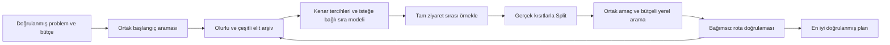

# Öğrenilmiş rota örüntüleriyle TSP ve öğrenci taşımacılığı

**Hazırlayan:** Codex. **Tarih:** 2026-10-14. **Durum:** bağımsız araştırma ve algoritma tasarımı; uygulama, eğitim ve performans deneyi yapılmadı.

Bu çalışma, kullanıcının “iyi rotaların ortak özelliklerini öğrenerek yeni rotalar üretme; düğümlerin önce/sonra gelmesine ağırlık verme” önerisini somutlaştırır. [Önceki algoritma tasarımları](ASTRA6_YENI_ALGORITMA_TASARIMLARI.md) değiştirilmemiştir. Buradaki yöntem adları araştırma etiketidir; kayıtlı veya çalışan UniRide algoritması değildir.

## 1. Değerlendirme ve öneri

**Evet, bu yaklaşımın literatürde doğrudan karşılıkları var.** İyi permütasyonlardan kenar dağılımı öğrenen EHBSA, elit çözümlerle olasılık modelini güncelleyen cross-entropy/EDA ve öğrenilmiş kenar skorlarıyla LKH aramasını yönlendiren NeuroLKH bunun örnekleridir. Okul servisi rotaları için Mallows dağılımına dayanan bir çalışma da vardır. [L1–L4, L8]

Fikir araştırmaya değer; ancak “iyi rotalarda sık görülen ilişki, başka rotada da mutlaka iyidir” sonucu çıkmaz. İlişkiler talebe, yönlü süre matrisine, araç tipine ve diğer ziyaretlere bağlıdır. Öğrenme, aramanın hangi adayları önce deneyeceğini belirlemelidir. Adayın kabulü gerçek maliyet ve kesin kısıt denetimiyle yapılmalıdır.

**Önerilen ilk yöntem: Elite Route Pattern Learning + Split (ERPL-Split).** Aynı problem örneğinin iyi, olurlu çözümlerinden yönlü kenar tercihleri öğrenilir; bu tercihlerle yeni ziyaret sıraları örneklenir; Split sıraları araç rotalarına böler; ortak yerel arama ve bağımsız doğrulayıcı sonucu değerlendirir. Öğrencinin daha önce/sonra gelmesi bilgisi, ayrıca tanımlanmış bir deney kolunda aynı rota içindeki hamleleri sıralar. İlk sürüm derin sinir ağı gerektirmez.

İkinci aşama, farklı problem örneklerinden öğrenen özellik tabanlı kenar modelidir. Önce basit bir model, gerekirse yönlü matrisleri işleyen sinir ağı denenir. Bugünkü tasarım için SOTA, üstünlük, yeni algoritmik paradigma veya genelleme başarısı iddiası yoktur.

| Seçenek | Öğrendiği şey | Gereksinim | Bu çalışma için karar |
|---|---|---|---|
| Aynı örnekte elit dağılımı / EDA | Bu snapshot ve talepte hangi kenarların iyi çözümlerde bulunduğu | Çözüm üretmek için ortak arama bütçesi | **İlk deney.** Kullanıcının fikrine doğrudan karşılık; açıklanabilir model |
| Örnekler arası kenar tahmini + klasik arama | Matris, talep ve kaynak özelliklerinden kenar tercihleri | Ayrı eğitim/doğrulama/test örnekleri; etiket üretme maliyeti | İkinci aşama; yeni gün ve taleplere aktarım burada sınanır |
| Uçtan uca attention/RL/diffusion | Çözüm üretme politikası veya kenar ısı haritası | Eğitim altyapısı, veri, problem özelinde decoder ve kapsamlı karşılaştırma | İlk prototipe eklenmez; güçlü ilgili çalışmalar olarak izlenir |

Bu tercih bir mühendislik önerisidir; üç seçenek arasında deneyle gösterilmiş bir performans sıralaması değildir.

## 2. Literatürle eşleştirme

Tarama tarihi 2026-10-14. Aşağıdaki içerik birincil makalelerin görülen bölümlerine dayanır. “Tam metinde ilgili bölüm” tüm deneylerin yeniden üretildiği anlamına gelmez. Yalnız özet görülen çalışmalardan ayrıntılı yöntem veya UniRide performansı çıkarılmamıştır. Bu hedefli tarama sistematik derleme ve eksiksiz SOTA sıralaması değildir.

| Kod | Birincil çalışma | Kullanıcının fikriyle ilişkisi | Görülen kanıt ve aktarım sınırı |
|---|---|---|---|
| L1 | Tsutsui, Pelikan ve Ghosh (2006), *Edge histogram based sampling with local search for solving permutation problems*. [DOI](https://doi.org/10.3233/HIS-2006-3102), [yayıncı özeti](https://journals.sagepub.com/doi/pdf/10.3233/HIS-2006-3102?download=true) | İyi permütasyonların komşuluk histogramından yeni permütasyon üretme; yerel aramayla birleştirme | Yayıncı özeti görüldü: 2-opt ve Lin–Kernighan ile birleşim. Temel fikrin öncülü; burada birebir yeniden uygulanmış sayılmaz |
| L2 | Wu, Möhring ve Lai (2018), *Stochastic Runtime Analysis of a Cross-Entropy Algorithm for Traveling Salesman Problems*. [DOI](https://doi.org/10.1016/j.tcs.2017.10.012), [yazar tam metni](https://arxiv.org/html/1612.06962v2) | Aday üret → elit seç → dağılım öğren → yeniden örnekle | §§2–3 ve örnekleme kuralları görüldü. Teorik sonuçlar makaledeki özel problem sınıfları içindir; bizim varyantımızın yakınsama veya süre kanıtı değildir |
| L3 | Dorigo, Maniezzo ve Colorni (1996), *Ant System: Optimization by a Colony of Cooperating Agents*. [DOI](https://doi.org/10.1109/3477.484436), [yazar PDF'i](https://iridia.ulb.ac.be/~mdorigo/Published_papers/All_Dorigo_papers/DorManCol1996tsmcb.pdf) | Turlardan kenar belleğini güncelleyen olasılıksal yapım | Araştırma alt görevinde özet ve algoritma bölümü görüldü; ana oturum PDF erişimi başarısız. ACO benzerliği kavramsal; EDA ile aynı algoritma değildir |
| L4 | Pérez-Rodríguez ve Hernández-Aguirre (2017), *An estimation of distribution algorithm coupled with the generalized Mallows distribution for a school bus routing problem with bus stop selection*. [DOI](https://doi.org/10.1016/j.riai.2017.05.002), [yayıncı](https://www.sciencedirect.com/science/article/pii/S1697791217300201) | Okul servisi rotaları üzerinde açık bir permütasyon dağılımı öğrenme | Yayıncı özeti görüldü. Durak seçimi içeren okul servisi problemi, UniRide'ın sabit occurrence ve Sw/So sözleşmesiyle aynı problem değildir |
| L5 | Pérez-Rodríguez ve Hernández-Aguirre (2019), *A hybrid estimation of distribution algorithm for the vehicle routing problem with time windows*. [DOI](https://doi.org/10.1016/j.cie.2019.02.017), [yayıncı](https://www.sciencedirect.com/science/article/pii/S0360835219300919) | Genelleştirilmiş Mallows dağılımıyla çok rotalı sıralama; route-first/cluster-second | Özet ve giriş görüldü. VRPTW öncülü; UniRide ride-time, yönlü matris ve tip kotası uyumu doğrulanmış değildir |
| L6 | Kool, van Hoof ve Welling (2019), *Attention, Learn to Solve Routing Problems!* ICLR. [Kurumsal tam metin](https://pure.uva.nl/ws/files/44641651/attention_learn_to_solve_routing_problems_.pdf) | Bir sonraki düğümün olasılığını bağlama göre öğrenme; REINFORCE ve greedy rollout baseline | §§3–5 görüldü. Eğitim hedefi örnek çözüm etiketlerinden farklıdır; özgün modelin koordinat temsili UniRide'a hazır matris desteği sayılmaz |
| L7 | Kwon ve diğerleri (2020), *POMO: Policy Optimization with Multiple Optima for Reinforcement Learning*. NeurIPS. [Tam metin](https://papers.nips.cc/paper_files/paper/2020/file/f231f2107df69eab0a3862d50018a9b2-Paper.pdf) | Bir çözümün farklı gösterimlerini ve çoklu başlangıçları öğrenmede kullanma | Özet, §1–2 görüldü. Çevrim gösterimi önemlidir; bizim sıra tercihi modelimize doğrudan bir doğruluk garantisi vermez |
| L8 | Xin, Song, Cao ve Zhang (2021), *NeuroLKH: Combining Deep Learning Model with Lin-Kernighan-Helsgaun Heuristic for Solving the Traveling Salesman Problem*. NeurIPS. [Tam metin](https://proceedings.nips.cc/paper_files/paper/2021/file/3d863b367aa379f71c7afc0c9cdca41d-Paper.pdf) | Öğrenilmiş kenar skorları aday kenar seçimini; düğüm cezaları arama yapısını yönlendirir | §4 ve deney kapsamı görüldü. Öğrenme + güçlü klasik çözücü bileşimidir. İlgili TSP deneyleri Öklidyen; ERPL-Split'in yönlü, çok rotalı başarısını kanıtlamaz |
| L9 | Kwon ve diğerleri (2021), *Matrix Encoding Networks for Neural Combinatorial Optimization* (MatNet). NeurIPS. [Tam metin](https://papers.neurips.cc/paper_files/paper/2021/file/29539ed932d32f1c56324cded92c07c2-Paper.pdf) | Koordinatlar yerine ilişkiler matrisini kodlama; ATSP | §§3–4 görüldü. **ATSP deneyleri üçgen eşitsizliğini sağlayan tmat sınıfında.** Matris girişi, metrik olmayan UniRide verisinde başarı kanıtı değildir |
| L10 | Sun ve Yang (2023), *DIFUSCO: Graph-based Diffusion Solvers for Combinatorial Optimization*. NeurIPS. [Tam metin](https://papers.nips.cc/paper/2023/file/0ba520d93c3df592c83a611961314c98-Paper-Conference.pdf) | Kenar ısı haritasından çözüm üretme | Yöntem ve TSP deney bölümü görüldü. Decode/search ve 2-opt sonuçta rol oynar; raporlanan birleşik başarı yalnız diffusion modeline mal edilemez |
| L11 | Son ve diğerleri (2026 sürümü), *RRNCO: Towards Real-World Routing with Neural Combinatorial Optimization*. [arXiv v2](https://arxiv.org/abs/2503.16159v2), [tam metin](https://arxiv.org/html/2503.16159v2) | Düğüm özellikleriyle asimetrik mesafe/süre bilgisini birlikte kullanma; ATSP, ACVRP, ACVRPTW | §§3, 6 ve Table 1 görüldü. arXiv kaydı ICLR 2026 kabulünü bildiriyor; OpenReview erişimi doğrulama ekranında kaldı. Gerçek yol matrisleriyle ilgili güçlü aday referans; bizim kısıtlarımız ve bütün yöntemler üzerinde genel SOTA kanıtı değildir |
| L12 | Huang ve diğerleri (2023), *Relational Bayesian Optimization for Permutation*. GECCO Companion. [DOI](https://doi.org/10.1145/3583133.3590606), [kurumsal kayıt](https://scholars.lib.ntu.edu.tw/entities/publication/6a4aee31-2c1b-4321-91dd-f9e291577216) | Permütasyonlardaki ortak ikili ilişkilerden model kurma | Alt görevde kurumsal özet görüldü; tam yöntem okunmadı. İlişki kodlamasının bizim “aynı rotada önce” tanımımızla eşit olduğu iddia edilmez |

L1–L5 istatistiksel model kuran optimizasyon yöntemleridir; hepsini güncel anlamda derin öğrenme diye adlandırmak yanlış olur. L6–L11 sinir ağı temelli örneklerdir. Bütün bu ailelerin ortak fikri, çözüm üretimini geçmiş deneyim veya eğitim verisiyle yönlendirmektir. Bu rapordaki özgül tasarım kararları aşağıda **öneri** olarak verilmiştir.

## 3. Ne öğrenilmeli: kenar, önce/sonra ve rota ortaklığı

| İlişki | Anlamı | Öğrenme etiketi | Ana risk / karar |
|---|---|---|---|
| Kenar: i → j | i'nin hemen ardından j ziyaret edilir | Gerçek, çözülmüş rotadaki ardışık yay | **İlk modelin girdisi.** ATSP ve öğrenci rotasında yön korunur |
| Öncelik: i ≺ j | Aynı araç rotasında i, j'den daha erken ziyaret edilir | Aynı rota şartıyla konum karşılaştırması | Ardışıklık değildir; yalnız sıra ağırlığı. Ayrı deney kolu |
| Aynı rotada bulunma | i ve j aynı araç seferindedir | Araç rotası kimliği eşitliği | Gruplama sinyali; kapasite uygunluğu yerine geçmez. İlk sürümde yalnız tanılayıcı |
| Rota başlangıç/bitişi | D → i veya i → D kullanılmıştır | Gerçek depo yayları | Rota sınırı korunur; giant-tour birleşim yaylarıyla karıştırılmaz |
| Mutlak sıra | i belirli sıra indeksindedir | Ham permütasyon sütunu | Değişen düğüm sayısı ve çevrim başlangıcına bağımlı; ilk modelde kullanılmaz |
| Kısa alt yol | i → j → k birlikte seçilir | Gerçek rota içindeki parça | Daha çok veri ve parametre; ikili modelin eksikliği gösterilmeden eklenmez |

**Gerçek maliyet ayrı kalır.** c(i,j) snapshot'taki seyahat süresidir. h(i,j) ise boyutsuz öğrenilmiş tercih skorudur. h, c'nin yerine yazılmaz; “daha sık kullanıldı” diye yolun süresi azaltılmaz. Fiziksel araç sayısı, kapasite, ride-time ve amaç fonksiyonu da öğrenilen skora çevrilmez.

### 3.1 Çevrim ile depo başlangıçlı rota aynı temsil değildir

Simetrik TSP'de A–B–C–D–A çevriminin başlangıcı kaydırılabilir; ters yönü de aynı maliyettedir. Ham diziden “A, B'den önce” etiketi üretmek başlangıç seçimini öğrenmeye yol açabilir. **TSP kolunda yönsüz kenar istatistiği kullanılır; önce/sonra modeli kapalıdır.** Arşivde rotasyon ve ters çevirme eşdeğerlikleri tek çözüm sayılır.

ATSP'de rotasyon eşdeğerdir; ters yön genellikle başka bir çözümdür. Yönlü yaylar öğrenilir, ters turlar birleştirilmez. Sabit bir düğümde turu kesmek, önce/sonra ilişkisini tanımlamaya yeter ama ona doğal ulaşım anlamı kazandırmaz; bu yüzden ATSP ilk kolunda da kenar modeli yeterlidir.

Öğrenci dalgasında D depodur; başlangıç ve bitişin hizmet anlamı vardır. Aynı rota içinde önce/sonra bilgisi anlamlıdır. Farklı araçların rotalarında bulunan iki occurrence için ziyaret sırası etiketi **eksik/tanımsızdır**, olumsuz örnek değildir. Rota listesinin dosyada hangi sırayla yazıldığı etiketleri değiştirmemelidir. Aynı fiziksel durağa ait farklı occurrence'lar tek düğüm diye birleştirilmez.

### 3.2 Yüksek ağırlıklar birlikte tutarlı olmayabilir

Aşağıdaki örnek tamamen açıklama amaçlıdır; deney sonucu değildir. Elit arşivde eşit ağırlıklı üç depo başlangıçlı sıra bulunsun:

- D–A–B–C–D
- D–B–C–A–D
- D–C–A–B–D

Ham önce/sonra çoğunlukları A ≺ B, B ≺ C, C ≺ A olur: her biri üç gözlemin ikisinde doğrudur. Üçünü birden zorunlu sıralama kuralı yapmak olanaksızdır. Benzer biçimde en yüksek kenar ağırlıklarını bağımsız seçmek küçük alt turlar, birden çok çıkış veya eksik ziyaret üretebilir.

Bu nedenle ağırlıklar yumuşak tercihtir. Yeni çözüm geçerli bir permütasyon kurucusu ve ardından gerçek rota decoder'ı ile üretilir. Öğrenilmiş çoğunluklardan sert precedence kısıtı çıkarılmaz; gerçek pickup-before-delivery gibi iş kuralları ayrı kaynaktan gelir.

## 4. Önerilen ERPL-Split algoritması

### 4.1 Problem ve durum

İlk uygulama hedefi, [önceki tasarımın](ASTRA6_YENI_ALGORITMA_TASARIMLARI.md) P5 olarak tanımladığı tek kampüslü, aynı yön ve aynı anchor zamanındaki dalgadır. Bu, depo başlangıçlı çok rotalı problemdir; Hamilton TSP değildir. TSP/ATSP deneyleri ayrı profiller ve doğrulayıcılarla yapılır.

Öğrenme bağlamı κ şu kimlikleri taşır: snapshot ve matris özeti, occurrence kümesi, pickup/dropoff yönü, anchor, süre birimi, kapasite profili, R/T sınırları ve amaç sırası. Araç tipi/kota desteği eklenirse bunlar da κ'ya girer. Bunlardan biri değiştiğinde ilk sürümde arşiv sıfırlanır. Başka güne ait aynı sayısal düğüm indeksi, aynı öğrenme değişkeni sayılmaz.

Durum: bugüne kadarki en iyi doğrulanmış çözüm **best**; en fazla K farklı olurlu çözümden oluşan arşiv **E**; yönlü fiziksel yay tercihleri **H**; precedence kolunda sıra tercihleri **P** ve gözlem desteği **A**; ortak bütçe, RNG ve sayaçlar. İlk sürüm için model servisi, GPU veya ayrı veritabanı gerekmez. Model bir çözüm çağrısının belleğinde kalır.

### 4.2 “Başarılı rota” etiketi

Öğrenme hedefi önce sabitlenir. P5 için önerilen sıra: olurluluk, araç rotası sayısı, toplam gerçek seyahat süresi. Daha kısa fakat daha çok rota kullanan çözüm otomatik olarak daha başarılı değildir. Tipli problemde borç alınan tip rotası sayısını önceleyen ayrı amaç profili gerekir. Gün düzeyindeki fiziksel araç sayısı, dalga rota sayısına eşit değildir.

E'ye yalnız tam çözüm ve doğrulama sonucu girer. Seçilmiş çözümün yayları iyi çözümde gözlenmiştir; bu, her yayın başarıya neden olduğu anlamına gelmez.

Arşiv kuralı: eşdeğer çözümü tekilleştir; best'i koru; kalanlar için önce ilan edilmiş amaç sırasıyla elit aday havuzunu belirle, sonra bu havuz içinde kenar farkıyla çeşitlilik seç. Havuz büyüklüğü ve K doğrulama kümesinde belirlenip deneyden önce dondurulur. Rota listesi sırası ve eşdeğer TSP gösterimleri çoğaltma sağlamaz. İlk sürümde arşiv çözümleri eşit ağırlıklıdır; ayrıca maliyete ters ağırlık eklenmez.

Elit arşiv tek çözümün kopyalarına çökerse bilgi artmış sayılmaz. Çeşitli başlangıçlar ve pozitif keşif olasılığı korunur. Hiç olurlu çözüm bulunamazsa sonuç “olurlu tanık bulunamadı” olur; olanaksızlık kanıtı verilmez.

### 4.3 Kenar ve sıra modelleri

E'deki farklı çözüm sayısı m olsun. I_s(i,j), s çözümünün gerçek rotalarında i → j yayı varsa 1, yoksa 0'dır. α > 0 yumuşatma kuvvetidir. İlk sürümde bütün i ≠ j çiftlerinde h₀(i,j) = 1 seçilir:

**h(i,j) = [α h₀(i,j) + Σ(s∈E) I_s(i,j)] / (α + m).**

E boşken h = h₀ = 1 olur. Bu sabit seçim önsel ölçeğinin ayrıca belirsiz bir parametre olmasını önler; ucuz yay tercihi §4.4'teki maliyet teriminden gelir. Formül Bayesçi posterior veya normalize edilmiş geçiş dağılımı olarak yorumlanmaz. H bir **tercih matrisi**dir: satırlarının toplamının 1 olduğu varsayılmaz. Özellikle deponun bir çözümde birden çok çıkışı vardır. Seçim olasılığı aşağıda normalize edilir.

H arşivin o anki içeriğinden yeniden hesaplanır. Değişmemiş arşivi her iterasyonda yeni bağımsız gözlemmiş gibi birikimli saymak yasaktır. α istatistiksel güven garantisi değildir; ilişkili elit örneklerde az gözleme aşırı güveni sınırlayan parametredir.

P, A, B ve G yalnız **birbirinden farklı, depo dışı occurrence çiftleri** üzerinde tanımlıdır. Başlangıç ve bitişte tekrar görünen D bu modellerin dışındadır; depo bilgisi H'de korunur. Sıra için A(i,j), i ve j'nin aynı araç rotasında bulunduğu arşiv çözümü sayısı; B(i,j), bunlardan i'nin j'den önce geldiği sayı olsun:

**p(i ≺ j) = [α/2 + B(i,j)] / [α + A(i,j)].**

A = 0 iken p = 1/2 ve ilişki nötrdür. Tam, tekrarsız rotalarda B(i,j) + B(j,i) = A(i,j), dolayısıyla p(i≺j) + p(j≺i) = 1 olur. Bu ikili tutarlılık, bütün düğümler için geçişli sıra garanti etmez. A ayrıca saklanır: aynı p, farklı sayıda gözlemden gelmiş olabilir.

Bunlar bizim önerilen model tanımlarımızdır; L1 veya L12 denklemlerinin birebir kopyası değildir. Skorlar “bu yay optimum çözümde bulunur” olasılığı diye sunulmaz.

**Rota sınırı:** D–A–B–D ve D–C–D rotaları giant-tour olarak A–B–C yazılsa bile B → C için olumlu etiket üretmez. Öğrenilen yaylar D→A, A→B, B→D, D→C ve C→D'dir. Rota sayısı ve depo yayları arşivde korunur.

### 4.4 Yeni aday üretimi

Kurucu bütün occurrence'ları tam bir kez içeren ziyaret sırası üretir. Başlangıçta i = D; her adımda U ziyaret edilmemiş occurrence'lar kümesidir. r(i,j), U içindeki c(i,j) maliyetlerinin sırasından hesaplanır. Eşit maliyetler ortalama sıra alır; sıra aralığı pozitifse r = (sıra − en küçük sıra)/(en büyük sıra − en küçük sıra), bütün maliyetler eşit veya tek seçenek varsa r = 0'dır.

**z(i,j) = λ log h(i,j) − β r(i,j)**

**Pr(j | i,U) = (1−ε) exp(z(i,j)/τ) / Σ(k∈U) exp(z(i,k)/τ) + ε/|U|.**

λ, β ≥ 0, τ > 0 ve 0 < ε ≤ 1'dir. Uygulama kararlı softmax kullanır. Pozitif önsel log 0'ı önler. ε bütün U üzerinde uygulanır; yalnız en yüksek skorlu küçük listeye uygulanırsa dışarıdaki düğümlerin keşfi kaybolur.

Bu tasarım doğrulanmış, sonlu, negatif olmayan gerekli yayları bulunan bir snapshot varsayar. Eksik, NaN veya birimi belirsiz veri sessizce Öklidyen uzaklıkla doldurulmaz; veri sözleşmesi hatası raporlanır. Seyrek graf desteği ayrı kurucu ve olurluluk sözleşmesi gerektirir.

h(i,j) bir öneri skorudur; sıradaki her ardışık çiftin aynı araç rotasına atanacağı varsayılmaz. İlk sürümde depo dönüş bilgisi decoder ve gerçek değerlendirmede korunur, ancak i→D ile D→j'yi birleştiren ek “rota kes” öğrenme terimi yoktur. Dolayısıyla kurucu rota sınırlarını eksik modelleyebilir. Bu, ölçülecek bir sınırlamadır; yapay B→C yaylarını öğrenme etiketi yaparak giderilmez.

Tam sıra, problemle uyumlu ortak Split decoder'ına verilir. Decoder olurlu segmentlerden rotalar kurar. Plan gerçek amaçla değerlendirilir; ortak yerel arama aynı bütçeyle çalışır; kabul edilen sonuç bağımsız denetleyiciden geçer. Split'in bir sıradaki en iyi bölmeyi bulması, bütün sıralar üzerindeki global optimum anlamına gelmez.

### 4.5 Önce/sonra bilgisini kullanacak deney kolu

**M1:** kenar tabanlı kurucu + ortak Split + uniform aday seçen ortak yerel arama.

**M2:** M1 ile aynı kurucu/decoder/hamle ailesi; yalnız aynı rota içindeki relocate hamlelerinin deneme sırası P ile yönlendirilir. Bu, önce/sonra fikrini ayrı ölçülebilir bileşen yapar; yeni amaç veya kısıt eklemez.

Tam plan s için, aynı rota içindeki birbirinden farklı depo dışı occurrence çiftleri üzerinden yardımcı uyum skoru:

**G(s) = Σ(rotalarda i, j'den önce) [A(i,j)/(α+A(i,j))] · [2p(i≺j)−1] / max(1, s içindeki aynı-rota çiftlerinin sayısı).**

G yalnız sıranın öğrenilmiş tercihle uyumudur. Yerel aramada mevcut rotanın düğüm üyeliğini değiştirmeyen relocate adayı a için ΔG(a) hesaplanır. Uygun yapısal hamleler kümesi M(s) boş değilken seçim olasılığı **q(a) = (1−ε_LS) softmax(ηΔG(a)) + ε_LS/|M(s)|** olur; softmax bütün M(s) üzerinde normalize edilir. 0 < ε_LS ≤ 1 bütün kollarda sabittir; η ≥ 0 ve η = 0 uniform kontrolü verir. M(s) boşsa yerel arama biter. Hamle ailesi, tekrar politikası ve deneme sınırı bütün kollarda aynıdır. İlk aşamada rota üyeliğini değiştiren hamlelerde P kullanılmaz.

Seçilen hamle **gerçek amaç ve kısıtlarla** değerlendirilir. G artsa da gerçek amaç kötüleşiyorsa iyileştirme adımı kabul etmez. Gerçek amaç eşitliklerindeki kabul politikası bütün kollarda aynı ve önceden ilan edilmiş olur. Öğrenilmiş uyumu gerçek amaca ekleyip daha çok araç kullanan planı tercih etmek yasaktır.

Böylece “önce/sonra ağırlığı” şu soruyla sınanır: aynı hamleleri daha yararlı sırayla denemeyi sağlıyor mu? Katkı göstermiyorsa P ve G kaldırılır; M1 korunabilir.

### 4.6 İş akışı ve sözde kod



Bu kod çalıştırılmış uygulama değildir. EVALUATE, §8'de tanımlanması gereken bütçe sarmalayıcısıdır; decoder, amaç ve kabul kontrollerinin dışından ücretsiz değerlendirme yapılamaz.

```text
input: problem κ, frozen configuration, budget B, paired seed
validate snapshot, units, objective profile and problem contract
best := none; elite := empty; model := neutral prior

within the shared initialization allowance:
    construct a seed using the declared common initializer
    result := EVALUATE(seed, κ, budget)
    if complete and feasible: validate; update best and distinct elite

while budget allows another evaluation and attempt limit is not reached:
    if scheduled archive update: recompute H (and P for M2) from elite
    order := sample every occurrence exactly once from H and cost prior
    result := EVALUATE(order through Split, κ, budget)
    if result is STOP_BUDGET: break
    if not a complete feasible plan: log outcome; continue
    validate; update best before starting local search
    result := COMMON_LOCAL_SEARCH(result, same budget,
                                  uniform ordering for M1,
                                  P-guided ordering for M2)
    validate result against original snapshot and all hard constraints
    keep best by the declared actual objective
    update the distinct, bounded, diverse elite archive

return best with certificate, counters and provenance;
       if best is none: return no-feasible-witness-found
```

EVALUATE her çağrının başında bir değerlendirme birimini atomik olarak ayırır; ayıramazsa amaç/decoder çalıştırmadan STOP_BUDGET döner. COMMON_LOCAL_SEARCH bütün tam aday değerlendirmelerini aynı EVALUATE üzerinden yapar; bütçe bitince girdisi dahil en iyi tamamlanmış olurlu planı döndürür. Kalan bütçesi olmayan LS yeni adaya başlamaz; toplu çağrı arkasında gizli değerlendirme yapılamaz. Bu bir uygulama gereksinimidir; mevcut bir ledger sınıfının bunu yaptığı iddiası değildir.

Başlangıç üretimi ve yerel arama da B içindedir. İyi başlangıç çözümleri bir kola ücretsiz verilip diğer koldan bunları bulması beklenmez. Model güncelleme sıklığı duvar saati yerine değerlendirme sayısıyla belirlenir.

## 5. UniRide'a uyarlamada korunacak sözleşmeler

Bu bölümün yerel dayanakları [önceki tasarım §4](ASTRA6_YENI_ALGORITMA_TASARIMLARI.md), [görevin problem tanımları](00_PROMPT_ASTRA6_YENI_ALGORITMA_TASARIMI.md), [adil karşılaştırma protokolü](../../../../ACADEMIC_FAIRNESS_PROTOCOL_DESIGN.md) ve [birleştirme tasarımıdır](../../../../ACADEMIC_STUDY_UNIFICATION_DESIGN.md). Bu çalışma kaynak kodunun bugünkü davranışını yeniden denetlememiştir; aşağıdaki maddeler tasarımın uyması gereken sözleşmelerdir.

| Konu | Tasarım kararı |
|---|---|
| Talep kimliği | Düğüm occurrence'tır; fiziksel durağın tekrarları korunur |
| Matris | Yönlü, metrik olmak zorunda olmayan snapshot maliyeti asıl değerlendirmedir |
| Dalga | Aynı kampüs, yön ve anchor bağlamı; farklı bağlamların ham H/P matrisleri birleştirilmez |
| Kapasite | Sw/So kaynakları ayrı; araç tipinin varsa toplam yük sınırı da korunur |
| Ride-time ve rota süresi | Pickup ve dropoff için hizmet anlamına uygun ayrı hesap; sadece toplam uzunlukla ikame edilmez |
| Split | İç kararların ve dış plan sıralamasının aynı amaç sözleşmesiyle uyumu doğrulanmalı; eski decoder'ın otomatik uyduğu varsayılmaz |
| Araç tipi/kota | İlk P5 denemesinden ayrı profil; tip atanamayan çözüm yalnız ucuz olduğu için elit olamaz |
| Gün planı | Rota aralıkları ve araç yeniden kullanımı ayrı; dalga iyileşmesi günün fiziksel araç sayısını azaltmış sayılmaz |
| Google süreleri | Birim doğrulama açık iştir. Birimi doğrulanmış snapshot gerekir; öğrenme veri birimi sorununu çözmez |
| Kabul | Orijinal matristen her ziyaret, kaynak, süre ve amaç yeniden doğrulanır; sertifika optimalite kanıtı değildir |

### 5.1 Nonmetric veri nedeniyle yanlış erken eleme

Aşağıdaki küçük karşı örnek **bu rapor için kurulmuş sentetik aritmetik örneğidir**, repository sonucu veya gerçek süre değildir. Birim “soyut süre”; rota sınırı T = 5 olsun:

- c(D,A) = 1, c(A,D) = 10;
- c(A,B) = 1, c(B,D) = 1.

D–A–D süresi 11 iken D–A–B–D süresi 3 olur. Dolayısıyla “kısmi kapalı rota T'yi aştı; bundan sonraki bütün uzatmalar da aşar” çıkarımı yanlış olabilir. Pickup tarafında A'dan depoya kalan süre de 10'dan 2'ye iner. Üçgen eşitsizliği varsayımı burada sağlanmaz.

İlk kurucuda yalnız ziyaret edilmiş olma gibi güvenli yapısal maske kullanılır. Kapasite veya zaman maskesi eklenirse onun **kalan bütün tamamlamalar için gerekli koşul** olduğu ispatlanmalıdır. Tam sıra üretip tüm uygun segmentleri değerlendiren Split, bu yanlış erken kesmeyi önler; fakat Split'in kendisinde aynı güvensiz kırılma varsa sorun devam eder. Decoder uyumu uygulama öncesi kontrol kapısıdır.

P5'in beklemesiz, ortak R sınırına sahip modelinde bir segment vᵢ,…,vⱼ için Pᵢⱼ iç yayların toplamı olsun:

- Cᵢⱼ = c(D,vᵢ) + Pᵢⱼ + c(vⱼ,D);
- pickup için en uzun araç içi süre Pᵢⱼ + c(vⱼ,D);
- dropoff için en uzun araç içi süre c(D,vᵢ) + Pᵢⱼ.

Bu formüller negatif olmayan seyahat süreleri, beklemesiz hizmet ve belirtilen dalga modeli içindir. Bireysel zaman pencereleri, servis süreleri veya eşlenik pickup–delivery eklenince yeniden türetilmelidir. Genel DARP için bu üç denklem yeterli değildir.

### 5.2 Önceki yedi tasarımla ilişki

ERPL ayrı bir öğrenme deneyi olarak tutulmalıdır. Önceki A4 rota havuzuna yeni sertifikalı rota adayları üretebilir veya A3 benzeri giant-tour/Split aramasının kurucusu olabilir. Bunun için mevcut bileşenlerin arayüzü uygulama aşamasında doğrulanır; yeni solver kopyası açılmaz.

A5 gün planına geçerken başarı etiketi günün gerçek hedefinden gelmelidir. Dalga bazında kısa rota, zaman aralıkları değiştiğinde günün araç kullanımını kötüleştirebilir. P5'te öğrenilmiş modele doğrudan “gün optimizasyon modeli” denmez.

A7'deki operatör seçimi ile buradaki kenar/sıra öğrenmesi de ayrı deneylerdir. İkisini aynı anda açmak, hangi bileşenin katkı verdiğini belirsizleştirir. İlk ERPL deneyi başka yeni tasarımlarla birlikte paketlenmez.

## 6. Günler ve farklı örnekler arasında öğrenmeye geçiş

Aynı örnekte H öğrenmek **çevrimiçi istatistiksel uyarlamadır**. Başka günün yeni yolcu kümesinde başarılı olmak, bunun otomatik sonucu değildir. Kullanıcının “başarılı rotaların ortak özellikleri” fikrinin daha geniş biçimi, düğüm kimliği yerine problem özelliklerinden tercih öğrenmektir.

Önerilen ikinci aşama: fθ(problem özellikleri, i, j) → yönlü kenar skoru. İlk aday düzenlileştirilmiş lojistik modeldir. Açık bir kazanç görülürse aynı hedef ve veri bölmesiyle matris tabanlı ağ denenir. MatNet ve RRNCO temsil seçenekleri için referanstır; modellerinin bütün kısıtlarımızı hazır desteklediği kabul edilmez. [L9, L11]

### 6.1 Öğrenilecek özellikler

| Özellik grubu | Örnek | Koruma / sınırlama |
|---|---|---|
| Yol ilişkisi | c(i,j), c(j,i), satır sırası, depo giriş/çıkış maliyetleri | Yön ayrımı korunur; koordinat uzaklığı asıl maliyeti değiştirmez |
| Kaynaklar | i/j talep vektörleri, araç kapasitesi, tip | Aynı model farklı kaynak profillerini ayırt etmeli |
| Hizmet bağlamı | pickup/dropoff, R/T, anchor ve problem profili | Rota özellikleri tahmin anında bilinebilir olmalı |
| Arama durumu | Ziyaret edilmemiş küme veya mevcut rotanın kalan kapasitesi | Bunları kullanan model statik kenar sınıflandırıcısından farklı varyanttır |
| Yapısal çevre | İyi giriş/çıkış alternatiflerinin sıraları | Ölçekten ve keyfi düğüm numarasından bağımsız tasarlanır |

İlk statik model yalnız ilk üç satırdaki tahmin öncesi özellikleri kullanır; dinamik bağlam eklemek ayrı varyanttır. Süreler normalize edilecekse c, R ve T aynı ölçekle dönüştürülür. Payda sıfır olduğunda tanımlı davranış gerekir. İsim, telefon, kimlik numarası gibi rota için gereksiz kişisel veriler özellik değildir. Deney kimlikleri anonimleştirilir; konum ve talep verileri de veri paylaşımı izinlerine tabidir.

### 6.2 Eğitim etiketi ve veri sızıntısı

Öğretmen verisi tek bir sezgiselin tek çıktısından ibaret olmamalıdır. Aynı örneğin farklı seed ve yöntemlerinden doğrulanmış iyi çözümler toplanır. Küçük örneklerde optimum kanıtı varsa ayrı bir etiketle kullanılır; büyük örneklerin en iyi bilinen sonucu “optimum” yazılmaz. Üretilmiş çözüm çeşitliliği ve öğretmenin harcadığı kaynak kaydedilir.

Kenar hedefi, iyi çözümlerde görülme oranı gibi yumuşak etiket olabilir. Hiç görülmeyen yay “her durumda kötü” diye yorumlanmaz; yalnız örneklenmiş öğretmen dağılımında görülmemiştir. Maliyeti bilmenin tek başına başarısını ölçmek için maliyet/satır sırası kontrolü şarttır. Aksi halde model, yeni yapı öğrenmeden yakın komşu davranışını tekrar edebilir.

Önce/sonra eğitimi yapılırsa yalnız aynı rotada gözlenen çiftlerde kayıp hesaplanır. Farklı araçtaki çiftler kayıp maskesinin dışındadır. Birden çok iyi çözümün çelişen sıraları yumuşak hedef olarak korunur. Etiketi üreten çözümün sonradan hesaplanan gerçek slack değeri, tahmin anında bulunmuyorsa model girdisi yapılamaz.

Veri bölmesi **rota satırı bazında değil, problem ailesi/snapshot/gün grubu bazında** yapılır. Aynı örneğin rotasyonları, seed tekrarları, öğretmen çözümleri ve türetilmiş alt örnekleri aynı bölmede kalır. Farklı günler aynı matrisi paylaşıyorsa “yeni gün” ile “yeni matris” ayrı aktarım testleridir. Tek bir haftadan ayrılan birkaç rota, yeni haftalara genelleme kanıtı sayılmaz.

Eğitim, doğrulama ve test ayrımı yapıldıktan sonra model ve hiperparametreler test kümesinde seçilmez. Test sırasında çevrimiçi uyarlama yapılacaksa yalnız o çağrının bütçeli sonuçları kullanılabilir; test öğretmen/optimum etiketleri kullanılamaz. Frozen model ve testte uyarlanan model ayrı varyant olarak raporlanır.

### 6.3 Yeni rota üretimiyle bağ

İkinci aşamada fθ skoru §4.4'teki h yerine pozitif tercih sağlayabilir; aynı Split, amaç, yerel arama ve doğrulama katmanları korunur. İlk karşılaştırma:

1. maliyet önseli;
2. aynı örnekte öğrenilmiş H;
3. offline öğrenilmiş, dondurulmuş fθ;
4. gerekirse fθ başlangıcı + bütçeli çevrimiçi uyarlama.

Model ağırlıklarının tekrar kullanılması farklı problemlerde düğüm indekslerinin tekrar kullanılmasını gerektirmez. Yeniden numaralandırılmış aynı grafik için skorlar da aynı permütasyonla taşınmalıdır. Eğitimde gördüğü düğüm numarasını ezberleyen model aktarım sağlamış sayılmaz.

## 7. Öğrenmenin katkısını ayıracak deney tasarımı

Aşağıdaki kollar **planlanmıştır; çalıştırılmamıştır.** İlk soru, öğrenme eklemenin aynı decoder ve yerel aramaya değer katıp katmadığıdır. Yeni yöntemi yalnız zayıf rastgele turla karşılaştırmak yeterli değildir.

| Kol | Kurucu | Aynı rota içi hamle seçimi | Sorduğu soru |
|---|---|---|---|
| M0 | Maliyet önseli + keşif; H sabit | Uniform | Öğrenmesiz aynı iskelet ne yapıyor? |
| M1 | Maliyet + çevrimiçi H | Uniform | Kenar öğrenmesinin ek katkısı var mı? |
| M2 | Maliyet + çevrimiçi H | P ile yumuşak yönlendirme | Önce/sonra bilgisi H üzerine katkı sağlıyor mu? |
| M3 | Maliyet önseli + keşif; H sabit | P ile yumuşak yönlendirme | Sıra bilgisi tek başına faydalı mı? |

M0/M3 için §4.4'te λ = 0 alınır. M0/M1 için §4.5'te η = 0'dır. Arşiv politikası, initializasyon payı, decoder, gerçek amaç, hamle ailesi ve toplam değerlendirme bütçesi eşlenir. RNG akışlarının farklı sayıda kullanılması beklenebilir; aynı seed kullanılması her kolun aynı adayları gördüğü anlamına gelmez.

İlk kollar yalnız P5'te çalıştırılır. TSP/ATSP için P devre dışıdır; ayrı M0/M1 deneyidir. M2/M3'ü doğal başlangıcı olmayan TSP'ye mekanik olarak taşımak hedefi değiştirir.

### 7.1 Kontroller ve dış karşılaştırmalar

İlk dört kol sonrasında bir fark görülürse şu tanılamalar yapılır:

- **Öğrenme kapalı veya etiketleri karıştırılmış kontrol:** katkı, ek hesaplamadan ve çeşitlilikten mi geliyor, yoksa doğru ilişki bilgisinden mi?
- **Yerel arama etkisi:** bütün kollarda eşit LS açık ana deney; ayrıca LS kapalı tanılama. Kazancın tamamı ortak LS'den geliyorsa öğrenmeye mal edilmez.
- **Öğretmen/başlangıç etkisi:** aynı iyi başlangıçlar verildiğinde arama ve yalnız arşivden en iyi çözümü seçme karşılaştırılır. Öğretmen maliyeti ve erişimi eşlenir.
- **Keşif ve çeşitlilik:** arşiv çökmesi, özgün aday sayısı ve uzun süre iyileşmeme kaydedilir. Yalnız tek seed'deki iyi sonuç seçilmez.

| Problem | Uygun güçlü dış referans | Karşılaştırma sınırı |
|---|---|---|
| Simetrik TSP | Yerel aramalı ILS; gerçek LKH; uygun küçük örneklerde kanıtlı optimum; NeuroLKH/DIFUSCO temsilci öğrenilmiş yöntemler | Aynı problem ve decoder/search maliyetleri; kapalı backend için ayrı native süre protokolü |
| ATSP | Yönlü maliyeti doğru hesaplayan ILS/LKH profili; MatNet ve uygun RRNCO profili | MatNet'in tmat eğitimi ile nonmetric test ayrılır; sırayı ters çeviren hamlelerin maliyeti doğru olmalı |
| Standart CVRP/CVRPTW | Problem sözleşmesine uyan HGS veya sürümü sabitlenmiş güçlü açık solver; POMO/attention ya da RRNCO'nun ilgili profili | Tek kapasite ve zaman penceresi sonuçları Sw/So ile aynı problem diye raporlanmaz |
| UniRide P5 | Mevcut GA-Split ailesinin doğrulanmış profili; öğrenmesiz aynı ERPL iskeleti; önceki A4'te planlanan küçük kesin referans | Kesin referans yalnız gerçekten çalıştırılıp kanıt üretirse “optimum”; mevcut kodun FE uyumu ayrıca doğrulanır |

Dış modelleri eğitmek veya uyarlamak bu raporda yapılmadı. İlgili problem desteği, lisans, sürüm ve kaynak bütçesi uygulama planında doğrulanmalıdır. Uyumlu olmayan solver satırı boş bırakılır; yapay eşitlik kurulmaz.

### 7.2 Veri, ölçütler ve karar

Üç ayrı değerlendirme alanı gerekir: kontrollü sentetik küçük örnekler, problem ailesine uygun standart benchmarklar ve izinli UniRide snapshot'ları. Sentetik nonmetric/asimetrik örnekler ayrıca bulunmalıdır. Yeni düğüm sayısı, yeni talepler, yeni matris ve yeni kaynak profili ayrı dağılım kayması eksenleridir.

Birincil kalite ölçütü gerçek amaç sırasıdır. P5'te önce olurlu çözüm oranı ve rota sayısı, eşit rota sayısında toplam süre raporlanır. Araç sayısı ile süre farklı öncelikteyken tek bir ortalama yüzde farkı hesaplanmaz. Gün düzeyi fiziksel araç kullanımı ancak gün planlama katmanı çalıştırılan ayrı deneyde ölçülür.

İkincil ölçütler: değerlendirme sayısına karşı en iyi amaç eğrisi, uçtan uca süre, olurlu aday oranı, arşiv çeşitliliği, decoder reddi, model güncelleme/çıkarım maliyeti, bellek ve tekrar oranı. Öğrenilmiş kenarın etiketlerle uyuşması yardımcı göstergedir; rota kalitesinin yerine geçmez.

Aynı problem/replicate grupları eşleştirilir; seed sayısı ve örneklem büyüklüğü test sonuçları görülmeden bir pilot varyans değerlendirmesi ve kaynak planıyla dondurulur. Tekrarlar bağımsız problem örnekleri gibi sayılmaz. Etki büyüklüğü ve belirsizlik aralığı problem düzeyinde raporlanır; çoklu karşılaştırma yapılırsa düzeltme politikası önceden belirlenir.

**İlerleme kararı:** M1'in M0'a katkısı yoksa neural modele geçilmez; önce maliyet, decoder ve örnekleme darboğazı incelenir. M2'nin M1'e katkısı yoksa önce/sonra bileşeni çıkarılır. Etki yalnız eğitim örneklerinde veya yalnız ek çalışma süresiyle görülüyorsa genelleme/hız kazancı denmez. “SOTA” için güçlü, güncel ve problemce uyumlu dış referanslar karşısında tekrarlanmış kanıt gerekir; mevcut rapor böyle bir sonuç içermiyor.

## 8. Bütçe, hesaplama maliyeti ve yeniden üretilebilirlik

### 8.1 Yerel adil karşılaştırma sözleşmesi

[Adil karşılaştırma tasarımında](../../../../ACADEMIC_FAIRNESS_PROTOCOL_DESIGN.md) bir FE, bir adayın tam kapalı tur amaç değerlendirmesidir. Initializasyon, arama, polish ve adaptörün ek tam değerlendirmeleri ortak bütçededir. Delta/komşuluk taramalarını kullanıp tamamlanmış adayları ücretsiz değerlendirmek kabul edilmez. Sabit bütçede aşım sıfır olmalıdır.

**Çok rotalı plan için aşağıdaki genişletme bir öneridir; uygulanmış veya kabul edilmiş mevcut protokol diye sunulmaz.** P5 deneyleri başlamadan onaylanmış sürümlü plan-değerlendirme tanımı gerekir:

- Bir tam ziyaret sırasını gerçek Split ile plan olarak değerlendirme isteği, önceden ayrılmış bir plan-evaluation birimi tüketir; geçerli plan veya bölme bulunamadı sonucu açıkça kaydedilir.
- Bir tamamlanmış yerel arama adayının gerçek plan amaç/olurluluk değerlendirmesi de aynı sayaçtan tüketir.
- Aynı adayı yeniden tam hesaplamak yeniden sayılır. İlk deneyde amaç önbelleğiyle ek serbest arama yapılmaz.
- Split içindeki segment maliyetleri ve DP durumları tam plan değerlendirmesiyle özdeş değildir; ayrıca segment/decoder iş yükü ve süresi ölçülür. Bu, hesaplamayı bedelsiz saymak değildir.
- Aday üretim denemeleri ve başarısız yapısal girişimler ayrıca sayılır; süre ve deneme sınırı, değerlendirilemeyen adaylarda sonsuz döngüyü önler.
- Son raporlayıcı bilinen amaç değerini kullanır; ilave tam amaç hesabı gerekiyorsa bütçesi baştan ayrılır. Sertifika üretimi başka adaylar için ek arama veya ücretsiz amaç seçimi sağlayamaz.

Bu sözleşmenin doğrulanmış uygulaması yokken P5 sonuçlarına “exact FE compliant” etiketi verilmez. TSP FE sayısıyla plan-evaluation sayısı aynı sonuç havuzunda toplanmaz. Black-box LKH/CP/başka çözücü çağrısı bir FE kabul edilmez; iç muhasebe gösterilemiyorsa native süre protokolünde kalır.

Seed türetimi protokol sürümü, base seed, normalize problem kimliği ve replicate üzerinden kararlı özetle yapılır; algoritma kimliği ve Python hash'i seed'e katılmaz. Model eğitimi, aday örnekleme ve kontrol tanılamaları için alt akışlar belirtilir. Native süre deneylerinde aynı seed, aynı sonuç için tek başına yeterli değildir.

### 8.2 Eğitim ve çıkarım ücretsiz değildir

H güncelleme, model çıkarımı ve G hesaplama tam amaç değerlendirmesi olmadığı için FE sayacının yerine geçmez. Ancak CPU/GPU zamanı ve bellek tüketir; uçtan uca native süreye dahildir. FE-eşlenmiş ve süre-eşlenmiş sonuçlar ayrı panellerde gösterilir.

Çevrimiçi ilk sürümde elit arşivi oluşturmanın bütün çözüm değerlendirmeleri aynı B'dedir. Offline modelde öğretmen çözümü üretme ve eğitim maliyeti ayrıca açıklanır. Yalnız inference süresini raporlayıp toplam eğitim masrafını yok sayarak “daha ucuz” denmez.

Tekrarlı kullanım için açıklanabilecek maliyet hesabı: **çağrı başına amortize maliyet = eğitim/etiket üretme maliyeti ÷ gerçek kullanım sayısı + çağrı çözüm maliyeti.** Bütün terimler aynı birimde ifade edilmelidir; CPU-saat ile GPU-saat doğrudan toplanmaz. Kullanım sayısı henüz bilinmediği için bu rapor bir amortisman kazancı öngörmüyor.

İlk yoğun matris tasarımında H/P/A belleği O(n²), tam aday örnekleme O(n²), arşivden kenar sayımı O(Kn), bütün sıra çiftlerini sayma en kötü O(Kn²)'dir. Bu bizim tasarımın döngülerinden çıkan maliyetidir. Split ve yerel aramanın ek maliyeti bunun dışındadır; algoritmanın toplamı O(n²) diye etiketlenmez. P/G eklemek maliyetlidir ve ölçülmüş katkı gerektirir.

### 8.3 Kaydedilecek en küçük araştırma izi

Her çalıştırmada: kod/algoritma kimliği ve sürümü, problem profili, veri/matris özeti ve birimi, kaynak sınırları, amaç sırası, seed provenance, bütçe türü ve limitleri, kullanılan değerlendirme/deneme sayıları, başlangıç ve LS politikası, arşiv/öğrenme parametreleri, tamamlanma nedeni, doğrulanmış amaç, sertifika sonucu, süre ve donanım.

Offline aşamada ek olarak: eğitim/doğrulama/test grup listelerinin özetleri, öğretmen kimlikleri ve maliyetleri, model ağırlığı özeti, eğitim seed'i, eğitim süresi, testte güncelleme yapılıp yapılmadığı. Geçerli bir rapor yeniden eğitimden veya yeniden çalıştırmadan aynı sonucun çıkacağını varsaymaz; gereken izleri sağlar.

## 9. Uygulama öncesi doğrulama örnekleri

Aşağıdakiler **test planıdır; testler yazılmadı ve çalıştırılmadı.** Gerçek uygulama bunları küçük deterministik örneklerle geçmeden performans iddiasına açılmamalıdır.

| Kontrol | Beklenen davranış |
|---|---|
| Boş elit arşiv | H nötr önsele döner; P = 1/2; NaN oluşmaz |
| Aynı çözümün kopyaları | Arşiv tekilleştirmesinden sonra H/P desteği şişmez |
| Düğüm yeniden numaralama | Model matrisi aynı yeniden numaralamayla taşınır; amaç değişmez. RNG eşitlikleri uygun eşlenir |
| TSP rotasyon/ters gösterim | Aynı yönsüz kenar modeli ve tek arşiv üyesi |
| ATSP ters gösterim | Farklı yönlü çözüm olarak kalır; maliyetler karıştırılmaz |
| Çoklu rota listesi sırası | Listeyi değiştirmek H/P etiketlerini değiştirmez |
| Giant-tour yapay bağlantısı | D–A–B–D ve D–C–D için B→C olumlu etiket değildir |
| Farklı araçtaki çift veya depo | Önce/sonra gözlem desteğine ve eğitim kaybına girmez; P/G yalnız farklı, depo dışı occurrence çiftleridir |
| Döngülü çoğunluk | §3.2 örneği sert kısıta dönüşmez; tam permütasyon üretilebilir |
| Olasılık normalizasyonu | U boş değilken toplam 1; her üye en az ε/|U| olasılıklı |
| Eşit/tek seçenek maliyeti | Sıra ölçeklemede sıfıra bölme ve keyfi kimlik yanlılığı oluşmaz |
| Nonmetric segment | §5.1'de D–A–D elense bile D–A–B–D segmenti incelenir |
| Kaynak ve rota doğruluğu | Eksik/tekrar occurrence, Sw/So taşması ve ride-time ihlali elenir |
| G ile gerçek amaç çatışması | Daha yüksek G, daha kötü gerçek amacı kabul ettirmez |
| Bütçe sınırı | Başlangıç, Split değerlendirmesi, LS ve ek tam amaç hesapları dahil aşım yok |
| Model sayısal hatası | NaN/sonsuz skorla normal devam edilmez; hata veya açık etiketli baseline fallback; araştırma kaydında görünür |
| Oracle karşılaştırması | Küçük örnekte tüm sıralar/bölmelerin sayımıyla decoder ve amaç doğrulanır; aramanın her seferinde optimum bulması beklenmez |
| Veri ayrımı | Aynı örnek/snapshot'ın türevleri eğitim ve test arasında sızmaz |

Eşit maliyetlerde tam örnek yolunun birebir aynı olması, modelin dağılımsal değişmezliğiyle aynı iddia değildir. Testler bu iki özelliği ayırmalıdır. Benzer biçimde olurlu çözüm sertifikası, bütün arama uzayında en iyilik sertifikası değildir.

## 10. En küçük geliştirme yolu

| Aşama | Somut çıktı | Geçiş ölçütü |
|---|---|---|
| 0 — Sözleşme ve örnekler | P5 amaç/decoder uyumu, sürümlü plan-evaluation tanımı, küçük oracle örnekleri ve birimi doğrulanmış snapshot | Hangi davranışın doğru olduğu belirsiz kalmamalı; repository'nin ilgili önceki gate'leri kapalı olmalı |
| 1 — M0/M1 prototipi | Ortak kurucu/decoder/LS üstüne bir elit arşiv ve yönlü kenar modeli | §9 doğruluk kontrolleri; eşit bütçe ve uçtan uca maliyette öğrenmenin katkısı ölçülebilmeli |
| 2 — M2/M3 sıra deneyi | Aynı rota içinde P ile relocate adayı sıralaması | Kenar öğrenmesine ek katkı varsa korunur; yoksa kaldırılır |
| 3 — Örnekler arası model | Ayrı veri bölmeleri, basit özellik modeli, gerekirse yönlü matris ağı | Yeni örneklerde fayda ve toplam hesaplama maliyeti gösterilmeli |

Kanonik solver/amaç/olurluluk **uniride_core**, veri bölmeleri/protokol/istatistik **academic_benchmark** sorumluluğunda olmalıdır. Bunlar mevcut mimari gereksinimleridir; bugün bu bileşenlerin ERPL için hazır olduğu iddiası değildir. Yeni modül yolu, registry adı veya bağımlılık seçilmeden ilgili canlı arayüzler CodeGraph ile doğrulanmalıdır. Aynı solver Bildiri/YAEM içinde ayrı kopyalanmamalıdır.

İlk uygulama için geniş bir neural framework, model sunucusu, üretim ekranı veya yeni bir genel optimizasyon platformu tasarlamak gerekmiyor. Geliştirilecek temel fark, mevcut uyumlu aramanın aday üretme ve deneme sırası olacaktır. Daha karmaşık motifler, rota kesme modeli, online neural fine-tuning ve gün planı öğrenmesi ancak ilk deneyde karşılığı ölçülen bir eksikliği gideriyorsa ele alınır.

## 11. Açık sorular ve bu çalışmanın teslim sınırı

| Soru | Bu raporun yanıtı / durum |
|---|---|
| Fikir literatürde var mı? | Evet: edge histogram, CE/EDA, öğrenilmiş kenar yönlendirmesi ve okul servisi EDA öncülleri bulundu |
| Önce/sonra ağırlığı anlamlı mı? | Aynı depo başlangıçlı rota içinde anlamlı yumuşak sinyal; çevrim ve farklı araçlar için aynı yorum geçerli değil |
| Yeni rota üretilebilir mi? | §4'te tam bir kurucu ve decoder döngüsü tanımlandı; çalışan uygulaması henüz yok |
| Neural model gerekli mi? | İlk aynı-örnek deneyi için hayır; örnekler arası özellik öğrenmesi ikinci araştırma aşaması |
| Mevcut decoder ve bütçe arayüzleri uyumlu mu? | Bu çalışmada canlı kaynak koduyla doğrulanmadı; aşama 0'ın konusu |
| Veri birimleri ve öğretmen etiketleri hazır mı? | ERPL için doğrulanmış veri paketi hazırlanmadı; Google süre birimi açık doğrulama kalemi |
| UniRide'da daha iyi sonuç verir mi? | Bilinmiyor; M0–M3 deneyleri ve güçlü referanslar gerekli |
| Akademik yenilik var mı? | Temel fikir yeni değil. Bağlama duyarlı yönlü öğrenme, kısıt uyumu ve katkının dürüst ayrıştırılması araştırma konusu; özgünlük/SOTA gösterilmedi |
| Yapılan iş ne? | Kaynak araştırması, temsil analizi, matematiksel model, sözde kod, deney ve test planı; ayrı Markdown raporu |
| Yapılmayan iş ne? | Solver uygulaması, model eğitimi, benchmark, canlı kod uygunluk denetimi, üretim entegrasyonu, commit/push |

**Araştırma önerisi:** Önce ERPL-Split'in kenar öğrenen M1 kolunu öğrenmesiz M0'a karşı deneyelim; ardından aynı rota içindeki önce/sonra ağırlığının katkısını M2/M3 ile ayıralım. Sonuçlar bu basit yapıda fayda göstermeden daha büyük bir neural modelin maliyetine geçmeyelim.

Kaynak incelemesine sınırlı literatür alt görevi katkısı alınmıştır; onun bulguları yukarıdaki kanıt kapsamlarıyla ayrılmıştır. Kaynak yayınların deneyleri yeniden üretilmemiştir. Yeni rapor önceki tasarımın yerine geçmez.
