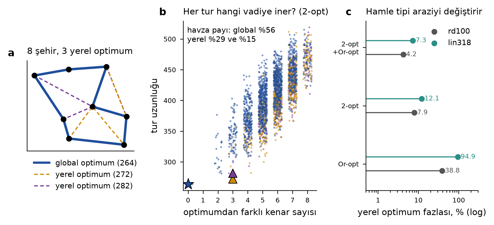
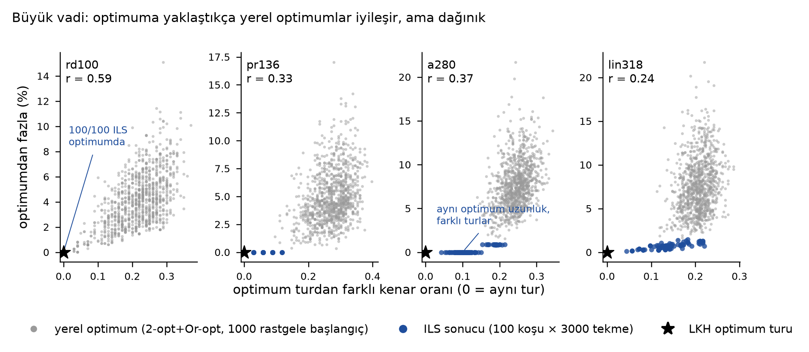
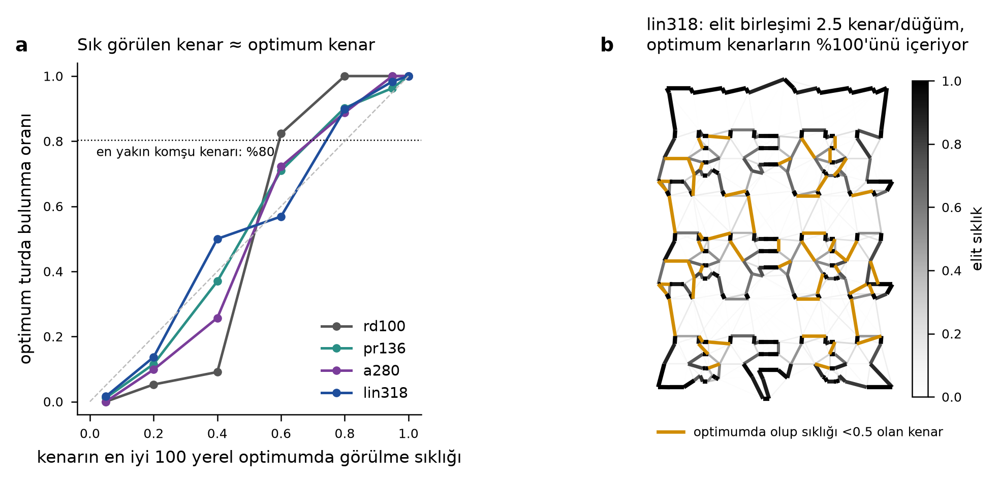

# Öğrenilmiş rota örüntüleri: bağımsız çalışma ve ölçümler

Tarih: 2026-10-15. Hazırlayan: Claude Science. Kapsam: TSP (P1), UniRide dalga (P5), ölçek örnekleri (S1–S3).

**Bağımsızlık notu.** Literatür taraması Codex'in `CODEX_OGRENILMIS_ROTA_ORUNTULERI_TASARIMI_2026-10-14.md` dosyası açılmadan yapıldı. Deneyler de bu dosya okunmadan tasarlandı ve başlatıldı. Codex belgesi yalnız sonuçlar alındıktan sonra, §11'deki karşılaştırma için okundu.

## 0. Kısa sonuç

1. **İyi çözümler gerçekten ortak parça taşıyor (TSP).** 4 TSPLIB örneğinin hepsinde en iyi 100 yerel optimumun kenar birleşimi, optimum turun kenarlarının %100'ünü içeriyor. Bu birleşim düğüm başına yalnız 1.8–2.6 kenar. Elitlerin ≥%90'ında görülen kenarların %98–100'ü optimumda. Aynı oran en yakın komşu kenarı için %76–86.
2. **Bu bilgi, eşit sürede ILS'i anlamlı biçimde iyileştirmedi.** Elit birleşimi + 3 en yakın komşudan kurulan aday listesiyle ILS-fast, K=10 en yakın komşulu ILS-fast'a karşı 20 eşleşik koşuda 11/1/8 (kazanç/beraberlik/kayıp) verdi; Wilcoxon p=0.78. Saf birleşim listesi, aynı boyuttaki 5 en yakın komşu listesinden iyi: 14/6 kazanç/kayıp, p=0.057, sınırda.
3. **UniRide'da geçmiş günlerden öğrenmek mümkün.** Bir günü dışarıda bırakan çapraz doğrulamada (LODO) öğrenen model, yeni günde hangi yolcunun hangisinden hemen sonra geldiğini (ardıl yay) AUC 0.909 ile tahmin etti. Saf mesafe 0.764, durak kimliğine dayalı sıklık belleği 0.714 verdi. Model 5/5 günde mesafeyi geçti. Yalnız geçmiş günlerle (ileriye zincirleme) eğitildiğinde de 4/4 test gününde geçti. Ancak öğrenilenin büyük kısmı basit bir kurala indirgeniyor: "karşılıklı yakın komşu + yolculuk süresi payı". Bu elle yazılmış kural AUC 0.855 ve ilk 5'te yakalama 0.956 verdi; öğrenilmiş modelin ilk 5'te yakalaması 0.944.
4. **Öncelik ("i, j'den önce") kısmen öğrenilebilir.** Aynı rotadaki çiftlerde "kampüse uzak olan önce" kuralı %72.0, öğrenilmiş model %77.9 doğru (n≥6 dalgalar, 661 çift). Kimlik tabanlı öncelik belleğinin doğruluğu yalnız %62.0.
5. **Öğrenilmiş ağırlıkla rota *inşası* klasik yöntemi geçmedi.** Öğrenilmiş ardıl olasılığına göre birleştiren savings yöntemi, n≥6 olan 36 dalgada ve aynı yeniden sıralamayla 9 fazla rota ve 419 fazla dakika verdi. Klasik Clarke–Wright aynı koşulda 3 fazla rota ve 181 fazla dakika verdi.
6. **Öğrenilmiş aday yaylarla kesin sayımı budamak hızlandırır ama kesinliği bozar.** k=4 ile öğrenilmiş aday seti optimumu 36 dalganın 30 tanesinde korudu ve rota sayısı hiçbir dalgada artmadı. Aynı k'da mesafe tabanlı set optimumu 27 dalgada korudu. Tutulan kolon oranı: öğrenilmiş set %22, mesafe seti %32. Bugünkü ölçekte tam kesin çözüm zaten ucuz (medyan 0,014 s/dalga), bu yüzden budamaya üretimde gerek yok.
7. **Ölçekte (S1–S3, 19–108 yolculuk) öğrenilmiş komşuluk** ESN-SP'de mesafe tabanlı komşuluğa karşı 15 örnekte 5 iyi / 5 eşit / 5 kötü sonuç verdi. Rota sayısı her örnekte aynı kaldı. Dakika farklarında Wilcoxon p=0.95, yani fark yok. Öğrenilmiş komşuluk S1'de (19–27 yolculuk) 2 iyi / 3 eşit sonuç verdi; S2 ve S3'te karışık. Sonuç olarak H6 desteklenmiyor.

Genel hüküm: "iyi rotaların ortak özelliklerini öğrenip kullanma" fikri sağlam bir temele dayanıyor. Ancak bu temel, bugünkü UniRide ölçeğinde kesin yöntemlerin yerini almıyor. Fikrin değeri üç yerde ortaya çıkar:
- kesinliği bozmayan sıralama ve sıcak başlangıç;
- P8 ölçeğinde açıkça sezgisel moddaki budama;
- eşit maliyetli optimumlar arasından geçmiş planlara en benzeyeni seçerek plan kararlılığı.

## 1. Sorular ve hipotezler

| Kod | Hipotez | Deney | Sonuç |
|---|---|---|---|
| H1 | İyi yerel optimumlarda sık görülen kenarlar optimumdadır | E1 (TSP arazi) | Destekleniyor (§3) |
| H2 | Aynı örnekteki elit kenarlar aday listesi olarak ILS'i eşit sürede iyileştirir | E2 | Desteklenmiyor: p=0.78 |
| H3 | Önceki günlerin optimum planlarından birlikte-rotalanma, ardıl ve öncelik yeni günde tahmin edilebilir | E3 | Destekleniyor; ama basit bir kural kazancın çoğunu açıklıyor |
| H4 | Öğrenilmiş ardıl ağırlıklarıyla inşa klasik inşayı geçer | E4 | Desteklenmiyor |
| H5 | Öğrenilmiş aday yaylar kesin sayımı optimumu kaybetmeden daraltır | E5 | Kısmen: rota sayısı korunuyor, dakika optimumu her zaman korunmuyor |
| H6 | Öğrenilmiş komşuluk ESN-SP'yi ölçekte iyileştirir | E6 | Desteklenmiyor: 5/5/5, p=0.95 |

## 2. Literatürdeki yeri (ayrı tarama)

Ayrı literatür taraması [ML_ROTA_LITERATUR_2026-10-15.md](ML_ROTA_LITERATUR_2026-10-15.md) dosyasında. Kaynakçası [ml_rota_kaynakca.csv](ml_rota_kaynakca.csv): 87 kaynak; DOI/arXiv/OpenAlex ile künye doğrulandı. Taramanın sınırları şunlar:
- 7 kaynağın tam metni okundu.
- 59 kaynak yayımlanmış özete dayanıyor.
- 10 kaynak yalnız Semantic Scholar TLDR özetine dayanıyor.
- 11 kaynağın özeti okunamadı; bu satırlar işaretli.
- 6 DOI ayrıca CrossRef'te tekrar çözüldü ve eşleşti: Canoy & Guns 2019, Cook vd. 2024, Bresich vd. 2026, Accorsi vd. 2022, Sun vd. 2020/2021, Zlochin vd. 2004.

Bu çalışmayla doğrudan ilgili dersler:
- **Fikrin üç ölçeği.**
  - Aynı örnek içinde öğrenme: ACO feromonu, çapraz entropi, kenar histogramlı EDA'lar (Zlochin vd. 2004'ün model tabanlı arama çerçevesi).
  - Örnekler arası öğrenme: GCN/difüzyon ısı haritaları, NeuroLKH.
  - Geçmiş operasyondan öğrenme: Canoy & Guns 2019'un i→j geçiş matrisi, Amazon Last Mile yarışması (Cook vd. 2024: LKH + geçmişten türetilen kısıtlar).
- **Basit taban çizgisi şart.** Xia vd. 2024'e göre mesafeye sıcaklıklı softmax uygulayan tek parametreli bir "ısı haritası", öğrenilmiş ısı haritalarıyla aynı aramada onları geçebiliyor. Bu çalışmadaki "karşılıklı yakın komşu" bulgusu aynı dersin küçük ölçekli tekrarıdır.
- **Küçük n'de klasik çözücü önde.** Öğrenilmiş yapıcı politikalar, LKH/HGS'ye eşit koşulda yetişmiyor (Accorsi vd. 2022 kılavuzu; taramadaki tablolara bakınız). Başarılı uygulamalar öğrenilmiş bilgiyi güçlü bir klasik çözücüye kısıt veya ceza olarak veriyor.

## 3. Öğretici çerçeve: ayrık problemlerde "arazi"

### 3.1 Sürekli arazi metaforu nasıl aktarılır?

Sürekli bir fonksiyonda "yakın nokta" doğaldır: x'i biraz oynatırsınız ve eğim (gradyan) yönü gösterir. TSP'de böyle bir eksen yoktur. Bir tur, şehirlerin bir sıralamasıdır. Bu yüzden arazi üç bileşenle tanımlanır (Reidys & Stadler 2002):
1. çözüm kümesi S (tüm turlar);
2. komşuluk N, yani bir hamle tipi (2-opt, Or-opt, takas…);
3. maliyet f.

"Tepe", "vadi" ve "çukur" N'ye göre tanımlanır. Yerel optimum, hiçbir komşusu daha iyi olmayan çözümdür. Mesafe genellikle iki tur arasındaki farklı kenar sayısıdır (bağ mesafesi).

*Şekil 1.* (a) 8 rastgele şehir için 2520 farklı turun hepsi sayıldı. 2-opt komşuluğunda (her turun 20 komşusu var) 3 yerel optimum bulundu. (b) Her turdan en dik iniş yapıldı. Global optimuma inen başlangıç payı %56; iki yerel optimumun payları %29 ve %15. Optimumdan az kenar farkı olan turlar ortalamada daha kısa. (c) Aynı problem farklı hamleyle farklı arazi verir. 300 rastgele başlangıçta yerel optimumların optimumdan ortalama fazlası:

| Örnek | Yalnız Or-opt | Yalnız 2-opt | 2-opt + Or-opt |
|---|---|---|---|
| rd100 | %38.8 | %7.9 | %4.2 |
| lin318 | %94.9 | %12.1 | %7.3 |

### 3.2 Ayrık olmak bu bakışı bozuyor mu?

Kısmen bozuyor. Dört fark var:
1. **Gradyan yok.** "Eğim" yerine "daha iyi bir komşu var mı?" sorusu sorulur. Arama, komşuları tek tek dener.
2. **Harita bir projeksiyondur.** Turları iki boyuta çizen her yöntem (MDS vb.) mesafeleri bozar. Gerçek "arazi" yüksek boyutlu bir graftır.
3. **Düz tabanlar ve eşit optimumlar var.** pr136'da 100 ILS koşusunun hepsi optimum uzunluğu buldu. Ama yalnız 6 tanesi LKH turunun aynısı; diğerleri 4–16 kenar farklı. a280'de optimum uzunluğa ulaşan 79 koşunun hiçbiri LKH turuyla aynı değil; fark 12+ kenar. Yani tek bir çukur yok, aynı derinlikte birden çok çukur ya da düz bir taban var.
4. **Kısıtlar araziyi parçalar.** CVRP'de ve UniRide'da kapasite, T=150 ve yolculuk süresi sınırı R olurlu bölgeyi adalara böler. İki olurlu çözüm arasında tek hamleyle geçiş olmayabilir. Sözlüksel amaç (önce rota sayısı, sonra dakika) da büyük düz platolar yaratır, çünkü rota sayısı bir tamsayıdır.

### 3.3 En iyi çözüm hep iyi çözümlerin yakınında mı?

TSP'de istatistiksel olarak çoğunlukla öyle; ama "hep" değil.

*Şekil 2.* Her örnekte 1000 rastgele başlangıçtan 2-opt+Or-opt yerel optimumu ve 100 ILS koşusu (her biri 3000 tekme) üretildi. Optimum turlar LKH (elkai, 10 koşu) ile bulundu; dördü de bilinen optimuma eşit. Yerel optimumlarda fazla maliyet ile optimuma uzaklık arasındaki korelasyon r = 0.24–0.59; ILS sonuçları dahil edilince 0.48–0.72. Optimum, yerel optimumlara onların birbirine olduğundan daha yakın: ortalama farklı kenar oranı 0.21–0.27, karşılıklı mesafe ise 0.23–0.32. Bu, Boese vd. (1994)'ün "büyük vadi" gözlemidir. Ancak korelasyon zayıf-orta düzeyde ve dağılım geniş. Hains vd. (2011) ile Ochoa & Veerapen (2018), optimum çevresinde birden çok "huni" bulunduğunu gösterdi. Bu nedenle ILS gibi yöntemler bir hunide takılabilir.

### 3.4 Ortak kenarlar: öğrenilmiş ağırlığın deneysel temeli

*Şekil 3.* (a) Bir kenarın en iyi 100 yerel optimumda görülme sıklığı, onun optimumda bulunma olasılığıyla neredeyse doğrusal ilişkili. En yakın komşu kenarı ise ortalama yalnız %80 oranında optimumda. (b) lin318: elit birleşimi 2.5 kenar/düğüm ile optimumun tüm kenarlarını içeriyor. Turuncu kenarlar optimumda olup elitlerde %50'den az görülenler (53 kenar). Kararın asıl zor olduğu kenarlar bunlar.

| Örnek | n | Elit birleşimi (kenar/düğüm) | Optimum kenar kapsaması | Elitlerin %100'ünde olan kenar | Bunların optimumda olanı |
|---|---|---|---|---|---|
| rd100 | 100 | 1.81 | %100 | 44 | %100 |
| pr136 | 136 | 2.28 | %100 | 27 | %100 |
| a280 | 280 | 2.63 | %100 | 42 | %100 |
| lin318 | 318 | 2.53 | %100 | 133 | %100 |

Simetrik TSP'de "önce/sonra" anlamsızdır, çünkü tur iki yönde okunabilir. Anlamlı olan bitişikliktir (kenar). ATSP'de ve depoda başlayıp biten açık yollarda (UniRide) ise yön ve öncelik anlam kazanır.

### 3.5 Temel kaynaklar (kısa özet; DOI'ler CrossRef'te doğrulandı)

| Kaynak | Ne gösterdi |
|---|---|
| Kirkpatrick & Toulouse 1985, *J. Physique* 46, doi:10.1051/jphys:019850046080127700 | TSP konfigürasyon uzayını istatistik fizik araçlarıyla inceledi. İyi turların birbirine benzer olduğunu ve uzayın hiyerarşik yapı gösterdiğini tartıştı. |
| Weinberger 1990, *Biol. Cybern.*, doi:10.1007/BF00202749 | Rastgele yürüyüş boyunca maliyetin otokorelasyonuyla arazinin "pürüzlülüğünü" ölçmeyi önerdi. |
| Stadler 1992, *EPL*, doi:10.1209/0295-5075/20/6/001; Stadler 1996, *J. Math. Chem.*, doi:10.1007/BF01165154 | Kombinatoryal problemler ve hamle tipleri için korelasyon fonksiyonlarını türetti. Arazinin hamleye bağlı olduğunu kuramsal olarak gösterdi. |
| Reidys & Stadler 2002, *SIAM Review*, doi:10.1137/S0036144501395952 | Kombinatoryal arazilerin matematiksel çerçevesini derledi: (S, N, f), havzalar, korelasyon. |
| Boese, Kahng & Muddu 1994, *Oper. Res. Lett.*, doi:10.1016/0167-6377(94)90065-5 | Yerel optimumların maliyetinin optimuma uzaklıkla ilişkili olduğunu ("büyük vadi") ölçtü. Bunu kullanan uyarlamalı çoklu başlangıç yöntemi önerdi. |
| Ochoa vd. 2008, GECCO, doi:10.1145/1389095.1389204 | Yerel optimum ağlarını tanıttı: düğümler yerel optimumlar, kenarlar havzalar arası geçişler. |
| Hains, Whitley & Howe 2011, *JORS*, doi:10.1057/jors.2010.116 | Büyük vadinin optimuma çok yakın bölgede bozulduğunu, alt vadiler bulunduğunu gösterdi. |
| Ochoa & Veerapen 2018 (çevrimiçi 2017), *J. Heuristics*, doi:10.1007/s10732-017-9334-0 | TSP arazilerinin küresel yapısını huni analiziyle çıkardı. Zor örneklerde birden çok huni buldu. |
| Cook & Seymour 2003, *INFORMS JoC*, doi:10.1287/ijoc.15.3.233.16078 | Birçok iyi turun kenar birleşiminde en iyi turu bulan "tur birleştirme" yöntemini geliştirdi. Şekil 3b'deki birleşim fikrinin kesin kullanımıdır. |
| Helsgaun 2000, *EJOR*, doi:10.1016/s0377-2217(99)00284-2 | LKH: aday kenarları en yakın komşuya göre değil, 1-ağaç tabanlı α-yakınlığına göre seçer. Az sayıda iyi aday, çok sayıda kötü adaydan değerlidir. |

## 4. Veri ve protokol (UniRide deneyleri)

- **Veri.** `docs/paper/results/week-2026-10-05-4sw5so`: 5 gün, 228 dalga (R∈{50,60,70,90}), 28 farklı durak. Her gündeki durakların hepsi diğer günlerde de görülüyor. Yönlü ve metrik olmayan süre matrisi tek (sha `bfb2dd85…`).
- **Etiketler.** WAVE-EXACT'in kanıtlı optimum çözümleri: 228/228 dalga. 2 zor dalganın optimal değeri iki aşamalı SP ile kanıtlı. Etiketler:
  - aynı rotada olma (birlikte-rotalanma);
  - ardıl yay i→j: seyir yönünde j, i'den hemen sonra;
  - öncelik: aynı rotada i, j'den önce.
  Eşit maliyetli başka optimumlar olabileceği için etiketler gürültülüdür.
- **Doğrulama.** LODO: bir gün test, kalan dört gün eğitim. Kimlik tabanlı sıklık özellikleri, eğitim satırları için o satırın kendi günü dışlanarak hesaplandı (iç içe LODO). Böylece sızıntı önlendi.
- **Önemsiz olmayan dalgalar.** n≥6 olan 36 dalga raporlandı. Daha küçük dalgalarda tüm modeller kolay sonuç veriyor.
- **Modeller.**
  - GEO: −c_ij.
  - DETOUR: kampüse göre sapma maliyeti ve R olurluluğu.
  - MUTUAL-RANK: −(çıkış sırası + giriş sırası) ve R olurluluğu.
  - FREQ: durak çifti kimliğine dayalı Laplace düzeltmeli sıklık.
  - LR-geo / GBM-geo: lojistik regresyon / gradyan artırma; 15 geometrik ve olurluluk özelliği.
  - LR-hyb / GBM-hyb: geo özellikleri + FREQ.
- **Olurluluk denetimi.** Üretilen her çözüm deponun `feasibility_certificate` fonksiyonlarıyla denetlendi. İhlal: 0.

## 5. E3: Yeni günde tahmin (LODO, n≥6 dalgalar)

| model | aynı rota AUC | aynı rota AP | ardıl yay AUC | ardıl yay AP |
|---|---|---|---|---|
| GEO | 0.719 | 0.586 | 0.764 | 0.270 |
| DETOUR | 0.728 | 0.546 | 0.807 | 0.274 |
| MUTUAL-RANK | — | — | 0.855 | 0.312 |
| FREQ | 0.677 | 0.524 | 0.714 | 0.227 |
| LR-geo | 0.788 | 0.672 | 0.893 | 0.423 |
| GBM-geo | 0.812 | 0.699 | 0.909 | 0.403 |
| LR-hyb | 0.792 | 0.686 | 0.894 | 0.426 |
| GBM-hyb | 0.807 | 0.689 | 0.909 | 0.360 |

Gün bazında ardıl yay AUC aralıkları: GBM-geo 0.886–0.927, GEO 0.711–0.813, FREQ 0.623–0.803. GBM-geo 5/5 günde GEO'yu geçti.

**Yalnız geçmiş günlerle doğrulama (ileriye zincirleme).** LODO, test gününden *sonraki* günleri de eğitimde kullanır. Üretimde ise yalnız geçmiş günler vardır. Bu yüzden ayrıca 1–4 geçmiş günle eğitilip sonraki günde test edildi. Ardıl yay AUC: GBM-geo 0.863–0.921, MUTUAL-RANK 0.796–0.867, GEO 0.711–0.813. GBM-geo 4/4 test gününde ve iki hedefte de diğerlerini geçti. Tek bir geçmiş günle bile ardıl AUC 0.878. Bu, geometrik özelliklerden öğrenmenin çok az geçmişle aktarılabildiğini gösteriyor.

**İlk k adayda gerçek ardılın bulunma oranı** (270 ardıl yay):

| model | recall@1 | recall@2 | recall@3 | recall@4 | recall@5 |
|---|---|---|---|---|---|
| GEO | 0.470 | 0.685 | 0.796 | 0.856 | 0.896 |
| DETOUR | 0.422 | 0.578 | 0.744 | 0.833 | 0.856 |
| MUTUAL-RANK | 0.456 | 0.719 | 0.848 | 0.878 | 0.956 |
| FREQ | 0.311 | 0.470 | 0.548 | 0.641 | 0.711 |
| LR-geo | 0.541 | 0.767 | 0.870 | 0.900 | 0.941 |
| GBM-geo | 0.507 | 0.770 | 0.881 | 0.919 | 0.944 |
| LR-hyb | 0.559 | 0.759 | 0.870 | 0.915 | 0.948 |
| GBM-hyb | 0.481 | 0.785 | 0.893 | 0.926 | 0.948 |

**Model ne öğrendi?** 05.10 katında permütasyon önemi (AUC düşüşü) şöyle: R_slack 0.079, rank_out 0.078, rank_in 0.066, detour 0.028, d0_j 0.009. Önem büyük ölçüde iki özellikte toplanıyor:
- R yolculuk payı;
- karşılıklı yakın komşu sıraları.

Kimlik bilgisi (FREQ) tek başına zayıf. GBM-hyb'de FREQ'i eklemek ardıl AP değerini düşürdü (0,403 → 0,360). Bu, aşırı uyma belirtisi. Beş günlük veride durak çifti başına gözlem çok az.

**Öncelik.** n≥6 dalgalarda aynı rotadaki 661 çiftte doğru tahmin oranı şöyle (eşitlik yarım puan sayıldı):
- RADIAL ("toplamada kampüse uzak olan önce, bırakmada yakın olan önce"): %72.0;
- LR-geo: %77.9;
- FREQ: %62.0.

Öncelik bilgisi tek başına bir rotayı belirlemez. Rota içi sıra en çok 9 yolcuda Held–Karp ile kesin ve ucuz çözülür. Bu yüzden P5'te önceliği öğrenmenin pratik değeri düşük.

## 6. E4: Öğrenilmiş ağırlıklarla rota inşası

Savings çerçevesi kullanıldı. Her yolcu tek başına bir rotayla başlar. Bir rotanın sonundaki i ile başka bir rotanın başındaki j, öncelik sırasıyla birleştirilir; birleşme yalnız olursa (Sw ≤ 4, So ≤ 5, T ≤ 150, R) kabul edilir. Öncelik ölçütleri:
- klasik Clarke–Wright tasarrufu: c_i0 + c_0j − c_ij;
- öğrenilmiş ardıl olasılığı.

"+ yeniden sıralama" kolunda her rota içi sıra kesin olarak (permütasyonla) en iyilendi. Sonuçlar n≥6 olan 36 dalga içindir:

| yöntem | yeniden sıralama | dalga | tam_optimum | fazla_rota | fazla_dk | daha_fazla_rotali_dalga |
|---|---|---|---|---|---|---|
| CW-savings | hayır | 36 | 0.028 | 10 | 339 | 10 |
| CW-savings | evet | 36 | 0.333 | 3 | 181 | 3 |
| learned-FREQ | hayır | 36 | 0.000 | 22 | 1471 | 21 |
| learned-FREQ | evet | 36 | 0.083 | 10 | 855 | 10 |
| learned-GBM-geo | hayır | 36 | 0.139 | 10 | 552 | 10 |
| learned-GBM-geo | evet | 36 | 0.222 | 9 | 419 | 9 |
| learned-GBM-hyb | hayır | 36 | 0.056 | 12 | 612 | 11 |
| learned-GBM-hyb | evet | 36 | 0.083 | 6 | 417 | 6 |
| learned-LR-geo | hayır | 36 | 0.056 | 12 | 629 | 12 |
| learned-LR-geo | evet | 36 | 0.194 | 11 | 429 | 11 |

Aynı dalgalarda GA-Split 4 fazla rota verdi; tam optimum oranı %47.

Neden öğrenilmiş inşa kazanmadı? Model her yayın *marjinal* olasılığını veriyor. İnşa ise *koşullu* bir karar dizisi: önceki birleşmeler sonraki seçenekleri değiştiriyor. Tasarruf ölçütü bu geometrik etkileşimi doğrudan taşıyor. Literatürdeki ısı haritası + arama yöntemlerinin güçlü bir arama gerektirmesinin nedeni de bu.

## 7. E5: Öğrenilmiş aday yaylarla kesin sayımın budanması

Her yolcu için skorlara göre ilk k çıkış ve ilk k giriş yayı tutuldu (birleşim). Depo yayları serbest bırakıldı. Diğer yaylar yasaklandı. Ardından aynı alt küme DP (WAVE-EXACT) ve iki aşamalı küme bölümleme çalıştırıldı. Değerler n≥6 olan 36 dalga içindir. "Optimum korundu", sözlüksel optimumun (rota sayısı ve dakika) aynen bulunması demektir. SP süre sınırı 120 s; 45 bin kolonlu R90 dalgasında 20 s. Süre sınırına takılan SP koşuları "sp_ok" sütununda görülüyor.

| model | k | dalga | SP kanıtlı | optimum korundu | rota sayısı korundu | fazla rota (Σ) | dk farkı (Σ, rota eşitken) | kolon oranı |
|---|---|---|---|---|---|---|---|---|
| DETOUR | 2 | 36 | 1.000 | 0.250 | 0.861 | 5 | 171 | 0.086 |
| DETOUR | 3 | 36 | 1.000 | 0.556 | 0.972 | 1 | 32 | 0.209 |
| DETOUR | 4 | 36 | 0.972 | 0.667 | 0.972 | 4 | 22 | 0.380 |
| DETOUR | 6 | 24 | 0.958 | 0.875 | 0.958 | 0 | 6 | 0.687 |
| DETOUR | 8 | 20 | 0.950 | 0.850 | 0.950 | 0 | 4 | 0.879 |
| FREQ | 2 | 36 | 1.000 | 0.028 | 0.528 | 22 | 244 | 0.064 |
| FREQ | 3 | 36 | 1.000 | 0.111 | 0.694 | 12 | 266 | 0.138 |
| FREQ | 4 | 36 | 1.000 | 0.306 | 0.806 | 8 | 189 | 0.234 |
| FREQ | 6 | 24 | 0.958 | 0.375 | 0.875 | 5 | 84 | 0.439 |
| FREQ | 8 | 20 | 0.950 | 0.550 | 0.900 | 1 | 77 | 0.610 |
| GBM-geo | 2 | 36 | 1.000 | 0.500 | 0.861 | 5 | 55 | 0.061 |
| GBM-geo | 3 | 36 | 1.000 | 0.639 | 0.972 | 1 | 36 | 0.133 |
| GBM-geo | 4 | 36 | 1.000 | 0.833 | 1.000 | 0 | 13 | 0.216 |
| GBM-geo | 6 | 24 | 0.958 | 0.875 | 0.958 | 5 | 2 | 0.456 |
| GBM-geo | 8 | 20 | 0.950 | 0.900 | 0.950 | 0 | 1 | 0.657 |
| GBM-hyb | 2 | 36 | 1.000 | 0.444 | 0.889 | 4 | 73 | 0.056 |
| GBM-hyb | 3 | 36 | 1.000 | 0.694 | 0.917 | 3 | 38 | 0.126 |
| GBM-hyb | 4 | 36 | 1.000 | 0.889 | 0.972 | 1 | 22 | 0.222 |
| GBM-hyb | 6 | 24 | 0.958 | 0.875 | 0.958 | 1 | 2 | 0.469 |
| GBM-hyb | 8 | 20 | 0.950 | 0.950 | 0.950 | 0 | 0 | 0.687 |
| GEO | 2 | 36 | 1.000 | 0.361 | 0.889 | 4 | 80 | 0.055 |
| GEO | 3 | 36 | 1.000 | 0.722 | 0.944 | 2 | 34 | 0.159 |
| GEO | 4 | 36 | 0.972 | 0.750 | 0.944 | 2 | 12 | 0.319 |
| GEO | 6 | 24 | 0.958 | 0.917 | 0.917 | 1 | 0 | 0.617 |
| GEO | 8 | 20 | 0.950 | 0.900 | 0.950 | 0 | 7 | 0.832 |
| LR-geo | 2 | 36 | 1.000 | 0.361 | 0.833 | 6 | 65 | 0.050 |
| LR-geo | 3 | 36 | 1.000 | 0.722 | 0.944 | 2 | 30 | 0.124 |
| LR-geo | 4 | 36 | 0.972 | 0.778 | 0.917 | 4 | 9 | 0.248 |
| LR-geo | 6 | 24 | 0.958 | 0.875 | 0.917 | 3 | 1 | 0.551 |
| LR-geo | 8 | 20 | 0.950 | 0.850 | 0.950 | 0 | 8 | 0.778 |

**Kolon süzgeci.** Tam kolon kümesinden, içindeki her çiftin öğrenilmiş birlikte-rotalanma olasılığı θ'nın altında kalan kolonlar atıldı:

| model | θ | dalga | optimum korundu | rota sayısı korundu | fazla rota (Σ) | dk farkı (Σ) | kolon oranı |
|---|---|---|---|---|---|---|---|
| FREQ | 0.010 | 36 | 0.972 | 0.972 | 0 | 0 | 1.000 |
| FREQ | 0.030 | 36 | 0.972 | 0.972 | 0 | 0 | 1.000 |
| FREQ | 0.100 | 36 | 0.639 | 0.917 | 5 | 57 | 0.414 |
| FREQ | 0.200 | 36 | 0.389 | 0.778 | 8 | 78 | 0.329 |
| GBM-geo | 0.010 | 36 | 0.972 | 0.972 | 0 | 0 | 0.926 |
| GBM-geo | 0.030 | 36 | 0.917 | 0.972 | 0 | 13 | 0.880 |
| GBM-geo | 0.100 | 36 | 0.694 | 0.861 | 7 | 20 | 0.436 |
| GBM-geo | 0.200 | 36 | 0.306 | 0.611 | 16 | 111 | 0.178 |
| LR-geo | 0.010 | 36 | 0.972 | 0.972 | 0 | 0 | 0.996 |
| LR-geo | 0.030 | 36 | 0.889 | 0.944 | 1 | 11 | 0.804 |
| LR-geo | 0.100 | 36 | 0.778 | 0.861 | 7 | 17 | 0.235 |
| LR-geo | 0.200 | 36 | 0.278 | 0.472 | 29 | 38 | 0.103 |

**Yorum.**
- Öğrenilmiş skorlar, mesafe ve kimlik sıklığına göre biraz daha iyi aday seti kuruyor. GBM-geo k=4'te rota sayısı 36/36 dalgada korundu ve optimum 30/36 dalgada aynen bulundu. Kalan 6 dalgada rota sayısı aynı, fark +1…+5 dk. Mesafe seti aynı k'da daha çok kolon tuttu (%32'ye karşı %22), buna karşın toplam 2 fazla rota verdi.
- k=8'de bile optimum her dalgada korunmadı. GBM-hyb k=8'deki tek eksik, SP'nin 20 s'de çözüm bulamadığı 45 bin kolonlu R90 dalgası; bu bir budama kaybı değil. GBM-geo k=8'de buna ek olarak 1 dalga +1 dk.
- Kolon süzgecinde θ=0,01'deki tek eksik de aynı R90 dalgasındaki SP süre aşımı.
- Kesin mod için sonuç açık: öğrenilmiş budama yalnız sezgisel modda kullanılmalı. Kesin modda öğrenilmiş skorlar yalnız *sıralama* ve *sıcak başlangıç* için kullanılabilir: SP'ye verilecek başlangıç çözümü, kolon üretiminde fiyatlama sırası, dal-sınırda dallanma sırası. Tam alt küme DP'de sıra sonucu değiştirmez.
- 45 bin kolonlu R90 dalgası, budamanın en çok işe yaradığı yeri gösteriyor. Tam SP yük altında 20 s'de kanıtlanamadı. k=2 mesafe seti ise 628 kolonla 0,9 s'de 3 rota / 334 dk buldu; optimum 3 rota / 329 dk.

## 8. E6: Ölçekte öğrenilmiş komşuluk (ESN-SP v3 → v3L)

S1, S2 ve S3 örnekleri her günün yolcularını birleştirerek kuruldu: 19–108 yolculuk, R=90, toplama. Bu boyutta tam sayım mümkün değil. ESN-SP v3, her durağın en yakın duraklarıyla bir komşuluk kurar, komşulukta tüm olurlu rotaları sayar ve SP + rota birleşimi LNS uygular. v3L'de iki değişiklik yapıldı:
- komşuluk sıralaması, öğrenilmiş birlikte-rotalanma olasılığına göre (GBM, LODO: test gününün etiketleri eğitimde yok; dalga boyutundan bağımsız özellikler);
- birleşim sırası, aynı olasılığa göre.

İki kol aynı GA rotalarını ve aynı süre bütçesini aldı. Bütçe denetimi yalnız birleşimler arasında yapıldığı için koşular bütçeyi aşabiliyor; süreler tabloda.

| örnek | n | GA en iyi (rota/dk) | v3 mesafe | v3L öğrenilmiş | mesafe süre (s) | öğrenilmiş süre (s) | sonuç |
|---|---|---|---|---|---|---|---|
| 10-09:S1_day_pickups | 19 | 4/355 | 3/330 | 3/330 | 35.000 | 63.600 | eşit |
| 10-06:S1_day_pickups | 21 | 3/325 | 3/310 | 3/310 | 191.100 | 129.100 | eşit |
| 10-08:S1_day_pickups | 23 | 4/365 | 4/354 | 4/354 | 259.200 | 122.000 | eşit |
| 10-07:S1_day_pickups | 23 | 4/352 | 4/347 | 4/340 | 173.000 | 106.500 | öğrenilmiş iyi |
| 10-05:S1_day_pickups | 27 | 5/421 | 4/427 | 4/389 | 237.300 | 112.800 | öğrenilmiş iyi |
| 10-09:S2_day_all | 38 | 7/433 | 6/417 | 6/418 | 165.900 | 123.700 | mesafe iyi |
| 10-06:S2_day_all | 42 | 6/427 | 6/404 | 6/418 | 103.200 | 96.100 | mesafe iyi |
| 10-07:S2_day_all | 46 | 7/451 | 7/443 | 7/441 | 127.500 | 98.400 | öğrenilmiş iyi |
| 10-08:S2_day_all | 46 | 6/483 | 6/476 | 6/461 | 417.200 | 184.300 | öğrenilmiş iyi |
| 10-05:S2_day_all | 54 | 8/530 | 8/507 | 8/515 | 71.800 | 77.800 | mesafe iyi |
| 10-09:S3_day_all_x2 | 76 | 13/671 | 13/665 | 13/659 | 142.100 | 160.900 | öğrenilmiş iyi |
| 10-06:S3_day_all_x2 | 84 | 12/676 | 12/673 | 12/673 | 48.700 | 47.800 | eşit |
| 10-07:S3_day_all_x2 | 92 | 14/787 | 14/778 | 14/778 | 34.400 | 34.200 | eşit |
| 10-08:S3_day_all_x2 | 92 | 13/807 | 13/783 | 13/786 | 43.800 | 299.300 | mesafe iyi |
| 10-05:S3_day_all_x2 | 108 | 16/960 | 16/909 | 16/947 | 30.200 | 31.200 | mesafe iyi |

Rota sayısı 15/15 örnekte iki kolda aynı. Rota sayısı eşitken dakika farkı (öğrenilmiş − mesafe) toplamı -4, medyanı 0; sıfır olmayan 10 farkta Wilcoxon p=0.95. Öğrenilmiş komşuluk küçük örneklerde (S1) hiç kaybetmedi. S2–S3'te (38–108 yolculuk) sonuç karışık: 3 iyi, 2 eşit, 5 kötü. Bu, eğitim dalgalarının en çok 20 yolcu olmasından doğan dağılım kaymasıyla tutarlı; ama 10 örnekle bu ayırt edilemez. Pratik çıkarım: iki komşuluk tanımı birbirini tamamlıyor. İkisini de koşturup sözlüksel olarak iyisini almak 5/15 örnekte mesafe koluna göre iyileşme verir, ama iki kat süre harcar. Bu, öğrenmenin değil portföyün katkısıdır.

## 9. E2: TSP'de aynı örnek içi öğrenilmiş aday listesi

Kollar şunlar:
- **K10:** ILS-fast, 10 en yakın komşu.
- **K5:** 5 en yakın komşu.
- **P1+K10:** bütçenin %10'u rastgele başlangıçlı yerel optimumlara harcanır, en iyisinden K10 ile devam edilir.
- **U:** P1'in en iyi üçte birinin kenar birleşimi aday listesi olur.
- **U+3NN:** U'ya 3 en yakın komşu eklenir.

Bütçe lin318'de 20 s, pr439'da 30 s, rat783 ve pr1002'de 60 s. 5 tohum kullanıldı. Değer optimumdan ortalama fark (%):

| örnek | K10 | K5 | P1+K10 | U | U+3NN |
|---|---|---|---|---|---|
| lin318 | 0.248 | 0.661 | 0.223 | 0.426 | 0.182 |
| pr1002 | 0.413 | 0.657 | 0.465 | 0.431 | 0.417 |
| pr439 | 0.040 | 0.804 | 0.046 | 0.038 | 0.008 |
| rat783 | 0.209 | 0.234 | 0.179 | 0.257 | 0.241 |

Eşleşik testler (20 örnek×tohum): U+3NN – K10: 11/1/8, p=0.778; U – K10: 9/1/10, p=0.546; U – K5: 14/0/6, p=0.057; P1+K10 – K10: 10/1/9, p=1.000.

Birleşim listesinin ortalama derecesi 5.3. Rastgele başlangıçlı elitler zayıf olduğu için bu değer §3.4'teki 1,8–2,6'dan büyük. Daha iyi elitler, örneğin kısa ILS'ler, daha seyrek bir liste verir. Eşit sürede hız kazancı görülmedi: tekme sayısı K10'dan az, çünkü ilk aşamaya süre harcandı.

## 10. Tasarım önerisi: LAP — kesinliği koruyan öğrenilmiş yay öncelikleri

**Amaç.** Öğrenilmiş bilgiyi kesinliği bozmadan hız ve kararlılık için kullanmak; sezgisel modda ise ölçülü budama yapmak.

1. **Veri hattı.**
   - Her gün kanıtlı optimum planı (WAVE-EXACT / DAY-JOINT) kaydedilir: occurrence, durak, yön, R, rota sırası.
   - Etiketler yalnız geçmiş günlerden üretilir. Zaman sızıntısı yasaktır: yarının etiketi bugünün modeline girmez.
   - Matris sha'sı ve durak kümesi değişince kayma (drift) raporu üretilir.
2. **Model.**
   - Ardıl yay ve birlikte-rotalanma için GBM; özellikler: R yolculuk payı, karşılıklı komşu sıraları, sapma, c_ij, c_ji, kampüs uzaklıkları, Sw/So.
   - Zorunlu taban çizgisi MUTUAL-RANK. Öğrenilmiş model bunu LODO'da geçmezse yalnız taban çizgisi kullanılır.
   - Kimlik sıklığı, yeterli veri birikince (öneri: ≥8–10 hafta) yeniden denenir; bugünkü 5 günde zarar verdi.
3. **Kesin mod: yalnız sıralama, hiç eleme yok.**
   - SP sıcak başlangıcı (öğrenilmiş skorlu savings + yeniden sıralama, ya da önceki günün planı) ve kolon üretimi / dallanma sırası. Tam alt küme DP'de sıra sonucu değiştirmez; kazanç yalnız SP ve gün modelinde beklenir.
   - Eşit optimumlar arasında seçim: ikinci aşama SP'den sonra üçüncü sözlüksel aşama olarak "geçmiş planlara benzerlik" (Σ log p) en büyüklenir. Bu, maliyeti değiştirmeden plan kararlılığı verir.
4. **Sezgisel mod (P8 ölçeği, n ≳ 25).**
   - k=4–6 aday yay ile sayım ve SP; ESN-SP komşulukları öğrenilmiş olasılıkla kurulur.
   - Her koşuda, küçük alt problemlerde kesin oracle ile ölçülen boşluk raporlanır.
   - Bir yedek daima tutulur: GA-Split ve ESN-SP v3'ün mesafe tabanlı kolu ile kıyaslanır, sözlüksel olarak iyisi alınır.
5. **TSP hattı.** Elit-birleşim aday listesi seçenek olarak kalabilir, ama varsayılan değil. Eşit sürede K10'dan ayırt edilemedi. Tur birleştirme (Cook & Seymour 2003) kesin bir sonraki adım olarak denenebilir; LKH lisansı ticari kullanımı kısıtlıyor.
6. **Kabul ölçütleri.**
   - Yeni gün LODO AUC'si ≥ MUTUAL-RANK + 0,03.
   - Sezgisel modda S1–S3'te ESN-SP v3'e karşı eşleşik testte kayıp yok.
   - Kesin modda değer değişmiyor; yalnız süre ve kararlılık ölçülüyor.

## 11. Codex'in ERPL-Split belgesiyle karşılaştırma (sonuçlardan sonra okundu)

Codex belgesi önce aynı örneğin elit çözümlerinden kenar dağılımı öğrenmeyi önerir (EDA + Split + LS). Örnekler arası özellik modelini ikinci aşamaya bırakır. Belge sonuç iddia etmez. Bu çalışmanın ölçümleriyle ilişki şöyle:
- **Aynı örnek içi elit dağılım (Codex'in ilk deneyi).** TSP'de bunun aday listesi biçimini ölçtüm (E2): eşit sürede kazanç yok. EDA biçiminde örnekleme denemedim. Ancak §3.4'e göre tur kenarlarının %40–67'si elitlerin ≥%90'ında zaten ortak. Bu yüzden yeni turları elit kenarlardan *örneklemek* çoğunlukla aynı bölgeyi yeniden üretir. Kararsız kenarlarda ise model bilgisizdir. Bu, Codex'in ilk deneyine karşı somut bir risk.
- **P5 hedefi.** Codex ilk deneyi bugünkü P5 dalgalarına koyuyor. Bu dalgalar kanıtlı optimumla çözülüyor (228/228). Öğrenilmiş ağırlık maliyeti iyileştiremez. Doğru hedef S3 ve P8; Astra değerlendirmesindeki B-01 bulgusu da aynı yönde.
- **Önce/sonra kolu.** Ölçüm: öncelik %78 doğrulukla öğreniliyor, basit radyal kural %72. Rota içi sıra kesin ve ucuz çözüldüğü için P5'te bu kolun getirisi düşük.
- **Örnekler arası öğrenme (Codex'in ikinci aşaması).** Bu çalışma bu aşamayı ilk olarak ölçtü. Özellik tabanlı model yeni günde anlamlı sinyal veriyor. Kimlik tabanlı bellek zayıf; kazancın çoğu basit bir kurala indirgenebiliyor.

## 12. Sınırlar

- LODO, test gününden sonraki günleri de eğitimde kullanır; bu yüzden ileriye zincirleme test ayrıca yapıldı (§5).
- Yalnız 5 günlük, tek haftalık veri; önemsiz olmayan 36 dalga. AUC farkları gün bazında tutarlı (5/5), ama mutlak değerler bu haftaya özgü olabilir.
- Etiketler tek bir optimum çözümden alındı; eşit maliyetli optimumlar etiket gürültüsü yaratır.
- S1–S3 sentetik birleştirmelerdir (gerçek P8 talebi değil). ESN koşuları süre bütçelidir ve aynı makinede paralel yük altında koşturuldu.
- TSP deneyinde 4 örnek × 5 tohum var; düşük istatistik güç.
- Öğrenilmiş inşa yalnız savings çerçevesinde denendi. Öğrenilmiş olasılıklarla rastgele örnekleme + SP (ACO/CE tipi) denenmedi.

## 13. Yeniden üretim

Kod ve sonuç dosyaları (Claude Science çalışma alanı artefaktları):
- `learned_patterns_lodo.py` (artefakt sürümü `d227f132`)
- `landscape_demo.py` (artefakt sürümü `57d8b1fa`)
- `prune_exp.py` (artefakt sürümü `67313742`)
- `tsp_learned_cands.py` (artefakt sürümü `fc474ea1`)
- `run_esn_learned.py` (artefakt sürümü `1e12c8c1`)
- `esn_sp_v3L.py` (artefakt sürümü `0fc19fc6`)
- `landscape.json` (artefakt sürümü `e7446804`)
- `lodo_metrics.csv` (artefakt sürümü `642bc87b`)
- `lodo_auc_by_day.csv` (artefakt sürümü `7ffcb23f`)
- `recall_at_k.csv` (artefakt sürümü `a08f3185`)
- `construct_learned_vs_cw.csv` (artefakt sürümü `4e13902c`)
- `prune_learned_arcs_summary.csv` (artefakt sürümü `23be077b`)
- `prune_learned_arcs_all.csv` (artefakt sürümü `840b1dc9`)
- `esn_learned_vs_geo.csv` (artefakt sürümü `38c05fd7`)
- `tsp_learned_cands.csv` (artefakt sürümü `f0c140c8`)
- `forward_chaining_auc.csv` (artefakt sürümü `566932b9`)
- Girdi: `wave_exact_4sw5so.jsonl` (kanıtlı optimum etiketler), `wave_exact_vs_ga.csv`, depo verisi `docs/paper/results/week-2026-10-05-4sw5so`.

## 14. İlgili belgeler

- Astra belgelerinin değerlendirmesi: [ASTRA_DEGERLENDIRME_2026-10-15.md](ASTRA_DEGERLENDIRME_2026-10-15.md)
- Bu oturumun algoritma geliştirme sonuçları: `ALGORITHM_DEVELOPMENT_RESULTS_2026-10-14.md` (artefakt).
